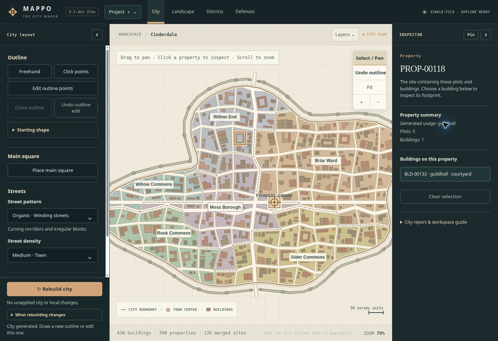
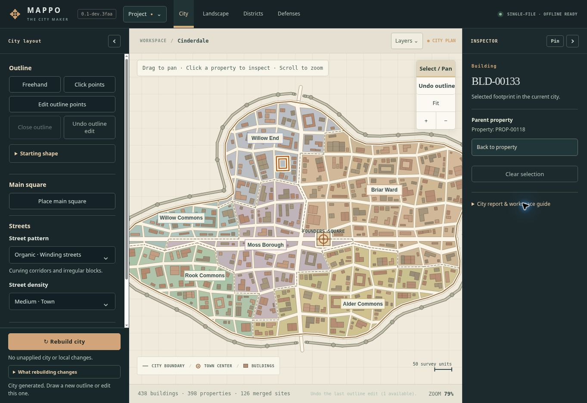

# 3F-Aa checkpoint QA

Build: **0.1-dev.3faa**. Branch: `feature/building-inspector-3f`.

## Behavior verified

- Roofs, yards and courtyard interiors select their property; landscape retains priority and districts remain available on open ground or with development layers hidden.
- Property Inspector resolves linked structures, separately selects compound wings, and returns from a child to its parent. Native action buttons use safe text, wrapping labels and heading focus.
- Property boundary overlay is independent of the ordinary property layer. Child view keeps dashed parent context and the existing footprint outline.
- Buildings, Properties and Plots visibility combinations, hidden-child fallback, stale/missing/reused IDs, full replacement, failed generation and existing gesture ownership are covered.
- Exact accepted project records/geometry remain unchanged by inspection. Session-only property/building selection does not break project download/recovery capture or older schema-9 project loading.
- Source and package versions agree; deterministic root/standalone parity and inline script/style checks are covered by the build regression.

## Verification results

- Node regression suite: **185/185 passed**, including eight additional property/navigation tests beyond 3F-A.
- Live Chrome preview: courtyard selected the property; child button opened the corresponding building; Back to property restored the site; the heading received focus after navigation.
- Firefox/Chromium matrices: **16/16 passed** in [CI run 44254201594](https://github.com/xbwtyz/Mappo/actions/runs/44254201594), on implementation commit `f1cfead`. The existing native standalone file smoke script and the extended property/child interaction script each cover 1440×900, 5120×1440, 768×1024 and 390×844 in both engines. The latter uses an intercepted normal origin with a test-only state observer; shipped HTML has neither test globals nor network dependencies.
- Exact standalone SHA256: `ccec4326768ed2d3cefe826148420f3f650273015dc017ffc72a682cf5d10a90`. Browser screenshots and the standalone HTML are archived in the successful CI run.
- Project schema **9**, workspace schema **1**; no migration or metadata edits.

## Limits and next work

Physical-touch verification and exhaustive terrain editing gestures are not claimed. Detailed property/building facts are 3F-B; identity editing is 3F-C; validated portable selection is 3F-D. No merge into main, release tag or Pages publication is part of this checkpoint.
