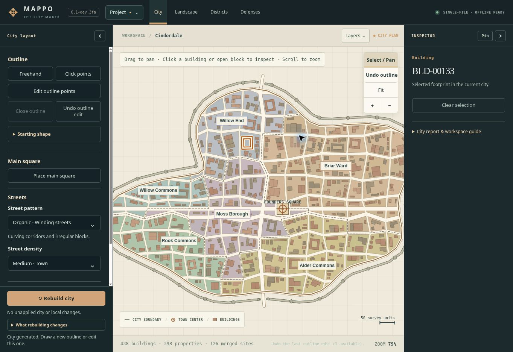

# Milestone 3F-A — Building selection checkpoint

Build: **0.1-dev.3fa**. Branch: `feature/building-inspector-3f`.

## Implemented behavior

- Select visible accepted building footprints in Select/Pan, with landscape first and district/block fallback.
- Three CSS-pixel outer-edge tolerance at all supported zooms; actual roof interiors win over nearby edges. Equal hits follow roof paint order.
- Courtyard interiors are excluded; individual compound wings retain their own IDs.
- Shared Inspector shows Building and its ID; hover is teal and selection orange with a pale halo. Both outer and inner footprint rings are outlined without fill/geometry changes.
- Hidden layers, missing records and full replacement clear building selection. Full rebuilding clears even reused IDs; failed generation preserves the current accepted city and selection.
- Existing click/drag ownership, editor histories, camera center/zoom and layer behavior remain in place. Tool changes, zoom and pointer leave/cancel clear hover.
- Building selection is session-only in A. Project download/recovery captures a null UI selection while preserving all city data. Portable building selection remains 3F-D work.

## Verification

- Baseline: **167/167** Node tests passed before implementation.
- New focused coverage: footprint and hole hits, zoom tolerance, adjacent/overlapping roofs, compound wings, rotated/concave shapes, overlay paths, provider lifecycle, hidden/missing/reused IDs, click precedence, drawing/drag/cancel ownership, save safety, exact geometry retention and successful/failed rebuilds.
- Full `npm run check`: **177/177** Node tests passed; no skipped tests.
- Root `index.html` and `dist/mappo-0.1-dev.3fa.html` are produced by the existing deterministic builder. The build test verifies byte equality, embedded script/styles, no runtime network references and valid compiled JavaScript.
- Project schema remains **9**; workspace schema remains **1**.
- Live Chrome preview: verified building Inspector and courtyard-wall outline, courtyard interior selecting its district, and hiding Buildings clearing the building selection.
- Automated Firefox/Chromium matrices: pending the feature-branch CI run. `.github/workflows/milestone-3f-check.yml` runs both the existing standalone smoke script and the new building interaction script at 1440×900, 5120×1440, 768×1024 and 390×844. The building script adds only a test-time closure observer to the compiled document; the existing smoke script opens the actual unchanged standalone file.

## Scope and limitations

3F-B information fields, 3F-C metadata editing/undo, and 3F-D portable selection/restoration are not implemented. No new runtime dependency, geometry migration or generator change was introduced. Automated pointer checks and viewport coverage do not replace exhaustive physical-touch or all terrain-editing gesture review. This checkpoint does not merge `main`, tag a release or publish GitHub Pages.
