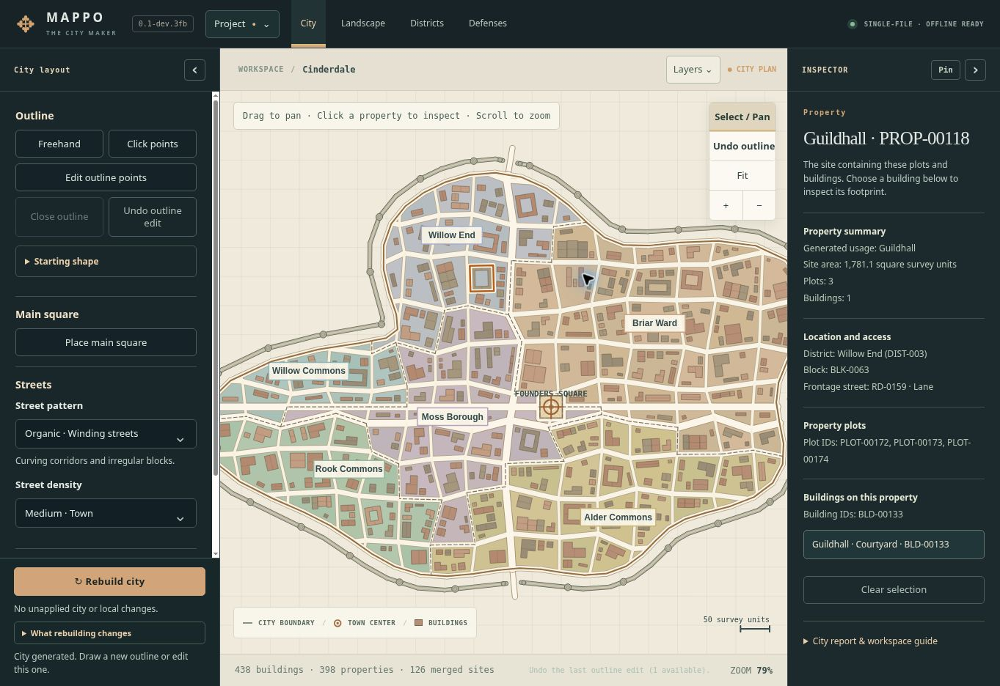
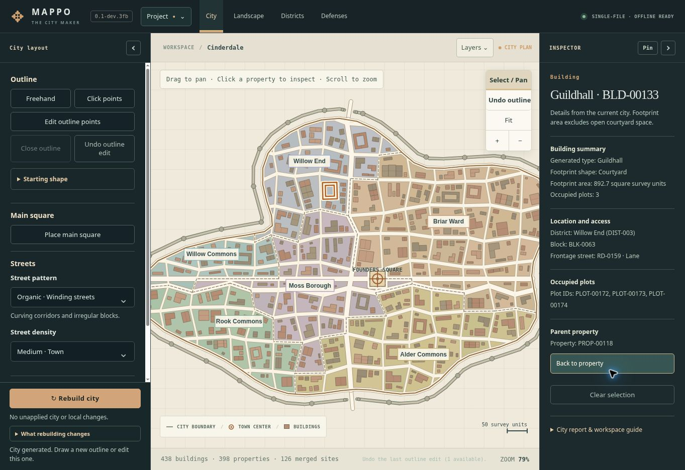

# 3F-B — Property and building information

Build: **0.1-dev.3fb**. Branch: `feature/building-inspector-3f`.

## Implemented

- Readable generated labels plus stable IDs in both Inspector headings.
- Properties: generated usage, site area, plot/building counts and IDs, district, block and frontage street.
- Individual buildings: generated type/shape, accepted net footprint area, their own occupied plot count/IDs, district, block, frontage and parent property.
- Areas use square survey units. Existing courtyard area already excludes its open center. Compound wings retain their individual facts and navigation.
- Actual linked names are displayed where recorded. Missing references retain their IDs with unavailable labels; unassigned districts and missing optional context have explicit fallbacks.
- Current record lookup after local changes; district rebuild/undo retains a selected property/building and refreshes its context. Explicit district selection still switches Inspectors normally.
- Existing property-first map selection, building navigation, layer semantics, geometry tools, scoped histories, downloads/recovery and session-only selection remain in place.

## Verification

- Full local `npm run check`: **193/193 tests passed**, none skipped. Eight additional information/refresh tests extend the 185-test 3F-Aa baseline.
- Focused coverage includes frozen source records, property/wing plot differences, distinct frontage references, accepted courtyard net area, readable row/L/compound shapes, missing/mismatched links, historical block/district context, literal HTML-like text, unknown type codes and refreshed district names.
- The compiled app tests exercise real district rebuild/undo controls, preserving property and building selection and restoring exact accepted city records. Inspection itself preserves the complete accepted project byte-for-byte.
- Live Chrome preview: inspected property and building facts, rebuilt districts while retaining the selected child and observed its changed district, then undid and confirmed the original district returned.
- Firefox/Chromium browser matrices: pending feature-branch CI. Both existing standalone smoke checks and extended property/child information/navigation checks cover 1440×900, 5120×1440, 768×1024 and 390×844. Desktop cases additionally exercise local district rebuild/undo and refreshed child facts.
- Exact root/standalone SHA256: `8e4e257acf1fae223e600631aea653a4ccb239c3e7c16862e0fe9909413e74ce`. No external scripts/styles or added runtime network requirements.
- Project schema **9**, workspace schema **1**; no migrations, metadata fields or geometry changes.

## Remaining milestones and limits

3F-C identity customization and 3F-D portable selection remain separate. This checkpoint adds no name/use editing or footprint editing. Automated viewport/pointer tests do not claim exhaustive physical-touch or every terrain gesture. No main merge, release tag or GitHub Pages publication is authorized by this checkpoint.
