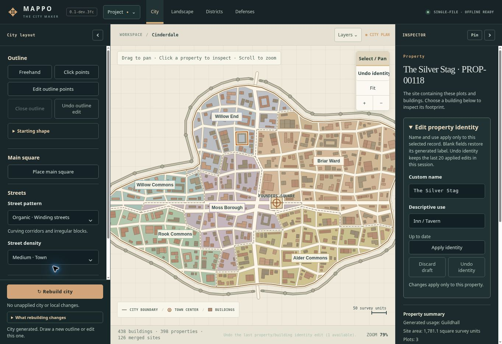

# Milestone 3F-C — Identity editing checkpoint QA

Branch: `feature/building-inspector-3f`. Build: `0.1-dev.3fc`.
Status: local and live-browser checks passed; CI browser matrix pending.

## Behavior

Properties remain the primary selected site. Properties and child buildings each support optional `customName` and `customUse` metadata, independently, without changes to generated usage/type or accepted geometry. The expandable editor provides explicit Apply, Discard draft, preset uses and Other free text. Blank values remove overrides; input is normalized and limited to 80 characters per field.

Identity history is independent, metadata-only, bounded to 20 applied edits, and protected against stale metadata. Contextual Undo respects active tools and native text editing. Per-record pending drafts survive inspection/navigation. Full rebuild/new street seed requires confirmation when identities or drafts would be lost; cancellation and failed generation preserve edits, while successful replacement resets session identity state. No customization is transferred by reused generated IDs.

Accepted fields round-trip through schema-9 project files and recovery storage, with atomic validation. Workspace schema remains 1. Identity history, pending drafts, and property/building selection remain session-only until the separately planned 3F-D review. Drafts must be applied before saving a project copy preserves them.

## Verification

- Local `npm run check`: **202/202 passed** before final warning-copy clarification; CI repeats the complete check on the committed checkpoint.
- Targeted identity workflow checks after that clarification: **8/8 passed**.
- Live Chrome, compiled standalone preview: inspected a courtyard property; verified pending versus applied name/use, independent child building identity, scoped Undo, regeneration confirmation, cancellation and retained parent identity. Screenshot below.
- CI will run the existing 8-case standalone smoke matrix and expanded 8-case property/building/identity matrix, in Chromium and Firefox at 1440×900, 5120×1440, 768×1024 and 390×844.
- Regression coverage includes immutable metadata-only scope; no-op/clear/validation; independent history; existing local district operations; bounded and stale undo; explicit Apply; per-record draft navigation/discard; saved-file round-trip and malformed-file atomic rejection; reset semantics; new-seed deferral and failed-generation retention.

## Limits

Browser viewport tests emulate layout and mouse/keyboard interaction; they do not prove physical touchscreen or screen-reader behavior. No identity-driven building generation, footprint editing, automatic inheritance, simulation or map text labels were added. No main merge, release tag or Pages publication is authorized for this checkpoint.
