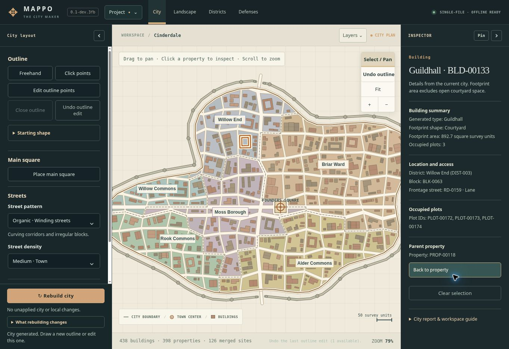

# Mappo

> **Current stable release: [Mappo v0.2.0](https://github.com/xbwtyz/Mappo/releases/tag/v0.2.0).** The 2D City Designer milestone is complete. v0.1.0 remains available as an archived release. The hosted Pages site is deployed separately and may be a different version.

**Mappo** is an offline-first medieval and fantasy city generator and 2D editor, shipped as **one standalone HTML file**.

**[Download the official v0.2.0 HTML](https://github.com/xbwtyz/Mappo/releases/download/v0.2.0/mappo-0.2.0.html)** · **[0.2.0 release notes](docs/releases/v0.2.0.md)** · **[Hosted Pages site](https://xbwtyz.github.io/Mappo/)** · **[User guide](docs/guides/user-guide.md)** · **[Development roadmap](docs/plans/README.md)**

**Stable release:** `0.2.0` · Project schema **9** · Portable format **1** · Offline browser runtime.

## Foundation introduced in 0.1.0

- Create a city with one of eight starting boundary shapes or a user-drawn outline. Generate radial, organic, linear, or planned street patterns with repeatable seeds.
- Shape rivers, coastlines, lakes, mountains, and related terrain/water features. Work with districts, perimeter defenses and a civic square.
- Select **properties first**, inspect individual buildings, and give properties and buildings independent names and descriptions.
- Edit existing four-corner property boundaries and plot dividers with safe previews, geometry checks and atomic Apply. Delete properties with confirmation and session-only restoration.
- Move, rotate, and resize building footprints. Add, replace, or delete individual buildings; **clear every building on a property in one reversible operation**.
- Use precise editing nudges, scoped keyboard shortcuts, live dimensions, contextual validation feedback and session-scoped Undo/Redo.
- Choose **Presentation**, **Planning**, **Minimal**, or **All layers** presets, or customize visibility manually.
- Download the **currently visible map as PNG**, with optional filenames shared with `.mappo.json` project downloads.
- Save/load portable validated project files. Browser-local recovery snapshots provide additional safety; downloaded files are the recommended backup.

## New in published 0.2.0

The [v0.2.0 City Designer](https://github.com/xbwtyz/Mappo/releases/tag/v0.2.0) adds road editing and validated neighborhood adaptation, property creation/split/merge, adjustable plots, advanced building footprints, and the **Generation / Add / Roads** workspace. The [versioned offline HTML](dist/mappo-0.2.0.html) is tracked in the repository. Schema 9 and file format 1 remain unchanged. Historical v0.1.0 and development distributions are preserved.

**Generation** hosts city, districts and defenses. **Add** begins property/building placement and landscape drafts. **Roads** exposes road changes, impact review and comparison. The property-first Inspector edits existing land, plots, buildings, names and uses. Desktop/laptop Firefox and Chromium are the current support targets; phone/touch acceptance is deferred.

## Launch and create a city

1. Download the [official v0.2.0 standalone HTML](https://github.com/xbwtyz/Mappo/releases/download/v0.2.0/mappo-0.2.0.html) and open it in a desktop browser. No server or installation is required. [GitHub Pages](https://xbwtyz.github.io/Mappo/) is published separately and may not match this version.
2. In **Generation**, draw or select a city outline, choose a street pattern and seed, then generate.
3. Use **Add** for new properties/buildings/landscape, **Roads** for road edits, and the **Inspector** for modifying existing sites.
4. Under **Project**, download the `.mappo.json` backup and optionally export the visible map as PNG.

See the [User Guide](docs/guides/user-guide.md) for detailed editing and save/recovery behavior.

## Historical interface screenshots

The following images document the earlier 3F property/building Inspector, **not** the published v0.2.0 Generation/Add/Roads desktop layout. They remain useful development examples. For current controls, see the [user guide](docs/guides/user-guide.md).

| Property-first selection | Individual building details | Identity customization |
| --- | --- | --- |
|  |  |  |

[Full gallery](docs/guides/gallery.md)

## Development

The source lives in `src/`; `scripts/build.mjs` embeds modules and CSS into two **identical** files: `index.html` (Pages entrypoint) and `dist/mappo-<version>.html` (versioned standalone download).

```bash
npm run check
npm run test:browser  # requires test-only Playwright browsers
```

Node 20.11+ is needed for development, **not to run** the distributed HTML. CI runs Node regression tests plus Chromium and Firefox QA before a production release. Historical `dist/` snapshots remain available.

## Current limitations and compatibility policy

Connected dead-end roads remain limited ([issue #79](https://github.com/xbwtyz/Mappo/issues/79)). Full 3D editing and high-resolution full-city tiled PNG export are not included; PNG export captures the current canvas. Undo histories and unfinished previews are generally session-scoped.

v0.2.0 **currently supports** migrations from old schemas 1–8. **Future releases are not required to support every older save**, but a breaking format, migration policy or CI change requires separate approval. See [AGENTS.md](AGENTS.md) and [Development Rules](docs/contributing/development-rules.md).

**Next:** separately plan future milestones; this policy PR does not authorize code changes, merges, releases or Pages deployment. The [0.2 acceptance history](docs/history/0.2/release/h5-release-candidate-report.md) remains preserved.

[Development guide](docs/contributing/developer-guide.md) · [Project format](docs/reference/PROJECT_FORMAT.md) · [0.2.0 release notes](docs/releases/v0.2.0.md) · [0.1.0 release notes](docs/releases/v0.1.0.md) · [Docs index](docs/README.md)
