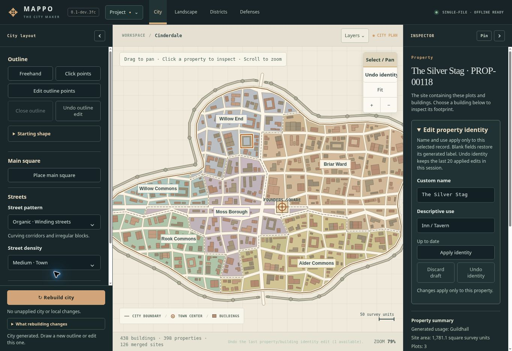

# Mappo

**Mappo** is an offline-first procedural medieval city mapper built from modular JavaScript and distributed as a **single standalone HTML file**.

[**Launch stable Mappo (main)**](https://xbwtyz.github.io/Mappo/) · [**Download 3H preview HTML**](dist/mappo-0.1-dev.3he.html) · [**User Guide**](docs/user-guide.md) · [**Roadmap**](docs/ROADMAP.md)

**3H preview:** `0.1-dev.3he` on `feature/building-management-3h` (awaiting review). **Stable main baseline:** 3G-D (`0.1-dev.3he`), merged in PR #9. Project schema 9 is unchanged.

## What it can do

- Draw and reshape a custom city boundary, or choose one of eight starting outlines.
- Generate connected streets, a civic square, plots, varied properties and individual building footprints in **Organic**, **Planned**, **Radial** or **Linear** patterns.
- Add and edit rivers, coastlines, lakes, mountain ranges and bridges; manage districts and perimeter defenses.
- Select properties first, inspect their individual buildings, and apply independent custom names and descriptive uses.
- Enter **Building Edit Mode** from the Inspector to move, rotate or resize building footprints. In 3G-C, a live geometry check enables **Apply to City** only for safe edits, and preserves project schema 9 and save/load compatibility.
- Undo or redo accepted footprint edits for the selected building (up to 20 accepted edits in session); changes, not history, persist in portable saves.
- Add buildings to a property, preview rectangle/L/courtyard/T shapes, replace an existing building while preserving its identity, or delete one with confirmation. Atomic transactions validate geometry, road access, and property links.
- Undo/redo accepted structural add/replace/delete actions within a property; history stays in the session.
- Download and load portable `.mappo.json` projects, with browser-local recovery snapshots.

## Start here

1. Open the [hosted stable app](https://xbwtyz.github.io/Mappo/), or save [the 3H standalone preview](dist/mappo-0.1-dev.3he.html) from this branch and open it in a modern browser.
2. In **City**, draw or choose an outline, then place a main square.
3. Select a street pattern and seed, then click **Generate city**.
4. Use **Landscape**, **Districts**, **Defenses**, **Layers**, and the **Inspector** to explore and edit.
5. Use **Project → Download project** to back up your city.

See the [User Guide](docs/user-guide.md) for controls, save/recovery details and known limits.

## Screenshots

| Property-first selection | Individual building details | Identity customization |
| --- | --- | --- |
|  |  |  |

[View the full captioned gallery](docs/gallery.md).

## Develop

The build embeds local JavaScript modules and CSS into a self-contained HTML artifact. **Node.js 20.11+** is required for development, but neither installation nor a server is required to run the resulting HTML. Standard build/Node tests need no `npm install`.

```bash
npm run build   # write index.html and dist/mappo-0.1-dev.3he.html
npm test        # run Node regression tests
npm run check   # build, then test
```

The generated root `index.html` and matching versioned `dist/` HTML are byte-for-byte identical. Previous standalone versions remain in [`dist/`](dist/).

## Documentation

[Documentation index](docs/README.md) · [Developer Guide](docs/development.md) · [Technical references](docs/reference/README.md) · [Development history](docs/history/README.md) · [Roadmap](docs/ROADMAP.md)

**Current limits:** Building placement and edits stay within existing property boundaries; Undo/Redo history is session-only, and structure edits require unobstructed original frontage access. Editing property shapes, PNG export and 3D remain future work. [3H QA and safeguards](docs/history/3h/MILESTONE_3H_QA.md).
