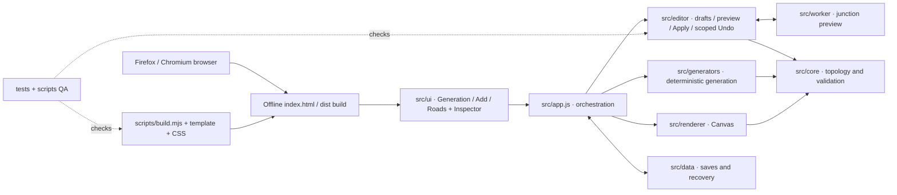

# Mappo · Repository Architecture Atlas

> **Verified tree inventory:** PR #92's `docs/mappo-agent-rules-and-release-reconciliation` branch, November 21, 2026 — **508 tracked files** in **33 directories**. This inventory replaces the older 408-file D2-era atlas, which is still preserved in Git history. Its content reflects the C01–C14 documentation cleanup; application/build/test/archival file paths remain unchanged.
>
> This is a recorded snapshot, **not** a live directory browser. The inventory links to the reviewed revision. See the [documentation index](../README.md) for the current layout.

[Repository](https://github.com/xbwtyz/Mappo) · [Development guide](../contributing/developer-guide.md) · [AI agent instructions](../../AGENTS.md) · [CI guide](../contributing/ci-guide.md) · [v0.2.0 release](../releases/v0.2.0.md)

## How Mappo fits together

**Architecture principles:** the accepted 2D city remains authoritative; edits and worker previews are transient until independent validation and atomic Apply. Protect IDs, authored geometry, supported migrations and unknown metadata. The compiled root `index.html` and `dist/mappo-0.2.0.html` intentionally contain identical bytes; they are not separately maintained source.

## Repository composition

| Directory | Tracked files | Purpose |
| --- | ---: | --- |
| `(root)` | 10 | Root files, entrypoints, README and aliases |
| `.github/` | 5 | Contribution instructions, PR template and CI/release/Pages workflows |
| `src/` | 151 | Authoritative modular runtime implementation |
| `styles/` | 1 | Source application styling |
| `scripts/` | 25 | Build, browser QA and performance helpers |
| `docs/` | 116 | Developer guides, policies, architecture and milestone history |
| `tests/` | 96 | Node tests and frozen historical-save fixtures |
| `dist/` | 104 | Preserved historical and current portable standalone builds |
| **Total** | **508** | Tracked file snapshot, not all historical Git commits |

## Scalable full hierarchy

[Open the linked SVG hierarchy](Mappo_Repository_Hierarchy.svg). The vector diagram includes **all 508 tracked files**: click a filename to open its GitHub source, or hover to read its role. Zoom to inspect longer file names.

## Full file inventory and purpose

Expand a folder below to navigate every tracked file. A historical file's age is **not** evidence that it can be removed; `dist/` files, old-save fixtures and archive refs have explicit retention requirements.

<strong>Repository root — 10 files</strong> · Root files, entrypoints, README and aliases

| File | Responsibility |
| --- | --- |
| [`.gitignore`](https://github.com/xbwtyz/Mappo/blob/4297fff94af1a5b262d7ab70b67c25c8572bf80a/.gitignore) | Excludes local dependencies, caches and machine-generated files from version control. |
| [`AGENTS.md`](https://github.com/xbwtyz/Mappo/blob/4297fff94af1a5b262d7ab70b67c25c8572bf80a/AGENTS.md) | Owner-approved concise instructions and permission boundaries for AI coding agents. |
| [`index.html`](https://github.com/xbwtyz/Mappo/blob/4297fff94af1a5b262d7ab70b67c25c8572bf80a/index.html) | Generated current standalone application and GitHub Pages entry point; do not hand-edit. |
| [`index.template.html`](https://github.com/xbwtyz/Mappo/blob/4297fff94af1a5b262d7ab70b67c25c8572bf80a/index.template.html) | HTML shell and UI markup populated with bundled scripts/styles at build time. |
| [`MILESTONE_3F_PLAN.md`](https://github.com/xbwtyz/Mappo/blob/4297fff94af1a5b262d7ab70b67c25c8572bf80a/MILESTONE_3F_PLAN.md) | Legacy root reference pointing toward the archived 3F design plan. |
| [`package.json`](https://github.com/xbwtyz/Mappo/blob/4297fff94af1a5b262d7ab70b67c25c8572bf80a/package.json) | NPM scripts, package metadata, app version and development commands. |
| [`PROJECT_FORMAT.md`](https://github.com/xbwtyz/Mappo/blob/4297fff94af1a5b262d7ab70b67c25c8572bf80a/PROJECT_FORMAT.md) | Legacy root reference to the authoritative project format documentation. |
| [`QA.md`](https://github.com/xbwtyz/Mappo/blob/4297fff94af1a5b262d7ab70b67c25c8572bf80a/QA.md) | Legacy root reference to current and archived QA documentation. |
| [`README.md`](https://github.com/xbwtyz/Mappo/blob/4297fff94af1a5b262d7ab70b67c25c8572bf80a/README.md) | Repository landing page with product overview, setup and release links. |
| [`WORKSPACE_UI.md`](https://github.com/xbwtyz/Mappo/blob/4297fff94af1a5b262d7ab70b67c25c8572bf80a/WORKSPACE_UI.md) | Legacy root reference to workspace UI documentation. |

<strong>.github/ — 5 files</strong> · Contribution instructions, PR template and CI/release/Pages workflows

| File | Responsibility |
| --- | --- |
| [`.github/PULL_REQUEST_TEMPLATE.md`](https://github.com/xbwtyz/Mappo/blob/4297fff94af1a5b262d7ab70b67c25c8572bf80a/.github/PULL_REQUEST_TEMPLATE.md) | Review checklist aligned to approved scope, tested revisions and manual publishing. |
| [`.github/workflows/ci-fast.yml`](https://github.com/xbwtyz/Mappo/blob/4297fff94af1a5b262d7ab70b67c25c8572bf80a/.github/workflows/ci-fast.yml) | Fast GitHub Actions checks for rapid pull request feedback. |
| [`.github/workflows/ci.yml`](https://github.com/xbwtyz/Mappo/blob/4297fff94af1a5b262d7ab70b67c25c8572bf80a/.github/workflows/ci.yml) | Full GitHub Actions build and automated regression checks. |
| [`.github/workflows/pages.yml`](https://github.com/xbwtyz/Mappo/blob/4297fff94af1a5b262d7ab70b67c25c8572bf80a/.github/workflows/pages.yml) | GitHub Pages site publishing workflow. |
| [`.github/workflows/release.yml`](https://github.com/xbwtyz/Mappo/blob/4297fff94af1a5b262d7ab70b67c25c8572bf80a/.github/workflows/release.yml) | GitHub Actions workflow for release packaging and publication. |

<strong>src/ — 151 files</strong> · Authoritative modular runtime implementation

| File | Responsibility |
| --- | --- |
| [`src/app.js`](https://github.com/xbwtyz/Mappo/blob/4297fff94af1a5b262d7ab70b67c25c8572bf80a/src/app.js) | Main application composition: initializes state, binds UI/editors and schedules redraws. |
| [`src/core/boundary.js`](https://github.com/xbwtyz/Mappo/blob/4297fff94af1a5b262d7ab70b67c25c8572bf80a/src/core/boundary.js) | Boundary cleanup, containment, segment-intersection and clearance helpers for city geometry. |
| [`src/core/building-footprint-f1.js`](https://github.com/xbwtyz/Mappo/blob/4297fff94af1a5b262d7ab70b67c25c8572bf80a/src/core/building-footprint-f1.js) | Modular core implementation: building footprint f1. |
| [`src/core/building-selection.js`](https://github.com/xbwtyz/Mappo/blob/4297fff94af1a5b262d7ab70b67c25c8572bf80a/src/core/building-selection.js) | Building hit-testing and selection logic used by map interaction. |
| [`src/core/building-transform.js`](https://github.com/xbwtyz/Mappo/blob/4297fff94af1a5b262d7ab70b67c25c8572bf80a/src/core/building-transform.js) | Computes editable building frames, rotations, dimensions and transform previews. |
| [`src/core/building-validation.js`](https://github.com/xbwtyz/Mappo/blob/4297fff94af1a5b262d7ab70b67c25c8572bf80a/src/core/building-validation.js) | Validates proposed building shapes, containment and collisions before acceptance. |
| [`src/core/city-model.js`](https://github.com/xbwtyz/Mappo/blob/4297fff94af1a5b262d7ab70b67c25c8572bf80a/src/core/city-model.js) | Creates a complete initial city/project model from generation settings. |
| [`src/core/district-model.js`](https://github.com/xbwtyz/Mappo/blob/4297fff94af1a5b262d7ab70b67c25c8572bf80a/src/core/district-model.js) | District records, constraints and validation rules. |
| [`src/core/district-topology.js`](https://github.com/xbwtyz/Mappo/blob/4297fff94af1a5b262d7ab70b67c25c8572bf80a/src/core/district-topology.js) | Builds district connectivity and adjacency data; checks connected district selections. |
| [`src/core/editing-precision-4c.js`](https://github.com/xbwtyz/Mappo/blob/4297fff94af1a5b262d7ab70b67c25c8572bf80a/src/core/editing-precision-4c.js) | Precision-edit controls and numeric nudge calculations introduced in Dev 4C. |
| [`src/core/export-filenames-4f.js`](https://github.com/xbwtyz/Mappo/blob/4297fff94af1a5b262d7ab70b67c25c8572bf80a/src/core/export-filenames-4f.js) | Sanitizes and coordinates filenames for project and map exports. |
| [`src/core/fortification-geometry.js`](https://github.com/xbwtyz/Mappo/blob/4297fff94af1a5b262d7ab70b67c25c8572bf80a/src/core/fortification-geometry.js) | Wall paths, measurements and geometry used for fortification placement. |
| [`src/core/fortification-model.js`](https://github.com/xbwtyz/Mappo/blob/4297fff94af1a5b262d7ab70b67c25c8572bf80a/src/core/fortification-model.js) | Fortification model constraints and integrity checks. |
| [`src/core/gate-geometry.js`](https://github.com/xbwtyz/Mappo/blob/4297fff94af1a5b262d7ab70b67c25c8572bf80a/src/core/gate-geometry.js) | Gate position, post and entrance geometry along walls and roads. |
| [`src/core/geometry.js`](https://github.com/xbwtyz/Mappo/blob/4297fff94af1a5b262d7ab70b67c25c8572bf80a/src/core/geometry.js) | Shared polygon areas, bounds and point-in-polygon calculations. |
| [`src/core/identity.js`](https://github.com/xbwtyz/Mappo/blob/4297fff94af1a5b262d7ab70b67c25c8572bf80a/src/core/identity.js) | Names, descriptions and identity validation for editable city objects. |
| [`src/core/inspector-feedback-4d.js`](https://github.com/xbwtyz/Mappo/blob/4297fff94af1a5b262d7ab70b67c25c8572bf80a/src/core/inspector-feedback-4d.js) | Converts validation and selection state into actionable inspector feedback. |
| [`src/core/lake-editing.js`](https://github.com/xbwtyz/Mappo/blob/4297fff94af1a5b262d7ab70b67c25c8572bf80a/src/core/lake-editing.js) | Lake control-point draft operations and editable lake shape handling. |
| [`src/core/lake-geometry.js`](https://github.com/xbwtyz/Mappo/blob/4297fff94af1a5b262d7ab70b67c25c8572bf80a/src/core/lake-geometry.js) | Lake polygons, access segments and geometric validation. |
| [`src/core/landscape-selection.js`](https://github.com/xbwtyz/Mappo/blob/4297fff94af1a5b262d7ab70b67c25c8572bf80a/src/core/landscape-selection.js) | Unified selection and lookup of landscape features in the editor. |
| [`src/core/layer-presets-4f.js`](https://github.com/xbwtyz/Mappo/blob/4297fff94af1a5b262d7ab70b67c25c8572bf80a/src/core/layer-presets-4f.js) | Named map-layer visibility presets and preset selection logic. |
| [`src/core/neighborhood-reflow.js`](https://github.com/xbwtyz/Mappo/blob/4297fff94af1a5b262d7ab70b67c25c8572bf80a/src/core/neighborhood-reflow.js) | Plans road/junction edits and locally adapts generated neighborhood geometry. |
| [`src/core/parcel-reconciliation.js`](https://github.com/xbwtyz/Mappo/blob/4297fff94af1a5b262d7ab70b67c25c8572bf80a/src/core/parcel-reconciliation.js) | Warps affected property frontages and reconciles parcels after road changes. |
| [`src/core/pending-changes.js`](https://github.com/xbwtyz/Mappo/blob/4297fff94af1a5b262d7ab70b67c25c8572bf80a/src/core/pending-changes.js) | Read-only summaries of uncommitted changes and rebuild consequences. |
| [`src/core/placement.js`](https://github.com/xbwtyz/Mappo/blob/4297fff94af1a5b262d7ab70b67c25c8572bf80a/src/core/placement.js) | Plot placement, polygon clipping and fit/collision utilities. |
| [`src/core/prng.js`](https://github.com/xbwtyz/Mappo/blob/4297fff94af1a5b262d7ab70b67c25c8572bf80a/src/core/prng.js) | Seeded deterministic random-number generator and seed hashing. |
| [`src/core/property-geometry.js`](https://github.com/xbwtyz/Mappo/blob/4297fff94af1a5b262d7ab70b67c25c8572bf80a/src/core/property-geometry.js) | Property corner, divider and boundary geometry transformations. |
| [`src/core/property-merge-geometry-e3.js`](https://github.com/xbwtyz/Mappo/blob/4297fff94af1a5b262d7ab70b67c25c8572bf80a/src/core/property-merge-geometry-e3.js) | Modular core implementation: property merge geometry e3. |
| [`src/core/property-selection.js`](https://github.com/xbwtyz/Mappo/blob/4297fff94af1a5b262d7ab70b67c25c8572bf80a/src/core/property-selection.js) | Property hit-testing, selection state and property-first selection behavior. |
| [`src/core/property-split-geometry-e2.js`](https://github.com/xbwtyz/Mappo/blob/4297fff94af1a5b262d7ab70b67c25c8572bf80a/src/core/property-split-geometry-e2.js) | Modular core implementation: property split geometry e2. |
| [`src/core/river-editing.js`](https://github.com/xbwtyz/Mappo/blob/4297fff94af1a5b262d7ab70b67c25c8572bf80a/src/core/river-editing.js) | River editing helper entry points shared with water editing. |
| [`src/core/road-building-decisions.js`](https://github.com/xbwtyz/Mappo/blob/4297fff94af1a5b262d7ab70b67c25c8572bf80a/src/core/road-building-decisions.js) | Evaluates building displacement decisions when proposed roads affect existing structures. |
| [`src/core/road-building-reflow.js`](https://github.com/xbwtyz/Mappo/blob/4297fff94af1a5b262d7ab70b67c25c8572bf80a/src/core/road-building-reflow.js) | Repositions/recreates eligible generated buildings during road-driven neighborhood reflow. |
| [`src/core/road-crossings.js`](https://github.com/xbwtyz/Mappo/blob/4297fff94af1a5b262d7ab70b67c25c8572bf80a/src/core/road-crossings.js) | Normalizes road crossings, drafts connections and assigns stable topology IDs. |
| [`src/core/road-face-geometry.js`](https://github.com/xbwtyz/Mappo/blob/4297fff94af1a5b262d7ab70b67c25c8572bf80a/src/core/road-face-geometry.js) | Road-face triangulation and overlap-area measurement for face identity matching. |
| [`src/core/road-faces.js`](https://github.com/xbwtyz/Mappo/blob/4297fff94af1a5b262d7ab70b67c25c8572bf80a/src/core/road-faces.js) | Extracts blocks/faces from the road graph and matches old faces to changed geometry. |
| [`src/core/road-graph.js`](https://github.com/xbwtyz/Mappo/blob/4297fff94af1a5b262d7ab70b67c25c8572bf80a/src/core/road-graph.js) | Builds transient road-node graphs, analyzes junctions and proposes junction moves. |
| [`src/core/road-impact-dependencies.js`](https://github.com/xbwtyz/Mappo/blob/4297fff94af1a5b262d7ab70b67c25c8572bf80a/src/core/road-impact-dependencies.js) | Detects dependencies of roads on walls, districts, water and other referenced features. |
| [`src/core/road-impact-model.js`](https://github.com/xbwtyz/Mappo/blob/4297fff94af1a5b262d7ab70b67c25c8572bf80a/src/core/road-impact-model.js) | Shared road-impact records, comparisons, budgets and report-format primitives. |
| [`src/core/road-impact.js`](https://github.com/xbwtyz/Mappo/blob/4297fff94af1a5b262d7ab70b67c25c8572bf80a/src/core/road-impact.js) | Runs impact analysis for proposed road edits without changing accepted project data. |
| [`src/core/road-inspection.js`](https://github.com/xbwtyz/Mappo/blob/4297fff94af1a5b262d7ab70b67c25c8572bf80a/src/core/road-inspection.js) | Read-only road hit-testing, inspection details and impact highlighting. |
| [`src/core/road-intent-c1.js`](https://github.com/xbwtyz/Mappo/blob/4297fff94af1a5b262d7ab70b67c25c8572bf80a/src/core/road-intent-c1.js) | Constructs road-first and junction edit intentions before local reconciliation. |
| [`src/core/road-provenance.js`](https://github.com/xbwtyz/Mappo/blob/4297fff94af1a5b262d7ab70b67c25c8572bf80a/src/core/road-provenance.js) | Tracks whether roads are generator-owned, user-edited or of unknown provenance. |
| [`src/core/road-reconciliation.js`](https://github.com/xbwtyz/Mappo/blob/4297fff94af1a5b262d7ab70b67c25c8572bf80a/src/core/road-reconciliation.js) | Prepares detached topology reconciliation candidates and preservation diagnostics. |
| [`src/core/road-shape.js`](https://github.com/xbwtyz/Mappo/blob/4297fff94af1a5b262d7ab70b67c25c8572bf80a/src/core/road-shape.js) | Validates and drafts editable road polylines, including bend limits. |
| [`src/core/road-topology-reflow.js`](https://github.com/xbwtyz/Mappo/blob/4297fff94af1a5b262d7ab70b67c25c8572bf80a/src/core/road-topology-reflow.js) | Rebuilds and validates topology after road edits, including connected parcels and buildings. |
| [`src/core/road-topology.js`](https://github.com/xbwtyz/Mappo/blob/4297fff94af1a5b262d7ab70b67c25c8572bf80a/src/core/road-topology.js) | Shared road-node normalization and planar face tracing used during generation. |
| [`src/core/selection-focus-4b.js`](https://github.com/xbwtyz/Mappo/blob/4297fff94af1a5b262d7ab70b67c25c8572bf80a/src/core/selection-focus-4b.js) | Selection-focus utilities for map interaction and keyboard navigation. |
| [`src/core/selection-information.js`](https://github.com/xbwtyz/Mappo/blob/4297fff94af1a5b262d7ab70b67c25c8572bf80a/src/core/selection-information.js) | Produces structured inspector summaries for selected city features. |
| [`src/core/shortcut-scope.js`](https://github.com/xbwtyz/Mappo/blob/4297fff94af1a5b262d7ab70b67c25c8572bf80a/src/core/shortcut-scope.js) | Guards keyboard shortcuts so map commands do not fire inside text inputs. |
| [`src/core/structure-history-feedback-4e.js`](https://github.com/xbwtyz/Mappo/blob/4297fff94af1a5b262d7ab70b67c25c8572bf80a/src/core/structure-history-feedback-4e.js) | User-facing feedback for building clear/delete undo and redo operations. |
| [`src/core/terrain-editing.js`](https://github.com/xbwtyz/Mappo/blob/4297fff94af1a5b262d7ab70b67c25c8572bf80a/src/core/terrain-editing.js) | Terrain draft editing, shape controls and edit state. |
| [`src/core/terrain-fortifications.js`](https://github.com/xbwtyz/Mappo/blob/4297fff94af1a5b262d7ab70b67c25c8572bf80a/src/core/terrain-fortifications.js) | Terrain-aware placement checks for defensive structures. |
| [`src/core/terrain-geometry.js`](https://github.com/xbwtyz/Mappo/blob/4297fff94af1a5b262d7ab70b67c25c8572bf80a/src/core/terrain-geometry.js) | Mountain/terrain geometry, contours and traversal/access constraints. |
| [`src/core/terrain-model.js`](https://github.com/xbwtyz/Mappo/blob/4297fff94af1a5b262d7ab70b67c25c8572bf80a/src/core/terrain-model.js) | Terrain feature records and validation rules. |
| [`src/core/undo-context.js`](https://github.com/xbwtyz/Mappo/blob/4297fff94af1a5b262d7ab70b67c25c8572bf80a/src/core/undo-context.js) | Context handling for session undo/redo boundaries and related state. |
| [`src/core/validate-development.js`](https://github.com/xbwtyz/Mappo/blob/4297fff94af1a5b262d7ab70b67c25c8572bf80a/src/core/validate-development.js) | Checks generated buildings, parcels and development geometry consistency. |
| [`src/core/validate-layout.js`](https://github.com/xbwtyz/Mappo/blob/4297fff94af1a5b262d7ab70b67c25c8572bf80a/src/core/validate-layout.js) | Rejects malformed or numerically invalid generated street and block layouts. |
| [`src/core/validation-feedback.js`](https://github.com/xbwtyz/Mappo/blob/4297fff94af1a5b262d7ab70b67c25c8572bf80a/src/core/validation-feedback.js) | Normalizes validation errors into concise, user-readable feedback. |
| [`src/core/version.js`](https://github.com/xbwtyz/Mappo/blob/4297fff94af1a5b262d7ab70b67c25c8572bf80a/src/core/version.js) | Canonical application version string checked by the build. |
| [`src/core/water-editing.js`](https://github.com/xbwtyz/Mappo/blob/4297fff94af1a5b262d7ab70b67c25c8572bf80a/src/core/water-editing.js) | Shared edits for rivers, coasts and lakes, including preview/commit handling. |
| [`src/core/water-fortifications.js`](https://github.com/xbwtyz/Mappo/blob/4297fff94af1a5b262d7ab70b67c25c8572bf80a/src/core/water-fortifications.js) | Checks interaction between shoreline/water features and fortifications. |
| [`src/core/water-geometry.js`](https://github.com/xbwtyz/Mappo/blob/4297fff94af1a5b262d7ab70b67c25c8572bf80a/src/core/water-geometry.js) | Water polygons, bridge access, shoreline containment and geometric utilities. |
| [`src/core/water-model.js`](https://github.com/xbwtyz/Mappo/blob/4297fff94af1a5b262d7ab70b67c25c8572bf80a/src/core/water-model.js) | Water feature constraints, identities and integrity validation. |
| [`src/core/water-regions.js`](https://github.com/xbwtyz/Mappo/blob/4297fff94af1a5b262d7ab70b67c25c8572bf80a/src/core/water-regions.js) | Computes connected land/water regions for placement and topology. |
| [`src/core/water-shore-topology.js`](https://github.com/xbwtyz/Mappo/blob/4297fff94af1a5b262d7ab70b67c25c8572bf80a/src/core/water-shore-topology.js) | Identifies shoreline components and accessible shore segments. |
| [`src/core/workspace-presentation.js`](https://github.com/xbwtyz/Mappo/blob/4297fff94af1a5b262d7ab70b67c25c8572bf80a/src/core/workspace-presentation.js) | Pure presentation helpers for workspace controls and inspector status. |
| [`src/core/workspace-state.js`](https://github.com/xbwtyz/Mappo/blob/4297fff94af1a5b262d7ab70b67c25c8572bf80a/src/core/workspace-state.js) | Workspace section definitions, selection state and UI transitions. |
| [`src/data/file-io.js`](https://github.com/xbwtyz/Mappo/blob/4297fff94af1a5b262d7ab70b67c25c8572bf80a/src/data/file-io.js) | Browser file download/read primitives for portable project files. |
| [`src/data/migrations.js`](https://github.com/xbwtyz/Mappo/blob/4297fff94af1a5b262d7ab70b67c25c8572bf80a/src/data/migrations.js) | Upgrades older saved project schema versions to the current format. |
| [`src/data/png-export-4f.js`](https://github.com/xbwtyz/Mappo/blob/4297fff94af1a5b262d7ab70b67c25c8572bf80a/src/data/png-export-4f.js) | Exports the visible canvas as PNG with safe filename handling. |
| [`src/data/project-format.js`](https://github.com/xbwtyz/Mappo/blob/4297fff94af1a5b262d7ab70b67c25c8572bf80a/src/data/project-format.js) | Encodes/decodes versioned .mappo.json documents and project metadata. |
| [`src/data/project-validation.js`](https://github.com/xbwtyz/Mappo/blob/4297fff94af1a5b262d7ab70b67c25c8572bf80a/src/data/project-validation.js) | Deep validation, limits and structural checks for saved project data. |
| [`src/data/recovery-store.js`](https://github.com/xbwtyz/Mappo/blob/4297fff94af1a5b262d7ab70b67c25c8572bf80a/src/data/recovery-store.js) | Manages browser-local recovery snapshots separate from downloaded backups. |
| [`src/editor/building-application.js`](https://github.com/xbwtyz/Mappo/blob/4297fff94af1a5b262d7ab70b67c25c8572bf80a/src/editor/building-application.js) | Validates and atomically applies building transformations and plot attachment. |
| [`src/editor/building-history.js`](https://github.com/xbwtyz/Mappo/blob/4297fff94af1a5b262d7ab70b67c25c8572bf80a/src/editor/building-history.js) | Undo/redo commands for building edits. |
| [`src/editor/building-structure-history.js`](https://github.com/xbwtyz/Mappo/blob/4297fff94af1a5b262d7ab70b67c25c8572bf80a/src/editor/building-structure-history.js) | Undo/redo for adding, replacing, clearing or deleting structures. |
| [`src/editor/building-structures.js`](https://github.com/xbwtyz/Mappo/blob/4297fff94af1a5b262d7ab70b67c25c8572bf80a/src/editor/building-structures.js) | Building creation, replacement, deletion and structure session operations. |
| [`src/editor/building.js`](https://github.com/xbwtyz/Mappo/blob/4297fff94af1a5b262d7ab70b67c25c8572bf80a/src/editor/building.js) | Interactive building movement, rotation and resize sessions. |
| [`src/editor/districts.js`](https://github.com/xbwtyz/Mappo/blob/4297fff94af1a5b262d7ab70b67c25c8572bf80a/src/editor/districts.js) | Editable district assignment and district-level operations. |
| [`src/editor/fortifications.js`](https://github.com/xbwtyz/Mappo/blob/4297fff94af1a5b262d7ab70b67c25c8572bf80a/src/editor/fortifications.js) | Edit sessions for perimeter walls, gates and towers. |
| [`src/editor/junction-preview-worker-client.js`](https://github.com/xbwtyz/Mappo/blob/4297fff94af1a5b262d7ab70b67c25c8572bf80a/src/editor/junction-preview-worker-client.js) | Browser worker lifecycle, cancellation and fallback for junction previews. |
| [`src/editor/outline.js`](https://github.com/xbwtyz/Mappo/blob/4297fff94af1a5b262d7ab70b67c25c8572bf80a/src/editor/outline.js) | Starting boundary presets plus interactive city-outline drawing/editing. |
| [`src/editor/property-application.js`](https://github.com/xbwtyz/Mappo/blob/4297fff94af1a5b262d7ab70b67c25c8572bf80a/src/editor/property-application.js) | Validates and commits edits to property boundaries/dividers. |
| [`src/editor/property-building-clear-4e.js`](https://github.com/xbwtyz/Mappo/blob/4297fff94af1a5b262d7ab70b67c25c8572bf80a/src/editor/property-building-clear-4e.js) | Clears all buildings on a property as a reversible operation. |
| [`src/editor/property-creation-e1.js`](https://github.com/xbwtyz/Mappo/blob/4297fff94af1a5b262d7ab70b67c25c8572bf80a/src/editor/property-creation-e1.js) | Modular editor implementation: property creation e1. |
| [`src/editor/property-deletion.js`](https://github.com/xbwtyz/Mappo/blob/4297fff94af1a5b262d7ab70b67c25c8572bf80a/src/editor/property-deletion.js) | Confirms/deletes properties and supports session restoration. |
| [`src/editor/property-edit.js`](https://github.com/xbwtyz/Mappo/blob/4297fff94af1a5b262d7ab70b67c25c8572bf80a/src/editor/property-edit.js) | Drafts property corner and divider edits before Apply. |
| [`src/editor/property-history.js`](https://github.com/xbwtyz/Mappo/blob/4297fff94af1a5b262d7ab70b67c25c8572bf80a/src/editor/property-history.js) | Undo/redo for property edits. |
| [`src/editor/property-merge-e3.js`](https://github.com/xbwtyz/Mappo/blob/4297fff94af1a5b262d7ab70b67c25c8572bf80a/src/editor/property-merge-e3.js) | Modular editor implementation: property merge e3. |
| [`src/editor/property-split-e2.js`](https://github.com/xbwtyz/Mappo/blob/4297fff94af1a5b262d7ab70b67c25c8572bf80a/src/editor/property-split-e2.js) | Modular editor implementation: property split e2. |
| [`src/editor/road-application.js`](https://github.com/xbwtyz/Mappo/blob/4297fff94af1a5b262d7ab70b67c25c8572bf80a/src/editor/road-application.js) | Final road-edit acceptance gate; checks the full candidate and applies atomically. |
| [`src/editor/road-history.js`](https://github.com/xbwtyz/Mappo/blob/4297fff94af1a5b262d7ab70b67c25c8572bf80a/src/editor/road-history.js) | Undo/redo for accepted road changes. |
| [`src/editor/road-preview.js`](https://github.com/xbwtyz/Mappo/blob/4297fff94af1a5b262d7ab70b67c25c8572bf80a/src/editor/road-preview.js) | Holds non-destructive road/junction previews, revisions and cancellation. |
| [`src/editor/road-workspace.js`](https://github.com/xbwtyz/Mappo/blob/4297fff94af1a5b262d7ab70b67c25c8572bf80a/src/editor/road-workspace.js) | Modular editor implementation: road workspace. |
| [`src/editor/terrain.js`](https://github.com/xbwtyz/Mappo/blob/4297fff94af1a5b262d7ab70b67c25c8572bf80a/src/editor/terrain.js) | Interaction sessions for drawing, moving and reshaping terrain. |
| [`src/editor/water.js`](https://github.com/xbwtyz/Mappo/blob/4297fff94af1a5b262d7ab70b67c25c8572bf80a/src/editor/water.js) | Interaction sessions for river, shoreline and lake editing. |
| [`src/generators/buildings.js`](https://github.com/xbwtyz/Mappo/blob/4297fff94af1a5b262d7ab70b67c25c8572bf80a/src/generators/buildings.js) | Procedurally places and shapes buildings within generated properties. |
| [`src/generators/coast.js`](https://github.com/xbwtyz/Mappo/blob/4297fff94af1a5b262d7ab70b67c25c8572bf80a/src/generators/coast.js) | Generates coastline paths from seed and landscape parameters. |
| [`src/generators/districts.js`](https://github.com/xbwtyz/Mappo/blob/4297fff94af1a5b262d7ab70b67c25c8572bf80a/src/generators/districts.js) | Generates district regions and assignments across blocks. |
| [`src/generators/fortifications.js`](https://github.com/xbwtyz/Mappo/blob/4297fff94af1a5b262d7ab70b67c25c8572bf80a/src/generators/fortifications.js) | Generates city walls and defensive perimeter structures. |
| [`src/generators/gates.js`](https://github.com/xbwtyz/Mappo/blob/4297fff94af1a5b262d7ab70b67c25c8572bf80a/src/generators/gates.js) | Places entrances/gates into valid wall segments. |
| [`src/generators/lakes.js`](https://github.com/xbwtyz/Mappo/blob/4297fff94af1a5b262d7ab70b67c25c8572bf80a/src/generators/lakes.js) | Procedurally generates configurable lake features. |
| [`src/generators/layout.js`](https://github.com/xbwtyz/Mappo/blob/4297fff94af1a5b262d7ab70b67c25c8572bf80a/src/generators/layout.js) | Generates the initial street network, blocks and morphology-dependent plan. |
| [`src/generators/survey.js`](https://github.com/xbwtyz/Mappo/blob/4297fff94af1a5b262d7ab70b67c25c8572bf80a/src/generators/survey.js) | Seeded city survey, density/morphology presets and boundary shape profiles. |
| [`src/generators/terrain.js`](https://github.com/xbwtyz/Mappo/blob/4297fff94af1a5b262d7ab70b67c25c8572bf80a/src/generators/terrain.js) | Generates mountains and other terrain features. |
| [`src/generators/towers.js`](https://github.com/xbwtyz/Mappo/blob/4297fff94af1a5b262d7ab70b67c25c8572bf80a/src/generators/towers.js) | Generates defensive towers along fortifications. |
| [`src/generators/water.js`](https://github.com/xbwtyz/Mappo/blob/4297fff94af1a5b262d7ab70b67c25c8572bf80a/src/generators/water.js) | Generates river and water layouts compatible with city geometry. |
| [`src/renderer/building-editing.js`](https://github.com/xbwtyz/Mappo/blob/4297fff94af1a5b262d7ab70b67c25c8572bf80a/src/renderer/building-editing.js) | Draws building transform outlines, handles and editing overlays. |
| [`src/renderer/building-selection.js`](https://github.com/xbwtyz/Mappo/blob/4297fff94af1a5b262d7ab70b67c25c8572bf80a/src/renderer/building-selection.js) | Draws highlights for a selected building. |
| [`src/renderer/building-structure-preview.js`](https://github.com/xbwtyz/Mappo/blob/4297fff94af1a5b262d7ab70b67c25c8572bf80a/src/renderer/building-structure-preview.js) | Draws previews for add/replace/delete structure operations. |
| [`src/renderer/buildings.js`](https://github.com/xbwtyz/Mappo/blob/4297fff94af1a5b262d7ab70b67c25c8572bf80a/src/renderer/buildings.js) | Draws building shapes and visual details. |
| [`src/renderer/camera.js`](https://github.com/xbwtyz/Mappo/blob/4297fff94af1a5b262d7ab70b67c25c8572bf80a/src/renderer/camera.js) | Controls map pan/zoom and world-to-canvas coordinate transforms. |
| [`src/renderer/canvas.js`](https://github.com/xbwtyz/Mappo/blob/4297fff94af1a5b262d7ab70b67c25c8572bf80a/src/renderer/canvas.js) | Top-level draw orchestrator combining terrain, water, blocks and overlays. |
| [`src/renderer/districts.js`](https://github.com/xbwtyz/Mappo/blob/4297fff94af1a5b262d7ab70b67c25c8572bf80a/src/renderer/districts.js) | Renders districts and district selection cues. |
| [`src/renderer/fortifications.js`](https://github.com/xbwtyz/Mappo/blob/4297fff94af1a5b262d7ab70b67c25c8572bf80a/src/renderer/fortifications.js) | Renders walls, gates and towers. |
| [`src/renderer/landscape-selection.js`](https://github.com/xbwtyz/Mappo/blob/4297fff94af1a5b262d7ab70b67c25c8572bf80a/src/renderer/landscape-selection.js) | Highlights hovered/selected landscape elements. |
| [`src/renderer/property-creation-e1.js`](https://github.com/xbwtyz/Mappo/blob/4297fff94af1a5b262d7ab70b67c25c8572bf80a/src/renderer/property-creation-e1.js) | Modular renderer implementation: property creation e1. |
| [`src/renderer/property-edit-preview.js`](https://github.com/xbwtyz/Mappo/blob/4297fff94af1a5b262d7ab70b67c25c8572bf80a/src/renderer/property-edit-preview.js) | Draws tentative property geometry while editing. |
| [`src/renderer/property-merge-e3.js`](https://github.com/xbwtyz/Mappo/blob/4297fff94af1a5b262d7ab70b67c25c8572bf80a/src/renderer/property-merge-e3.js) | Modular renderer implementation: property merge e3. |
| [`src/renderer/property-selection.js`](https://github.com/xbwtyz/Mappo/blob/4297fff94af1a5b262d7ab70b67c25c8572bf80a/src/renderer/property-selection.js) | Draws selected-property outlines and handles. |
| [`src/renderer/property-split-e2.js`](https://github.com/xbwtyz/Mappo/blob/4297fff94af1a5b262d7ab70b67c25c8572bf80a/src/renderer/property-split-e2.js) | Modular renderer implementation: property split e2. |
| [`src/renderer/road-comparison.js`](https://github.com/xbwtyz/Mappo/blob/4297fff94af1a5b262d7ab70b67c25c8572bf80a/src/renderer/road-comparison.js) | Modular renderer implementation: road comparison. |
| [`src/renderer/road-inspection.js`](https://github.com/xbwtyz/Mappo/blob/4297fff94af1a5b262d7ab70b67c25c8572bf80a/src/renderer/road-inspection.js) | Draws road/junction previews, impact overlays and issue highlights. |
| [`src/renderer/selection-accents-4b.js`](https://github.com/xbwtyz/Mappo/blob/4297fff94af1a5b262d7ab70b67c25c8572bf80a/src/renderer/selection-accents-4b.js) | Selection accent styles and overlay painting added in Dev 4B. |
| [`src/renderer/terrain.js`](https://github.com/xbwtyz/Mappo/blob/4297fff94af1a5b262d7ab70b67c25c8572bf80a/src/renderer/terrain.js) | Paints mountains and terrain draft geometry. |
| [`src/renderer/water.js`](https://github.com/xbwtyz/Mappo/blob/4297fff94af1a5b262d7ab70b67c25c8572bf80a/src/renderer/water.js) | Draws rivers, lakes, coastlines and related water boundaries. |
| [`src/ui/building-footprint-controls.js`](https://github.com/xbwtyz/Mappo/blob/4297fff94af1a5b262d7ab70b67c25c8572bf80a/src/ui/building-footprint-controls.js) | Modular ui implementation: building footprint controls. |
| [`src/ui/building-use.js`](https://github.com/xbwtyz/Mappo/blob/4297fff94af1a5b262d7ab70b67c25c8572bf80a/src/ui/building-use.js) | Modular ui implementation: building use. |
| [`src/ui/building-workspace.js`](https://github.com/xbwtyz/Mappo/blob/4297fff94af1a5b262d7ab70b67c25c8572bf80a/src/ui/building-workspace.js) | Building inspector panel and its interactive controls. |
| [`src/ui/controllers.js`](https://github.com/xbwtyz/Mappo/blob/4297fff94af1a5b262d7ab70b67c25c8572bf80a/src/ui/controllers.js) | Binds pointer, keyboard, camera and map input events. |
| [`src/ui/desktop-edit-layout.js`](https://github.com/xbwtyz/Mappo/blob/4297fff94af1a5b262d7ab70b67c25c8572bf80a/src/ui/desktop-edit-layout.js) | Modular ui implementation: desktop edit layout. |
| [`src/ui/desktop-place-editor.js`](https://github.com/xbwtyz/Mappo/blob/4297fff94af1a5b262d7ab70b67c25c8572bf80a/src/ui/desktop-place-editor.js) | Modular ui implementation: desktop place editor. |
| [`src/ui/desktop-workspace.js`](https://github.com/xbwtyz/Mappo/blob/4297fff94af1a5b262d7ab70b67c25c8572bf80a/src/ui/desktop-workspace.js) | Modular ui implementation: desktop workspace. |
| [`src/ui/district-workspace.js`](https://github.com/xbwtyz/Mappo/blob/4297fff94af1a5b262d7ab70b67c25c8572bf80a/src/ui/district-workspace.js) | District inspector view and property controls. |
| [`src/ui/districts.js`](https://github.com/xbwtyz/Mappo/blob/4297fff94af1a5b262d7ab70b67c25c8572bf80a/src/ui/districts.js) | District editing controls and UI event binding. |
| [`src/ui/fortifications.js`](https://github.com/xbwtyz/Mappo/blob/4297fff94af1a5b262d7ab70b67c25c8572bf80a/src/ui/fortifications.js) | Wall/gate/tower editing UI. |
| [`src/ui/identity-workspace.js`](https://github.com/xbwtyz/Mappo/blob/4297fff94af1a5b262d7ab70b67c25c8572bf80a/src/ui/identity-workspace.js) | Names and descriptions editor for selected records. |
| [`src/ui/landscape.js`](https://github.com/xbwtyz/Mappo/blob/4297fff94af1a5b262d7ab70b67c25c8572bf80a/src/ui/landscape.js) | Landscape workspace coordinating water/terrain selection and controls. |
| [`src/ui/project-files.js`](https://github.com/xbwtyz/Mappo/blob/4297fff94af1a5b262d7ab70b67c25c8572bf80a/src/ui/project-files.js) | Project save, load, download, recovery and PNG export UI. |
| [`src/ui/property-merge-e3-controls.js`](https://github.com/xbwtyz/Mappo/blob/4297fff94af1a5b262d7ab70b67c25c8572bf80a/src/ui/property-merge-e3-controls.js) | Modular ui implementation: property merge e3 controls. |
| [`src/ui/property-split-e2-controls.js`](https://github.com/xbwtyz/Mappo/blob/4297fff94af1a5b262d7ab70b67c25c8572bf80a/src/ui/property-split-e2-controls.js) | Modular ui implementation: property split e2 controls. |
| [`src/ui/property-workspace.js`](https://github.com/xbwtyz/Mappo/blob/4297fff94af1a5b262d7ab70b67c25c8572bf80a/src/ui/property-workspace.js) | Property inspector with plot and structure editing actions. |
| [`src/ui/road-inspection.js`](https://github.com/xbwtyz/Mappo/blob/4297fff94af1a5b262d7ab70b67c25c8572bf80a/src/ui/road-inspection.js) | Road editing interface: status, blockers, live previews and user decisions. |
| [`src/ui/road-recovery-d3.js`](https://github.com/xbwtyz/Mappo/blob/4297fff94af1a5b262d7ab70b67c25c8572bf80a/src/ui/road-recovery-d3.js) | Modular ui implementation: road recovery d3. |
| [`src/ui/terrain.js`](https://github.com/xbwtyz/Mappo/blob/4297fff94af1a5b262d7ab70b67c25c8572bf80a/src/ui/terrain.js) | Mountain and terrain controls. |
| [`src/ui/water.js`](https://github.com/xbwtyz/Mappo/blob/4297fff94af1a5b262d7ab70b67c25c8572bf80a/src/ui/water.js) | River, coast and lake editing controls. |
| [`src/ui/workspace-inspectors.js`](https://github.com/xbwtyz/Mappo/blob/4297fff94af1a5b262d7ab70b67c25c8572bf80a/src/ui/workspace-inspectors.js) | Inspector section composition and visibility wiring. |
| [`src/ui/workspace-menus.js`](https://github.com/xbwtyz/Mappo/blob/4297fff94af1a5b262d7ab70b67c25c8572bf80a/src/ui/workspace-menus.js) | Top-level workspace menus and section switches. |
| [`src/ui/workspace.js`](https://github.com/xbwtyz/Mappo/blob/4297fff94af1a5b262d7ab70b67c25c8572bf80a/src/ui/workspace.js) | Shared workspace shell, control state and panel lifecycle. |
| [`src/worker/junction-preview-worker.js`](https://github.com/xbwtyz/Mappo/blob/4297fff94af1a5b262d7ab70b67c25c8572bf80a/src/worker/junction-preview-worker.js) | Detached worker computation for non-blocking junction impact previews. |

<strong>styles/ — 1 files</strong> · Source application styling

| File | Responsibility |
| --- | --- |
| [`styles/app.css`](https://github.com/xbwtyz/Mappo/blob/4297fff94af1a5b262d7ab70b67c25c8572bf80a/styles/app.css) | All application styling, responsive layout and editor visual states. |

<strong>scripts/ — 25 files</strong> · Build, browser QA and performance helpers

| File | Responsibility |
| --- | --- |
| [`scripts/browser-qa.mjs`](https://github.com/xbwtyz/Mappo/blob/4297fff94af1a5b262d7ab70b67c25c8572bf80a/scripts/browser-qa.mjs) | Browser smoke and interface QA runner. |
| [`scripts/build.mjs`](https://github.com/xbwtyz/Mappo/blob/4297fff94af1a5b262d7ab70b67c25c8572bf80a/scripts/build.mjs) | Bundles JS modules and CSS into standalone index.html and versioned dist output. |
| [`scripts/building-browser-qa.mjs`](https://github.com/xbwtyz/Mappo/blob/4297fff94af1a5b262d7ab70b67c25c8572bf80a/scripts/building-browser-qa.mjs) | Automated browser interaction checks for building editing workflows. |
| [`scripts/building-footprint-f2-browser-qa.mjs`](https://github.com/xbwtyz/Mappo/blob/4297fff94af1a5b262d7ab70b67c25c8572bf80a/scripts/building-footprint-f2-browser-qa.mjs) | Build, browser QA or performance script: building footprint f2 browser qa. |
| [`scripts/building-performance-f4.mjs`](https://github.com/xbwtyz/Mappo/blob/4297fff94af1a5b262d7ab70b67c25c8572bf80a/scripts/building-performance-f4.mjs) | Build, browser QA or performance script: building performance f4. |
| [`scripts/c7-browser-performance.mjs`](https://github.com/xbwtyz/Mappo/blob/4297fff94af1a5b262d7ab70b67c25c8572bf80a/scripts/c7-browser-performance.mjs) | Browser performance benchmarks for C7 road/junction operations. |
| [`scripts/c7-p2-browser-qa.mjs`](https://github.com/xbwtyz/Mappo/blob/4297fff94af1a5b262d7ab70b67c25c8572bf80a/scripts/c7-p2-browser-qa.mjs) | Checks cancellation and responsiveness of background junction previews. |
| [`scripts/c7-p3-offline-qa.mjs`](https://github.com/xbwtyz/Mappo/blob/4297fff94af1a5b262d7ab70b67c25c8572bf80a/scripts/c7-p3-offline-qa.mjs) | Verifies compiled offline operation and worker fallback behavior. |
| [`scripts/d4-browser-acceptance.mjs`](https://github.com/xbwtyz/Mappo/blob/4297fff94af1a5b262d7ab70b67c25c8572bf80a/scripts/d4-browser-acceptance.mjs) | Build, browser QA or performance script: d4 browser acceptance. |
| [`scripts/d4-compare-performance.mjs`](https://github.com/xbwtyz/Mappo/blob/4297fff94af1a5b262d7ab70b67c25c8572bf80a/scripts/d4-compare-performance.mjs) | Build, browser QA or performance script: d4 compare performance. |
| [`scripts/desktop-three-tabs-browser-qa.mjs`](https://github.com/xbwtyz/Mappo/blob/4297fff94af1a5b262d7ab70b67c25c8572bf80a/scripts/desktop-three-tabs-browser-qa.mjs) | Build, browser QA or performance script: desktop three tabs browser qa. |
| [`scripts/e5-property-performance.mjs`](https://github.com/xbwtyz/Mappo/blob/4297fff94af1a5b262d7ab70b67c25c8572bf80a/scripts/e5-property-performance.mjs) | Build, browser QA or performance script: e5 property performance. |
| [`scripts/g3g-desktop-parity-browser-qa.mjs`](https://github.com/xbwtyz/Mappo/blob/4297fff94af1a5b262d7ab70b67c25c8572bf80a/scripts/g3g-desktop-parity-browser-qa.mjs) | Build, browser QA or performance script: g3g desktop parity browser qa. |
| [`scripts/g4-cross-editor-browser-qa.mjs`](https://github.com/xbwtyz/Mappo/blob/4297fff94af1a5b262d7ab70b67c25c8572bf80a/scripts/g4-cross-editor-browser-qa.mjs) | Build, browser QA or performance script: g4 cross editor browser qa. |
| [`scripts/g4-desktop-acceptance-browser-qa.mjs`](https://github.com/xbwtyz/Mappo/blob/4297fff94af1a5b262d7ab70b67c25c8572bf80a/scripts/g4-desktop-acceptance-browser-qa.mjs) | Build, browser QA or performance script: g4 desktop acceptance browser qa. |
| [`scripts/h2-save-compatibility-browser-qa.mjs`](https://github.com/xbwtyz/Mappo/blob/4297fff94af1a5b262d7ab70b67c25c8572bf80a/scripts/h2-save-compatibility-browser-qa.mjs) | Build, browser QA or performance script: h2 save compatibility browser qa. |
| [`scripts/h4-recovery-browser-qa.mjs`](https://github.com/xbwtyz/Mappo/blob/4297fff94af1a5b262d7ab70b67c25c8572bf80a/scripts/h4-recovery-browser-qa.mjs) | Build, browser QA or performance script: h4 recovery browser qa. |
| [`scripts/property-count-e4-browser-qa.mjs`](https://github.com/xbwtyz/Mappo/blob/4297fff94af1a5b262d7ab70b67c25c8572bf80a/scripts/property-count-e4-browser-qa.mjs) | Build, browser QA or performance script: property count e4 browser qa. |
| [`scripts/property-creation-e1-browser-qa.mjs`](https://github.com/xbwtyz/Mappo/blob/4297fff94af1a5b262d7ab70b67c25c8572bf80a/scripts/property-creation-e1-browser-qa.mjs) | Build, browser QA or performance script: property creation e1 browser qa. |
| [`scripts/property-integration-e5-browser-qa.mjs`](https://github.com/xbwtyz/Mappo/blob/4297fff94af1a5b262d7ab70b67c25c8572bf80a/scripts/property-integration-e5-browser-qa.mjs) | Build, browser QA or performance script: property integration e5 browser qa. |
| [`scripts/property-merge-e3-browser-qa.mjs`](https://github.com/xbwtyz/Mappo/blob/4297fff94af1a5b262d7ab70b67c25c8572bf80a/scripts/property-merge-e3-browser-qa.mjs) | Build, browser QA or performance script: property merge e3 browser qa. |
| [`scripts/property-split-e2-browser-qa.mjs`](https://github.com/xbwtyz/Mappo/blob/4297fff94af1a5b262d7ab70b67c25c8572bf80a/scripts/property-split-e2-browser-qa.mjs) | Build, browser QA or performance script: property split e2 browser qa. |
| [`scripts/road-browser-qa.mjs`](https://github.com/xbwtyz/Mappo/blob/4297fff94af1a5b262d7ab70b67c25c8572bf80a/scripts/road-browser-qa.mjs) | Automated browser QA for road editing and preview workflows. |
| [`scripts/road-impact-examples.mjs`](https://github.com/xbwtyz/Mappo/blob/4297fff94af1a5b262d7ab70b67c25c8572bf80a/scripts/road-impact-examples.mjs) | Regenerates A3 road impact report example data. |
| [`scripts/workspace-g2-browser-qa.mjs`](https://github.com/xbwtyz/Mappo/blob/4297fff94af1a5b262d7ab70b67c25c8572bf80a/scripts/workspace-g2-browser-qa.mjs) | Build, browser QA or performance script: workspace g2 browser qa. |

<strong>docs/ — 116 files</strong> · Developer guides, policies, architecture and milestone history

| File | Responsibility |
| --- | --- |
| [`docs/architecture/Mappo_Repository_Atlas.md`](https://github.com/xbwtyz/Mappo/blob/4297fff94af1a5b262d7ab70b67c25c8572bf80a/docs/architecture/Mappo_Repository_Atlas.md) | Current tracked-file inventory, architecture flow and purpose descriptions. |
| [`docs/architecture/Mappo_Repository_Hierarchy.svg`](https://github.com/xbwtyz/Mappo/blob/4297fff94af1a5b262d7ab70b67c25c8572bf80a/docs/architecture/Mappo_Repository_Hierarchy.svg) | Interactive linked vector hierarchy for all tracked files. |
| [`docs/CI_TEST_POLICY.md`](https://github.com/xbwtyz/Mappo/blob/4297fff94af1a5b262d7ab70b67c25c8572bf80a/docs/CI_TEST_POLICY.md) | Current testing cadence and CI coverage/support policy. |
| [`docs/CI.md`](https://github.com/xbwtyz/Mappo/blob/4297fff94af1a5b262d7ab70b67c25c8572bf80a/docs/CI.md) | Current six-runner GitHub Actions workflow and testing commands. |
| [`docs/ci/PARALLEL_REGRESSION.md`](https://github.com/xbwtyz/Mappo/blob/4297fff94af1a5b262d7ab70b67c25c8572bf80a/docs/ci/PARALLEL_REGRESSION.md) | Project documentation: PARALLEL REGRESSION. |
| [`docs/ci/PHASE_2_SIX_RUNNERS.md`](https://github.com/xbwtyz/Mappo/blob/4297fff94af1a5b262d7ab70b67c25c8572bf80a/docs/ci/PHASE_2_SIX_RUNNERS.md) | Project documentation: PHASE 2 SIX RUNNERS. |
| [`docs/DEVELOPMENT_RULES.md`](https://github.com/xbwtyz/Mappo/blob/4297fff94af1a5b262d7ab70b67c25c8572bf80a/docs/DEVELOPMENT_RULES.md) | Complete ON/OFF development and Adaptive communication policy. |
| [`docs/development.md`](https://github.com/xbwtyz/Mappo/blob/4297fff94af1a5b262d7ab70b67c25c8572bf80a/docs/development.md) | Developer guide: folder roles, build process, QA and contribution rules. |
| [`docs/gallery.md`](https://github.com/xbwtyz/Mappo/blob/4297fff94af1a5b262d7ab70b67c25c8572bf80a/docs/gallery.md) | Screenshot gallery index and descriptions. |
| [`docs/history/3f/MILESTONE_3F_PLAN.md`](https://github.com/xbwtyz/Mappo/blob/4297fff94af1a5b262d7ab70b67c25c8572bf80a/docs/history/3f/MILESTONE_3F_PLAN.md) | Original building selection and inspector milestone plan. |
| [`docs/history/3f/MILESTONE_3FA_QA.md`](https://github.com/xbwtyz/Mappo/blob/4297fff94af1a5b262d7ab70b67c25c8572bf80a/docs/history/3f/MILESTONE_3FA_QA.md) | Archived verification and acceptance notes for milestone 3FA. |
| [`docs/history/3f/MILESTONE_3FAA_PLAN.md`](https://github.com/xbwtyz/Mappo/blob/4297fff94af1a5b262d7ab70b67c25c8572bf80a/docs/history/3f/MILESTONE_3FAA_PLAN.md) | Property-first selection adjustment plan from phase 3FAA. |
| [`docs/history/3f/MILESTONE_3FAA_QA.md`](https://github.com/xbwtyz/Mappo/blob/4297fff94af1a5b262d7ab70b67c25c8572bf80a/docs/history/3f/MILESTONE_3FAA_QA.md) | Archived verification and acceptance notes for milestone 3FAA. |
| [`docs/history/3f/MILESTONE_3FB_QA.md`](https://github.com/xbwtyz/Mappo/blob/4297fff94af1a5b262d7ab70b67c25c8572bf80a/docs/history/3f/MILESTONE_3FB_QA.md) | Archived verification and acceptance notes for milestone 3FB. |
| [`docs/history/3f/MILESTONE_3FC_QA.md`](https://github.com/xbwtyz/Mappo/blob/4297fff94af1a5b262d7ab70b67c25c8572bf80a/docs/history/3f/MILESTONE_3FC_QA.md) | Archived verification and acceptance notes for milestone 3FC. |
| [`docs/history/3f/MILESTONE_3FD_QA.md`](https://github.com/xbwtyz/Mappo/blob/4297fff94af1a5b262d7ab70b67c25c8572bf80a/docs/history/3f/MILESTONE_3FD_QA.md) | Archived verification and acceptance notes for milestone 3FD. |
| [`docs/history/3f/README.md`](https://github.com/xbwtyz/Mappo/blob/4297fff94af1a5b262d7ab70b67c25c8572bf80a/docs/history/3f/README.md) | Index of 3F design and QA materials. |
| [`docs/history/3g/MILESTONE_3GA_QA.md`](https://github.com/xbwtyz/Mappo/blob/4297fff94af1a5b262d7ab70b67c25c8572bf80a/docs/history/3g/MILESTONE_3GA_QA.md) | Archived verification and acceptance notes for milestone 3GA. |
| [`docs/history/3g/MILESTONE_3GB_QA.md`](https://github.com/xbwtyz/Mappo/blob/4297fff94af1a5b262d7ab70b67c25c8572bf80a/docs/history/3g/MILESTONE_3GB_QA.md) | Archived verification and acceptance notes for milestone 3GB. |
| [`docs/history/3g/MILESTONE_3GC_QA.md`](https://github.com/xbwtyz/Mappo/blob/4297fff94af1a5b262d7ab70b67c25c8572bf80a/docs/history/3g/MILESTONE_3GC_QA.md) | Archived verification and acceptance notes for milestone 3GC. |
| [`docs/history/3g/MILESTONE_3GD_QA.md`](https://github.com/xbwtyz/Mappo/blob/4297fff94af1a5b262d7ab70b67c25c8572bf80a/docs/history/3g/MILESTONE_3GD_QA.md) | Archived verification and acceptance notes for milestone 3GD. |
| [`docs/history/3h/MILESTONE_3H_QA.md`](https://github.com/xbwtyz/Mappo/blob/4297fff94af1a5b262d7ab70b67c25c8572bf80a/docs/history/3h/MILESTONE_3H_QA.md) | Archived verification and acceptance notes for milestone 3H. |
| [`docs/history/3i/MILESTONE_3I_PLAN.md`](https://github.com/xbwtyz/Mappo/blob/4297fff94af1a5b262d7ab70b67c25c8572bf80a/docs/history/3i/MILESTONE_3I_PLAN.md) | Property geometry editing milestone plan. |
| [`docs/history/3i/MILESTONE_3I_QA.md`](https://github.com/xbwtyz/Mappo/blob/4297fff94af1a5b262d7ab70b67c25c8572bf80a/docs/history/3i/MILESTONE_3I_QA.md) | Archived verification and acceptance notes for milestone 3I. |
| [`docs/history/3i/MILESTONE_3IA_QA.md`](https://github.com/xbwtyz/Mappo/blob/4297fff94af1a5b262d7ab70b67c25c8572bf80a/docs/history/3i/MILESTONE_3IA_QA.md) | Archived verification and acceptance notes for milestone 3IA. |
| [`docs/history/dev4/DEV4A_PROPERTY_DELETION.md`](https://github.com/xbwtyz/Mappo/blob/4297fff94af1a5b262d7ab70b67c25c8572bf80a/docs/history/dev4/DEV4A_PROPERTY_DELETION.md) | Archived reference: Dev4a property deletion. |
| [`docs/history/dev4/DEV4B_MAP_INTERACTION_QA.md`](https://github.com/xbwtyz/Mappo/blob/4297fff94af1a5b262d7ab70b67c25c8572bf80a/docs/history/dev4/DEV4B_MAP_INTERACTION_QA.md) | Archived verification and acceptance notes for Dev 4B MAP INTERACTION. |
| [`docs/history/dev4/DEV4C_PRECISION_QA.md`](https://github.com/xbwtyz/Mappo/blob/4297fff94af1a5b262d7ab70b67c25c8572bf80a/docs/history/dev4/DEV4C_PRECISION_QA.md) | Archived verification and acceptance notes for Dev 4C PRECISION. |
| [`docs/history/dev4/DEV4D_INSPECTOR_FEEDBACK_QA.md`](https://github.com/xbwtyz/Mappo/blob/4297fff94af1a5b262d7ab70b67c25c8572bf80a/docs/history/dev4/DEV4D_INSPECTOR_FEEDBACK_QA.md) | Archived verification and acceptance notes for Dev 4D INSPECTOR FEEDBACK. |
| [`docs/history/dev4/DEV4E_BULK_CLEAR_QA.md`](https://github.com/xbwtyz/Mappo/blob/4297fff94af1a5b262d7ab70b67c25c8572bf80a/docs/history/dev4/DEV4E_BULK_CLEAR_QA.md) | Archived verification and acceptance notes for Dev 4E BULK CLEAR. |
| [`docs/history/dev4/DEV4F_EXPORT_QA.md`](https://github.com/xbwtyz/Mappo/blob/4297fff94af1a5b262d7ab70b67c25c8572bf80a/docs/history/dev4/DEV4F_EXPORT_QA.md) | Archived verification and acceptance notes for Dev 4F EXPORT. |
| [`docs/history/QA-legacy.md`](https://github.com/xbwtyz/Mappo/blob/4297fff94af1a5b262d7ab70b67c25c8572bf80a/docs/history/QA-legacy.md) | Long-form legacy QA checklist retained for historical reference. |
| [`docs/history/README-pre-cleanup-3fd.md`](https://github.com/xbwtyz/Mappo/blob/4297fff94af1a5b262d7ab70b67c25c8572bf80a/docs/history/README-pre-cleanup-3fd.md) | Archived README before the 3FD documentation cleanup. |
| [`docs/history/README.md`](https://github.com/xbwtyz/Mappo/blob/4297fff94af1a5b262d7ab70b67c25c8572bf80a/docs/history/README.md) | Index and policy for historical planning/QA archives. |
| [`docs/history/ui/PHASE7_QA.md`](https://github.com/xbwtyz/Mappo/blob/4297fff94af1a5b262d7ab70b67c25c8572bf80a/docs/history/ui/PHASE7_QA.md) | Archived UI phase 7 verification report. |
| [`docs/history/ui/README.md`](https://github.com/xbwtyz/Mappo/blob/4297fff94af1a5b262d7ab70b67c25c8572bf80a/docs/history/ui/README.md) | Index of archived UI overhaul materials. |
| [`docs/history/ui/UI_OVERHAUL_PLAN.md`](https://github.com/xbwtyz/Mappo/blob/4297fff94af1a5b262d7ab70b67c25c8572bf80a/docs/history/ui/UI_OVERHAUL_PLAN.md) | Archived multi-phase UI overhaul plan. |
| [`docs/images/mappo-3fa-building-selection.jpg`](https://github.com/xbwtyz/Mappo/blob/4297fff94af1a5b262d7ab70b67c25c8572bf80a/docs/images/mappo-3fa-building-selection.jpg) | Screenshot: 3fa building selection selection or inspector state. |
| [`docs/images/mappo-3faa-child.jpg`](https://github.com/xbwtyz/Mappo/blob/4297fff94af1a5b262d7ab70b67c25c8572bf80a/docs/images/mappo-3faa-child.jpg) | Screenshot: 3faa child selection or inspector state. |
| [`docs/images/mappo-3faa-property.jpg`](https://github.com/xbwtyz/Mappo/blob/4297fff94af1a5b262d7ab70b67c25c8572bf80a/docs/images/mappo-3faa-property.jpg) | Screenshot: 3faa property selection or inspector state. |
| [`docs/images/mappo-3fb-building.jpg`](https://github.com/xbwtyz/Mappo/blob/4297fff94af1a5b262d7ab70b67c25c8572bf80a/docs/images/mappo-3fb-building.jpg) | Screenshot: 3fb building selection or inspector state. |
| [`docs/images/mappo-3fb-property.jpg`](https://github.com/xbwtyz/Mappo/blob/4297fff94af1a5b262d7ab70b67c25c8572bf80a/docs/images/mappo-3fb-property.jpg) | Screenshot: 3fb property selection or inspector state. |
| [`docs/images/mappo-3fc-property.jpg`](https://github.com/xbwtyz/Mappo/blob/4297fff94af1a5b262d7ab70b67c25c8572bf80a/docs/images/mappo-3fc-property.jpg) | Screenshot: 3fc property selection or inspector state. |
| [`docs/images/README.md`](https://github.com/xbwtyz/Mappo/blob/4297fff94af1a5b262d7ab70b67c25c8572bf80a/docs/images/README.md) | How screenshot assets are organized and used by docs. |
| [`docs/maintenance/BRANCH_CLEANUP_REVIEW.md`](https://github.com/xbwtyz/Mappo/blob/4297fff94af1a5b262d7ab70b67c25c8572bf80a/docs/maintenance/BRANCH_CLEANUP_REVIEW.md) | Review of historical branches and safe cleanup candidates. |
| [`docs/maintenance/BUILD_RETENTION_POLICY.md`](https://github.com/xbwtyz/Mappo/blob/4297fff94af1a5b262d7ab70b67c25c8572bf80a/docs/maintenance/BUILD_RETENTION_POLICY.md) | Rules for keeping historical standalone HTML builds. |
| [`docs/maintenance/PASS_C_INVENTORY_AUDIT.md`](https://github.com/xbwtyz/Mappo/blob/4297fff94af1a5b262d7ab70b67c25c8572bf80a/docs/maintenance/PASS_C_INVENTORY_AUDIT.md) | Maintenance pass C audit of files, ownership and retained assets. |
| [`docs/PASS_A_QA.md`](https://github.com/xbwtyz/Mappo/blob/4297fff94af1a5b262d7ab70b67c25c8572bf80a/docs/PASS_A_QA.md) | Documented QA checks from repository maintenance pass A. |
| [`docs/PASS_B_QA.md`](https://github.com/xbwtyz/Mappo/blob/4297fff94af1a5b262d7ab70b67c25c8572bf80a/docs/PASS_B_QA.md) | Documented QA checks from repository maintenance pass B. |
| [`docs/plans/0.2/A1_ROAD_GRAPH.md`](https://github.com/xbwtyz/Mappo/blob/4297fff94af1a5b262d7ab70b67c25c8572bf80a/docs/plans/0.2/A1_ROAD_GRAPH.md) | Defines transient road graph and junction inspection design. |
| [`docs/plans/0.2/A2_FACE_IDENTITY.md`](https://github.com/xbwtyz/Mappo/blob/4297fff94af1a5b262d7ab70b67c25c8572bf80a/docs/plans/0.2/A2_FACE_IDENTITY.md) | Defines stable face identity tracking through road changes. |
| [`docs/plans/0.2/A3_IMPACT_EXAMPLES.json`](https://github.com/xbwtyz/Mappo/blob/4297fff94af1a5b262d7ab70b67c25c8572bf80a/docs/plans/0.2/A3_IMPACT_EXAMPLES.json) | Machine-readable reference examples of road impact analysis output. |
| [`docs/plans/0.2/A3_IMPACT_REPORT.md`](https://github.com/xbwtyz/Mappo/blob/4297fff94af1a5b262d7ab70b67c25c8572bf80a/docs/plans/0.2/A3_IMPACT_REPORT.md) | Design and acceptance criteria for non-destructive impact reports. |
| [`docs/plans/0.2/A4_ROAD_PREVIEW.md`](https://github.com/xbwtyz/Mappo/blob/4297fff94af1a5b262d7ab70b67c25c8572bf80a/docs/plans/0.2/A4_ROAD_PREVIEW.md) | Road/junction inspection and temporary preview design. |
| [`docs/plans/0.2/A5_IMPACT_USABILITY.md`](https://github.com/xbwtyz/Mappo/blob/4297fff94af1a5b262d7ab70b67c25c8572bf80a/docs/plans/0.2/A5_IMPACT_USABILITY.md) | Improves clarity and usefulness of impact report summaries. |
| [`docs/plans/0.2/assets/Mappo_0.2G_UI_Mockups.pdf`](https://github.com/xbwtyz/Mappo/blob/4297fff94af1a5b262d7ab70b67c25c8572bf80a/docs/plans/0.2/assets/Mappo_0.2G_UI_Mockups.pdf) | Milestone design, status or acceptance record: Mappo 0.2G UI Mockups. |
| [`docs/plans/0.2/B1_LOCAL_RECONCILIATION.md`](https://github.com/xbwtyz/Mappo/blob/4297fff94af1a5b262d7ab70b67c25c8572bf80a/docs/plans/0.2/B1_LOCAL_RECONCILIATION.md) | Detached local road topology reconciliation design. |
| [`docs/plans/0.2/B2_PARCEL_RECONCILIATION.md`](https://github.com/xbwtyz/Mappo/blob/4297fff94af1a5b262d7ab70b67c25c8572bf80a/docs/plans/0.2/B2_PARCEL_RECONCILIATION.md) | Rules for adapting local parcels to a road move. |
| [`docs/plans/0.2/B3_RECONCILIATION_PREVIEW.md`](https://github.com/xbwtyz/Mappo/blob/4297fff94af1a5b262d7ab70b67c25c8572bf80a/docs/plans/0.2/B3_RECONCILIATION_PREVIEW.md) | Reconciliation preview statuses, blockers and user choices. |
| [`docs/plans/0.2/B4_ATOMIC_ROAD_APPLY.md`](https://github.com/xbwtyz/Mappo/blob/4297fff94af1a5b262d7ab70b67c25c8572bf80a/docs/plans/0.2/B4_ATOMIC_ROAD_APPLY.md) | Atomic, validated Apply contract for road changes. |
| [`docs/plans/0.2/B5_STABILIZATION.md`](https://github.com/xbwtyz/Mappo/blob/4297fff94af1a5b262d7ab70b67c25c8572bf80a/docs/plans/0.2/B5_STABILIZATION.md) | Hardening and acceptance checks after 0.2B. |
| [`docs/plans/0.2/C1_ROAD_FIRST_PREVIEW.md`](https://github.com/xbwtyz/Mappo/blob/4297fff94af1a5b262d7ab70b67c25c8572bf80a/docs/plans/0.2/C1_ROAD_FIRST_PREVIEW.md) | Proposed road-first preview experience. |
| [`docs/plans/0.2/C1_ROAD_FIRST_TRANSITION.md`](https://github.com/xbwtyz/Mappo/blob/4297fff94af1a5b262d7ab70b67c25c8572bf80a/docs/plans/0.2/C1_ROAD_FIRST_TRANSITION.md) | Rationale and migration toward roads as primary layout authority. |
| [`docs/plans/0.2/C6_ROAD_EDITOR_ACCEPTANCE.md`](https://github.com/xbwtyz/Mappo/blob/4297fff94af1a5b262d7ab70b67c25c8572bf80a/docs/plans/0.2/C6_ROAD_EDITOR_ACCEPTANCE.md) | Acceptance checklist for the C6 road editor. |
| [`docs/plans/0.2/C7_CLOSEOUT_REVIEW.md`](https://github.com/xbwtyz/Mappo/blob/4297fff94af1a5b262d7ab70b67c25c8572bf80a/docs/plans/0.2/C7_CLOSEOUT_REVIEW.md) | Final review and remaining issues from C7. |
| [`docs/plans/0.2/C7_JUNCTION_FINALIZATION_PLAN.md`](https://github.com/xbwtyz/Mappo/blob/4297fff94af1a5b262d7ab70b67c25c8572bf80a/docs/plans/0.2/C7_JUNCTION_FINALIZATION_PLAN.md) | Junction editor completion work and validation gates. |
| [`docs/plans/0.2/C7_P1_BACKGROUND_PREVIEW_PLAN.md`](https://github.com/xbwtyz/Mappo/blob/4297fff94af1a5b262d7ab70b67c25c8572bf80a/docs/plans/0.2/C7_P1_BACKGROUND_PREVIEW_PLAN.md) | Worker-based background junction preview plan. |
| [`docs/plans/0.2/C7_P2_CANCELLATION_PLAN.md`](https://github.com/xbwtyz/Mappo/blob/4297fff94af1a5b262d7ab70b67c25c8572bf80a/docs/plans/0.2/C7_P2_CANCELLATION_PLAN.md) | Cancellation of superseded junction preview work. |
| [`docs/plans/0.2/C7_P3_VERIFICATION_PLAN.md`](https://github.com/xbwtyz/Mappo/blob/4297fff94af1a5b262d7ab70b67c25c8572bf80a/docs/plans/0.2/C7_P3_VERIFICATION_PLAN.md) | Browser/offline verification of junction previews. |
| [`docs/plans/0.2/C7_P4_APPLY_RESPONSIVENESS.md`](https://github.com/xbwtyz/Mappo/blob/4297fff94af1a5b262d7ab70b67c25c8572bf80a/docs/plans/0.2/C7_P4_APPLY_RESPONSIVENESS.md) | Performance design for responsive road Apply. |
| [`docs/plans/0.2/C7_P5_PREVIEW_RESPONSIVENESS.md`](https://github.com/xbwtyz/Mappo/blob/4297fff94af1a5b262d7ab70b67c25c8572bf80a/docs/plans/0.2/C7_P5_PREVIEW_RESPONSIVENESS.md) | Responsiveness targets for live road previews. |
| [`docs/plans/0.2/C7_P6_PREVIEW_COMPUTATION.md`](https://github.com/xbwtyz/Mappo/blob/4297fff94af1a5b262d7ab70b67c25c8572bf80a/docs/plans/0.2/C7_P6_PREVIEW_COMPUTATION.md) | Reducing redundant preview computation and caching work. |
| [`docs/plans/0.2/C7_P7_INPUT_RESPONSIVENESS.md`](https://github.com/xbwtyz/Mappo/blob/4297fff94af1a5b262d7ab70b67c25c8572bf80a/docs/plans/0.2/C7_P7_INPUT_RESPONSIVENESS.md) | Keeping pointer and editor input responsive on large maps. |
| [`docs/plans/0.2/C7_PERFORMANCE_BASELINE.md`](https://github.com/xbwtyz/Mappo/blob/4297fff94af1a5b262d7ab70b67c25c8572bf80a/docs/plans/0.2/C7_PERFORMANCE_BASELINE.md) | Measured baseline and methodology for C7 performance work. |
| [`docs/plans/0.2/C7_PHYSICAL_QA.md`](https://github.com/xbwtyz/Mappo/blob/4297fff94af1a5b262d7ab70b67c25c8572bf80a/docs/plans/0.2/C7_PHYSICAL_QA.md) | Manual, physical-device/browser acceptance checks for C7. |
| [`docs/plans/0.2/D4_ACCEPTANCE_REPORT.md`](https://github.com/xbwtyz/Mappo/blob/4297fff94af1a5b262d7ab70b67c25c8572bf80a/docs/plans/0.2/D4_ACCEPTANCE_REPORT.md) | Milestone design, status or acceptance record: D4 ACCEPTANCE REPORT. |
| [`docs/plans/0.2/E1_PROPERTY_CREATION_DESIGN.md`](https://github.com/xbwtyz/Mappo/blob/4297fff94af1a5b262d7ab70b67c25c8572bf80a/docs/plans/0.2/E1_PROPERTY_CREATION_DESIGN.md) | Milestone design, status or acceptance record: E1 PROPERTY CREATION DESIGN. |
| [`docs/plans/0.2/E2_ACCEPTANCE_REPORT.md`](https://github.com/xbwtyz/Mappo/blob/4297fff94af1a5b262d7ab70b67c25c8572bf80a/docs/plans/0.2/E2_ACCEPTANCE_REPORT.md) | Milestone design, status or acceptance record: E2 ACCEPTANCE REPORT. |
| [`docs/plans/0.2/E2_PROPERTY_SPLIT_DESIGN.md`](https://github.com/xbwtyz/Mappo/blob/4297fff94af1a5b262d7ab70b67c25c8572bf80a/docs/plans/0.2/E2_PROPERTY_SPLIT_DESIGN.md) | Milestone design, status or acceptance record: E2 PROPERTY SPLIT DESIGN. |
| [`docs/plans/0.2/E3_ACCEPTANCE_REPORT.md`](https://github.com/xbwtyz/Mappo/blob/4297fff94af1a5b262d7ab70b67c25c8572bf80a/docs/plans/0.2/E3_ACCEPTANCE_REPORT.md) | Milestone design, status or acceptance record: E3 ACCEPTANCE REPORT. |
| [`docs/plans/0.2/E3_PROPERTY_MERGE_DESIGN.md`](https://github.com/xbwtyz/Mappo/blob/4297fff94af1a5b262d7ab70b67c25c8572bf80a/docs/plans/0.2/E3_PROPERTY_MERGE_DESIGN.md) | Milestone design, status or acceptance record: E3 PROPERTY MERGE DESIGN. |
| [`docs/plans/0.2/E4_ACCEPTANCE_REPORT.md`](https://github.com/xbwtyz/Mappo/blob/4297fff94af1a5b262d7ab70b67c25c8572bf80a/docs/plans/0.2/E4_ACCEPTANCE_REPORT.md) | Milestone design, status or acceptance record: E4 ACCEPTANCE REPORT. |
| [`docs/plans/0.2/E4_PLOT_COUNT_DESIGN.md`](https://github.com/xbwtyz/Mappo/blob/4297fff94af1a5b262d7ab70b67c25c8572bf80a/docs/plans/0.2/E4_PLOT_COUNT_DESIGN.md) | Milestone design, status or acceptance record: E4 PLOT COUNT DESIGN. |
| [`docs/plans/0.2/E5_ACCEPTANCE_REPORT.md`](https://github.com/xbwtyz/Mappo/blob/4297fff94af1a5b262d7ab70b67c25c8572bf80a/docs/plans/0.2/E5_ACCEPTANCE_REPORT.md) | Milestone design, status or acceptance record: E5 ACCEPTANCE REPORT. |
| [`docs/plans/0.2/E5_INTEGRATED_ACCEPTANCE_PLAN.md`](https://github.com/xbwtyz/Mappo/blob/4297fff94af1a5b262d7ab70b67c25c8572bf80a/docs/plans/0.2/E5_INTEGRATED_ACCEPTANCE_PLAN.md) | Milestone design, status or acceptance record: E5 INTEGRATED ACCEPTANCE PLAN. |
| [`docs/plans/0.2/F1_FOOTPRINT_ACCEPTANCE.md`](https://github.com/xbwtyz/Mappo/blob/4297fff94af1a5b262d7ab70b67c25c8572bf80a/docs/plans/0.2/F1_FOOTPRINT_ACCEPTANCE.md) | Milestone design, status or acceptance record: F1 FOOTPRINT ACCEPTANCE. |
| [`docs/plans/0.2/F4_ACCEPTANCE_REPORT.md`](https://github.com/xbwtyz/Mappo/blob/4297fff94af1a5b262d7ab70b67c25c8572bf80a/docs/plans/0.2/F4_ACCEPTANCE_REPORT.md) | Milestone design, status or acceptance record: F4 ACCEPTANCE REPORT. |
| [`docs/plans/0.2/G1_G4_IMPLEMENTATION_PLAN.md`](https://github.com/xbwtyz/Mappo/blob/4297fff94af1a5b262d7ab70b67c25c8572bf80a/docs/plans/0.2/G1_G4_IMPLEMENTATION_PLAN.md) | Milestone design, status or acceptance record: G1 G4 IMPLEMENTATION PLAN. |
| [`docs/plans/0.2/G3G_PARITY_REVIEW.md`](https://github.com/xbwtyz/Mappo/blob/4297fff94af1a5b262d7ab70b67c25c8572bf80a/docs/plans/0.2/G3G_PARITY_REVIEW.md) | Milestone design, status or acceptance record: G3G PARITY REVIEW. |
| [`docs/plans/0.2/G4_ACCEPTANCE_REPORT.md`](https://github.com/xbwtyz/Mappo/blob/4297fff94af1a5b262d7ab70b67c25c8572bf80a/docs/plans/0.2/G4_ACCEPTANCE_REPORT.md) | Milestone design, status or acceptance record: G4 ACCEPTANCE REPORT. |
| [`docs/plans/0.2/H3_PERFORMANCE_AUDIT.md`](https://github.com/xbwtyz/Mappo/blob/4297fff94af1a5b262d7ab70b67c25c8572bf80a/docs/plans/0.2/H3_PERFORMANCE_AUDIT.md) | Milestone design, status or acceptance record: H3 PERFORMANCE AUDIT. |
| [`docs/plans/0.2/H4_RELEASE_QA_REPORT.md`](https://github.com/xbwtyz/Mappo/blob/4297fff94af1a5b262d7ab70b67c25c8572bf80a/docs/plans/0.2/H4_RELEASE_QA_REPORT.md) | Milestone design, status or acceptance record: H4 RELEASE QA REPORT. |
| [`docs/plans/0.2/H5_RELEASE_CANDIDATE_REPORT.md`](https://github.com/xbwtyz/Mappo/blob/4297fff94af1a5b262d7ab70b67c25c8572bf80a/docs/plans/0.2/H5_RELEASE_CANDIDATE_REPORT.md) | Milestone design, status or acceptance record: H5 RELEASE CANDIDATE REPORT. |
| [`docs/plans/0.2/MILESTONE_0_2A_PLAN.md`](https://github.com/xbwtyz/Mappo/blob/4297fff94af1a5b262d7ab70b67c25c8572bf80a/docs/plans/0.2/MILESTONE_0_2A_PLAN.md) | Complete 0.2A road foundations implementation plan. |
| [`docs/plans/0.2/MILESTONE_0_2B_DESIGN.md`](https://github.com/xbwtyz/Mappo/blob/4297fff94af1a5b262d7ab70b67c25c8572bf80a/docs/plans/0.2/MILESTONE_0_2B_DESIGN.md) | Complete 0.2B conservative adaptation and preservation design. |
| [`docs/plans/0.2/MILESTONE_0_2C_DESIGN.md`](https://github.com/xbwtyz/Mappo/blob/4297fff94af1a5b262d7ab70b67c25c8572bf80a/docs/plans/0.2/MILESTONE_0_2C_DESIGN.md) | Complete 0.2C road-first editing design. |
| [`docs/plans/0.2/MILESTONE_0_2D_ROAD_UX_PLAN.md`](https://github.com/xbwtyz/Mappo/blob/4297fff94af1a5b262d7ab70b67c25c8572bf80a/docs/plans/0.2/MILESTONE_0_2D_ROAD_UX_PLAN.md) | D1–D series plan for improving road editing usability. |
| [`docs/plans/0.2/MILESTONE_0_2E_PROPERTY_DESIGN.md`](https://github.com/xbwtyz/Mappo/blob/4297fff94af1a5b262d7ab70b67c25c8572bf80a/docs/plans/0.2/MILESTONE_0_2E_PROPERTY_DESIGN.md) | Milestone design, status or acceptance record: MILESTONE 0 2E PROPERTY DESIGN. |
| [`docs/plans/0.2/MILESTONE_0_2F_BUILDING_DESIGN.md`](https://github.com/xbwtyz/Mappo/blob/4297fff94af1a5b262d7ab70b67c25c8572bf80a/docs/plans/0.2/MILESTONE_0_2F_BUILDING_DESIGN.md) | Milestone design, status or acceptance record: MILESTONE 0 2F BUILDING DESIGN. |
| [`docs/plans/0.2/MILESTONE_0_2G_DESKTOP_UI.md`](https://github.com/xbwtyz/Mappo/blob/4297fff94af1a5b262d7ab70b67c25c8572bf80a/docs/plans/0.2/MILESTONE_0_2G_DESKTOP_UI.md) | Milestone design, status or acceptance record: MILESTONE 0 2G DESKTOP UI. |
| [`docs/plans/0.2/MILESTONE_0_2H_RELEASE_PLAN.md`](https://github.com/xbwtyz/Mappo/blob/4297fff94af1a5b262d7ab70b67c25c8572bf80a/docs/plans/0.2/MILESTONE_0_2H_RELEASE_PLAN.md) | Milestone design, status or acceptance record: MILESTONE 0 2H RELEASE PLAN. |
| [`docs/plans/0.2/README.md`](https://github.com/xbwtyz/Mappo/blob/4297fff94af1a5b262d7ab70b67c25c8572bf80a/docs/plans/0.2/README.md) | 2D city designer roadmap and navigation hub. |
| [`docs/plans/0.2/ROAD_EDIT_CONTRACT.md`](https://github.com/xbwtyz/Mappo/blob/4297fff94af1a5b262d7ab70b67c25c8572bf80a/docs/plans/0.2/ROAD_EDIT_CONTRACT.md) | Authoritative invariants: what a road edit may modify or preserve. |
| [`docs/README.md`](https://github.com/xbwtyz/Mappo/blob/4297fff94af1a5b262d7ab70b67c25c8572bf80a/docs/README.md) | Navigation index covering active documentation and historical records. |
| [`docs/reference/DISTRICTS.md`](https://github.com/xbwtyz/Mappo/blob/4297fff94af1a5b262d7ab70b67c25c8572bf80a/docs/reference/DISTRICTS.md) | District model behavior and editing reference. |
| [`docs/reference/FORTIFICATIONS.md`](https://github.com/xbwtyz/Mappo/blob/4297fff94af1a5b262d7ab70b67c25c8572bf80a/docs/reference/FORTIFICATIONS.md) | Wall, gate and tower reference design. |
| [`docs/reference/PROJECT_FORMAT.md`](https://github.com/xbwtyz/Mappo/blob/4297fff94af1a5b262d7ab70b67c25c8572bf80a/docs/reference/PROJECT_FORMAT.md) | Save file format, versioning, schema and persistence rules. |
| [`docs/reference/README.md`](https://github.com/xbwtyz/Mappo/blob/4297fff94af1a5b262d7ab70b67c25c8572bf80a/docs/reference/README.md) | Index of reference documentation. |
| [`docs/reference/TERRAIN.md`](https://github.com/xbwtyz/Mappo/blob/4297fff94af1a5b262d7ab70b67c25c8572bf80a/docs/reference/TERRAIN.md) | Terrain representation and editing reference. |
| [`docs/reference/UI_CONTROL_MAP.md`](https://github.com/xbwtyz/Mappo/blob/4297fff94af1a5b262d7ab70b67c25c8572bf80a/docs/reference/UI_CONTROL_MAP.md) | Inventory of interface controls and the code/actions they connect to. |
| [`docs/reference/WATER.md`](https://github.com/xbwtyz/Mappo/blob/4297fff94af1a5b262d7ab70b67c25c8572bf80a/docs/reference/WATER.md) | Rivers, lakes, coasts and water modeling reference. |
| [`docs/reference/WORKSPACE_UI.md`](https://github.com/xbwtyz/Mappo/blob/4297fff94af1a5b262d7ab70b67c25c8572bf80a/docs/reference/WORKSPACE_UI.md) | Workspace interaction and inspector architecture reference. |
| [`docs/releases/v0.1.0.md`](https://github.com/xbwtyz/Mappo/blob/4297fff94af1a5b262d7ab70b67c25c8572bf80a/docs/releases/v0.1.0.md) | Stable v0.1.0 release announcement and notes. |
| [`docs/releases/v0.2.0.md`](https://github.com/xbwtyz/Mappo/blob/4297fff94af1a5b262d7ab70b67c25c8572bf80a/docs/releases/v0.2.0.md) | Project documentation: v0.2.0. |
| [`docs/ROADMAP.md`](https://github.com/xbwtyz/Mappo/blob/4297fff94af1a5b262d7ab70b67c25c8572bf80a/docs/ROADMAP.md) | Project development direction and milestone overview. |
| [`docs/user-guide.md`](https://github.com/xbwtyz/Mappo/blob/4297fff94af1a5b262d7ab70b67c25c8572bf80a/docs/user-guide.md) | End-user instructions for generating, editing, saving and exporting cities. |

<strong>tests/ — 96 files</strong> · Node tests and frozen historical-save fixtures

| File | Responsibility |
| --- | --- |
| [`tests/build.test.js`](https://github.com/xbwtyz/Mappo/blob/4297fff94af1a5b262d7ab70b67c25c8572bf80a/tests/build.test.js) | Automated regression tests for build output integrity, bundle reproducibility and generated HTML contracts. |
| [`tests/building-application.test.js`](https://github.com/xbwtyz/Mappo/blob/4297fff94af1a5b262d7ab70b67c25c8572bf80a/tests/building-application.test.js) | Automated regression tests for atomic building Apply and validation gate behavior. |
| [`tests/building-editing-workflow.test.js`](https://github.com/xbwtyz/Mappo/blob/4297fff94af1a5b262d7ab70b67c25c8572bf80a/tests/building-editing-workflow.test.js) | Automated regression tests for end-to-end building transform editing interactions. |
| [`tests/building-editing.test.js`](https://github.com/xbwtyz/Mappo/blob/4297fff94af1a5b262d7ab70b67c25c8572bf80a/tests/building-editing.test.js) | Automated regression tests for building transforms and geometry edit calculations. |
| [`tests/building-footprint-f1.test.js`](https://github.com/xbwtyz/Mappo/blob/4297fff94af1a5b262d7ab70b67c25c8572bf80a/tests/building-footprint-f1.test.js) | Node regression and integration tests: building footprint f1.test. |
| [`tests/building-footprint-f2.test.js`](https://github.com/xbwtyz/Mappo/blob/4297fff94af1a5b262d7ab70b67c25c8572bf80a/tests/building-footprint-f2.test.js) | Node regression and integration tests: building footprint f2.test. |
| [`tests/building-history.test.js`](https://github.com/xbwtyz/Mappo/blob/4297fff94af1a5b262d7ab70b67c25c8572bf80a/tests/building-history.test.js) | Automated regression tests for building editing undo/redo behavior. |
| [`tests/building-integration-f4.test.js`](https://github.com/xbwtyz/Mappo/blob/4297fff94af1a5b262d7ab70b67c25c8572bf80a/tests/building-integration-f4.test.js) | Node regression and integration tests: building integration f4.test. |
| [`tests/building-selection.test.js`](https://github.com/xbwtyz/Mappo/blob/4297fff94af1a5b262d7ab70b67c25c8572bf80a/tests/building-selection.test.js) | Automated regression tests for building hit detection and selection behavior. |
| [`tests/building-structures.test.js`](https://github.com/xbwtyz/Mappo/blob/4297fff94af1a5b262d7ab70b67c25c8572bf80a/tests/building-structures.test.js) | Automated regression tests for building add, replace, delete and clear operations. |
| [`tests/building-transform-workflow.test.js`](https://github.com/xbwtyz/Mappo/blob/4297fff94af1a5b262d7ab70b67c25c8572bf80a/tests/building-transform-workflow.test.js) | Automated regression tests for interactive building rotation, resize and movement flow. |
| [`tests/building-transform.test.js`](https://github.com/xbwtyz/Mappo/blob/4297fff94af1a5b262d7ab70b67c25c8572bf80a/tests/building-transform.test.js) | Automated regression tests for pure building transform geometry. |
| [`tests/building-validation-workflow.test.js`](https://github.com/xbwtyz/Mappo/blob/4297fff94af1a5b262d7ab70b67c25c8572bf80a/tests/building-validation-workflow.test.js) | Automated regression tests for building validation in full editing sessions. |
| [`tests/building-validation.test.js`](https://github.com/xbwtyz/Mappo/blob/4297fff94af1a5b262d7ab70b67c25c8572bf80a/tests/building-validation.test.js) | Automated regression tests for building overlap, boundary and containment validation. |
| [`tests/building-workflow.test.js`](https://github.com/xbwtyz/Mappo/blob/4297fff94af1a5b262d7ab70b67c25c8572bf80a/tests/building-workflow.test.js) | Automated regression tests for building generation-to-edit integration behavior. |
| [`tests/buildings.test.js`](https://github.com/xbwtyz/Mappo/blob/4297fff94af1a5b262d7ab70b67c25c8572bf80a/tests/buildings.test.js) | Automated regression tests for procedural building generation and placement invariants. |
| [`tests/c7-junction-preview-worker.test.js`](https://github.com/xbwtyz/Mappo/blob/4297fff94af1a5b262d7ab70b67c25c8572bf80a/tests/c7-junction-preview-worker.test.js) | Automated regression tests for junction worker preview computation and message behavior. |
| [`tests/c7-p2-worker-cancellation.test.js`](https://github.com/xbwtyz/Mappo/blob/4297fff94af1a5b262d7ab70b67c25c8572bf80a/tests/c7-p2-worker-cancellation.test.js) | Automated regression tests for worker cancellation, supersession and stale-result handling. |
| [`tests/c7-preview-cache.test.js`](https://github.com/xbwtyz/Mappo/blob/4297fff94af1a5b262d7ab70b67c25c8572bf80a/tests/c7-preview-cache.test.js) | Automated regression tests for c7 preview cache reuse and invalidation. |
| [`tests/canvas-pointer.test.js`](https://github.com/xbwtyz/Mappo/blob/4297fff94af1a5b262d7ab70b67c25c8572bf80a/tests/canvas-pointer.test.js) | Automated regression tests for canvas pointer-event mapping and click/drag behavior. |
| [`tests/coast-editing.test.js`](https://github.com/xbwtyz/Mappo/blob/4297fff94af1a5b262d7ab70b67c25c8572bf80a/tests/coast-editing.test.js) | Automated regression tests for coastline editing shape controls and constraints. |
| [`tests/coast.test.js`](https://github.com/xbwtyz/Mappo/blob/4297fff94af1a5b262d7ab70b67c25c8572bf80a/tests/coast.test.js) | Automated regression tests for procedural coastline generation. |
| [`tests/core.test.js`](https://github.com/xbwtyz/Mappo/blob/4297fff94af1a5b262d7ab70b67c25c8572bf80a/tests/core.test.js) | Automated regression tests for core generation/model invariants. |
| [`tests/defense-workflow.test.js`](https://github.com/xbwtyz/Mappo/blob/4297fff94af1a5b262d7ab70b67c25c8572bf80a/tests/defense-workflow.test.js) | Automated regression tests for full fortification editing flow. |
| [`tests/dev4f-export.test.js`](https://github.com/xbwtyz/Mappo/blob/4297fff94af1a5b262d7ab70b67c25c8572bf80a/tests/dev4f-export.test.js) | Automated regression tests for dev 4F PNG and project-export enhancements. |
| [`tests/district-workspace.test.js`](https://github.com/xbwtyz/Mappo/blob/4297fff94af1a5b262d7ab70b67c25c8572bf80a/tests/district-workspace.test.js) | Automated regression tests for district workspace UI transitions and inspector state. |
| [`tests/districts.test.js`](https://github.com/xbwtyz/Mappo/blob/4297fff94af1a5b262d7ab70b67c25c8572bf80a/tests/districts.test.js) | Automated regression tests for district generation, topology and assignments. |
| [`tests/editing-precision-4c.test.js`](https://github.com/xbwtyz/Mappo/blob/4297fff94af1a5b262d7ab70b67c25c8572bf80a/tests/editing-precision-4c.test.js) | Automated regression tests for dev 4C numeric edit precision and shortcuts. |
| [`tests/fixtures/legacy-3a2-schema1.json`](https://github.com/xbwtyz/Mappo/blob/4297fff94af1a5b262d7ab70b67c25c8572bf80a/tests/fixtures/legacy-3a2-schema1.json) | Historical saved project using schema 1; validates backward compatibility and migration. |
| [`tests/fixtures/legacy-3b-schema1.json`](https://github.com/xbwtyz/Mappo/blob/4297fff94af1a5b262d7ab70b67c25c8572bf80a/tests/fixtures/legacy-3b-schema1.json) | Historical saved project using schema 1; validates backward compatibility and migration. |
| [`tests/fixtures/road-generation-parity-0.1.json`](https://github.com/xbwtyz/Mappo/blob/4297fff94af1a5b262d7ab70b67c25c8572bf80a/tests/fixtures/road-generation-parity-0.1.json) | Frozen 0.1 street-generation output used to catch unintended geometry changes. |
| [`tests/fixtures/save-3b1-format1-schema2.json`](https://github.com/xbwtyz/Mappo/blob/4297fff94af1a5b262d7ab70b67c25c8572bf80a/tests/fixtures/save-3b1-format1-schema2.json) | Historical saved project using schema 2; validates backward compatibility and migration. |
| [`tests/fixtures/save-3c-format1-schema3.json`](https://github.com/xbwtyz/Mappo/blob/4297fff94af1a5b262d7ab70b67c25c8572bf80a/tests/fixtures/save-3c-format1-schema3.json) | Historical saved project using schema 3; validates backward compatibility and migration. |
| [`tests/fixtures/save-3d-format1-schema4.json`](https://github.com/xbwtyz/Mappo/blob/4297fff94af1a5b262d7ab70b67c25c8572bf80a/tests/fixtures/save-3d-format1-schema4.json) | Historical saved project using schema 4; validates backward compatibility and migration. |
| [`tests/fixtures/save-3e-format1-schema5.json`](https://github.com/xbwtyz/Mappo/blob/4297fff94af1a5b262d7ab70b67c25c8572bf80a/tests/fixtures/save-3e-format1-schema5.json) | Historical saved project using schema 5; validates backward compatibility and migration. |
| [`tests/fixtures/save-3e1-format1-schema6.json`](https://github.com/xbwtyz/Mappo/blob/4297fff94af1a5b262d7ab70b67c25c8572bf80a/tests/fixtures/save-3e1-format1-schema6.json) | Historical saved project using schema 6; validates backward compatibility and migration. |
| [`tests/fixtures/save-3e4-format1-schema7.json`](https://github.com/xbwtyz/Mappo/blob/4297fff94af1a5b262d7ab70b67c25c8572bf80a/tests/fixtures/save-3e4-format1-schema7.json) | Historical saved project using schema 7; validates backward compatibility and migration. |
| [`tests/fixtures/save-3e5-format1-schema8.json`](https://github.com/xbwtyz/Mappo/blob/4297fff94af1a5b262d7ab70b67c25c8572bf80a/tests/fixtures/save-3e5-format1-schema8.json) | Historical saved project using schema 8; validates backward compatibility and migration. |
| [`tests/fortifications.test.js`](https://github.com/xbwtyz/Mappo/blob/4297fff94af1a5b262d7ab70b67c25c8572bf80a/tests/fortifications.test.js) | Automated regression tests for walls, towers and gates geometry/validation. |
| [`tests/geometry.test.js`](https://github.com/xbwtyz/Mappo/blob/4297fff94af1a5b262d7ab70b67c25c8572bf80a/tests/geometry.test.js) | Automated regression tests for general polygon and intersection primitives. |
| [`tests/h1-release-policy.test.js`](https://github.com/xbwtyz/Mappo/blob/4297fff94af1a5b262d7ab70b67c25c8572bf80a/tests/h1-release-policy.test.js) | Node regression and integration tests: h1 release policy.test. |
| [`tests/h2-historical-compat.test.js`](https://github.com/xbwtyz/Mappo/blob/4297fff94af1a5b262d7ab70b67c25c8572bf80a/tests/h2-historical-compat.test.js) | Node regression and integration tests: h2 historical compat.test. |
| [`tests/helpers/building-app.js`](https://github.com/xbwtyz/Mappo/blob/4297fff94af1a5b262d7ab70b67c25c8572bf80a/tests/helpers/building-app.js) | Shared mock application fixture used by building-related tests. |
| [`tests/helpers/building-footprint-fixture.js`](https://github.com/xbwtyz/Mappo/blob/4297fff94af1a5b262d7ab70b67c25c8572bf80a/tests/helpers/building-footprint-fixture.js) | Node regression and integration tests: building footprint fixture. |
| [`tests/helpers/property-split-merge-fixture.js`](https://github.com/xbwtyz/Mappo/blob/4297fff94af1a5b262d7ab70b67c25c8572bf80a/tests/helpers/property-split-merge-fixture.js) | Node regression and integration tests: property split merge fixture. |
| [`tests/helpers/vacant-frontage.js`](https://github.com/xbwtyz/Mappo/blob/4297fff94af1a5b262d7ab70b67c25c8572bf80a/tests/helpers/vacant-frontage.js) | Node regression and integration tests: vacant frontage. |
| [`tests/identity-workflow.test.js`](https://github.com/xbwtyz/Mappo/blob/4297fff94af1a5b262d7ab70b67c25c8572bf80a/tests/identity-workflow.test.js) | Automated regression tests for identity editor interactions and persistence. |
| [`tests/identity.test.js`](https://github.com/xbwtyz/Mappo/blob/4297fff94af1a5b262d7ab70b67c25c8572bf80a/tests/identity.test.js) | Automated regression tests for identity model validation. |
| [`tests/inspection-workflow.test.js`](https://github.com/xbwtyz/Mappo/blob/4297fff94af1a5b262d7ab70b67c25c8572bf80a/tests/inspection-workflow.test.js) | Automated regression tests for inspector selection and edit workflow integration. |
| [`tests/inspector-feedback-4d.test.js`](https://github.com/xbwtyz/Mappo/blob/4297fff94af1a5b262d7ab70b67c25c8572bf80a/tests/inspector-feedback-4d.test.js) | Automated regression tests for dev 4D inspector feedback details. |
| [`tests/lakes.test.js`](https://github.com/xbwtyz/Mappo/blob/4297fff94af1a5b262d7ab70b67c25c8572bf80a/tests/lakes.test.js) | Automated regression tests for multiple editable lake generation and geometry. |
| [`tests/landscape.test.js`](https://github.com/xbwtyz/Mappo/blob/4297fff94af1a5b262d7ab70b67c25c8572bf80a/tests/landscape.test.js) | Automated regression tests for landscape selection and user controls. |
| [`tests/map-interaction-4b.test.js`](https://github.com/xbwtyz/Mappo/blob/4297fff94af1a5b262d7ab70b67c25c8572bf80a/tests/map-interaction-4b.test.js) | Automated regression tests for dev 4B selection and navigation interactions. |
| [`tests/neighborhood-reflow.test.js`](https://github.com/xbwtyz/Mappo/blob/4297fff94af1a5b262d7ab70b67c25c8572bf80a/tests/neighborhood-reflow.test.js) | Automated regression tests for road-driven neighborhood reflow safeguards. |
| [`tests/outline.test.js`](https://github.com/xbwtyz/Mappo/blob/4297fff94af1a5b262d7ab70b67c25c8572bf80a/tests/outline.test.js) | Automated regression tests for city boundary presets and custom outline editing. |
| [`tests/parcel-reconciliation.test.js`](https://github.com/xbwtyz/Mappo/blob/4297fff94af1a5b262d7ab70b67c25c8572bf80a/tests/parcel-reconciliation.test.js) | Automated regression tests for parcel adaptation under candidate road geometry. |
| [`tests/pending-changes.test.js`](https://github.com/xbwtyz/Mappo/blob/4297fff94af1a5b262d7ab70b67c25c8572bf80a/tests/pending-changes.test.js) | Automated regression tests for pending-change summaries and rebuild warnings. |
| [`tests/persistence.test.js`](https://github.com/xbwtyz/Mappo/blob/4297fff94af1a5b262d7ab70b67c25c8572bf80a/tests/persistence.test.js) | Automated regression tests for save/load, format migration, validation and recovery. |
| [`tests/phase7-control-inventory.test.js`](https://github.com/xbwtyz/Mappo/blob/4297fff94af1a5b262d7ab70b67c25c8572bf80a/tests/phase7-control-inventory.test.js) | Automated regression tests for uI phase 7 expected controls and element IDs. |
| [`tests/phase7-integration.test.js`](https://github.com/xbwtyz/Mappo/blob/4297fff94af1a5b262d7ab70b67c25c8572bf80a/tests/phase7-integration.test.js) | Automated regression tests for uI phase 7 end-to-end composition. |
| [`tests/property-building-clear-4e.test.js`](https://github.com/xbwtyz/Mappo/blob/4297fff94af1a5b262d7ab70b67c25c8572bf80a/tests/property-building-clear-4e.test.js) | Automated regression tests for dev 4E reversible property structure clearing. |
| [`tests/property-count-e4.test.js`](https://github.com/xbwtyz/Mappo/blob/4297fff94af1a5b262d7ab70b67c25c8572bf80a/tests/property-count-e4.test.js) | Node regression and integration tests: property count e4.test. |
| [`tests/property-creation-e1.test.js`](https://github.com/xbwtyz/Mappo/blob/4297fff94af1a5b262d7ab70b67c25c8572bf80a/tests/property-creation-e1.test.js) | Node regression and integration tests: property creation e1.test. |
| [`tests/property-deletion.test.js`](https://github.com/xbwtyz/Mappo/blob/4297fff94af1a5b262d7ab70b67c25c8572bf80a/tests/property-deletion.test.js) | Automated regression tests for property removal confirmation and restoration. |
| [`tests/property-edit.test.js`](https://github.com/xbwtyz/Mappo/blob/4297fff94af1a5b262d7ab70b67c25c8572bf80a/tests/property-edit.test.js) | Automated regression tests for property corner and divider edit sessions. |
| [`tests/property-integration-e5.test.js`](https://github.com/xbwtyz/Mappo/blob/4297fff94af1a5b262d7ab70b67c25c8572bf80a/tests/property-integration-e5.test.js) | Node regression and integration tests: property integration e5.test. |
| [`tests/property-merge-e3.test.js`](https://github.com/xbwtyz/Mappo/blob/4297fff94af1a5b262d7ab70b67c25c8572bf80a/tests/property-merge-e3.test.js) | Node regression and integration tests: property merge e3.test. |
| [`tests/property-selection.test.js`](https://github.com/xbwtyz/Mappo/blob/4297fff94af1a5b262d7ab70b67c25c8572bf80a/tests/property-selection.test.js) | Automated regression tests for property-first map selection logic. |
| [`tests/property-split-e2.test.js`](https://github.com/xbwtyz/Mappo/blob/4297fff94af1a5b262d7ab70b67c25c8572bf80a/tests/property-split-e2.test.js) | Node regression and integration tests: property split e2.test. |
| [`tests/readability.test.js`](https://github.com/xbwtyz/Mappo/blob/4297fff94af1a5b262d7ab70b67c25c8572bf80a/tests/readability.test.js) | Automated regression tests for source/build readability and naming safeguards. |
| [`tests/responsive-layout.test.js`](https://github.com/xbwtyz/Mappo/blob/4297fff94af1a5b262d7ab70b67c25c8572bf80a/tests/responsive-layout.test.js) | Automated regression tests for responsive layout structure and CSS contract. |
| [`tests/river-editing.test.js`](https://github.com/xbwtyz/Mappo/blob/4297fff94af1a5b262d7ab70b67c25c8572bf80a/tests/river-editing.test.js) | Automated regression tests for river control-point editing and constraints. |
| [`tests/road-application.test.js`](https://github.com/xbwtyz/Mappo/blob/4297fff94af1a5b262d7ab70b67c25c8572bf80a/tests/road-application.test.js) | Automated regression tests for road Apply validation, atomicity and preservation. |
| [`tests/road-b5-hardening.test.js`](https://github.com/xbwtyz/Mappo/blob/4297fff94af1a5b262d7ab70b67c25c8572bf80a/tests/road-b5-hardening.test.js) | Automated regression tests for post-0.2B road editing robustness. |
| [`tests/road-building-decisions.test.js`](https://github.com/xbwtyz/Mappo/blob/4297fff94af1a5b262d7ab70b67c25c8572bf80a/tests/road-building-decisions.test.js) | Automated regression tests for road conflict choices for existing buildings. |
| [`tests/road-editor-acceptance.test.js`](https://github.com/xbwtyz/Mappo/blob/4297fff94af1a5b262d7ab70b67c25c8572bf80a/tests/road-editor-acceptance.test.js) | Automated regression tests for road editor end-to-end acceptance criteria. |
| [`tests/road-faces.test.js`](https://github.com/xbwtyz/Mappo/blob/4297fff94af1a5b262d7ab70b67c25c8572bf80a/tests/road-faces.test.js) | Automated regression tests for road blocks/faces matching and preservation. |
| [`tests/road-first-c1.test.js`](https://github.com/xbwtyz/Mappo/blob/4297fff94af1a5b262d7ab70b67c25c8572bf80a/tests/road-first-c1.test.js) | Automated regression tests for c1 road-first intent and preview flow. |
| [`tests/road-graph.test.js`](https://github.com/xbwtyz/Mappo/blob/4297fff94af1a5b262d7ab70b67c25c8572bf80a/tests/road-graph.test.js) | Automated regression tests for graph/junction extraction and moves. |
| [`tests/road-impact-usability.test.js`](https://github.com/xbwtyz/Mappo/blob/4297fff94af1a5b262d7ab70b67c25c8572bf80a/tests/road-impact-usability.test.js) | Automated regression tests for readable impact reports and status summaries. |
| [`tests/road-impact.test.js`](https://github.com/xbwtyz/Mappo/blob/4297fff94af1a5b262d7ab70b67c25c8572bf80a/tests/road-impact.test.js) | Automated regression tests for road edit dependency and conflict analysis. |
| [`tests/road-preview.test.js`](https://github.com/xbwtyz/Mappo/blob/4297fff94af1a5b262d7ab70b67c25c8572bf80a/tests/road-preview.test.js) | Automated regression tests for non-destructive road draft preview lifecycle. |
| [`tests/road-reconciliation-preview.test.js`](https://github.com/xbwtyz/Mappo/blob/4297fff94af1a5b262d7ab70b67c25c8572bf80a/tests/road-reconciliation-preview.test.js) | Automated regression tests for b3 candidate/impact preview composition. |
| [`tests/road-reconciliation.test.js`](https://github.com/xbwtyz/Mappo/blob/4297fff94af1a5b262d7ab70b67c25c8572bf80a/tests/road-reconciliation.test.js) | Automated regression tests for b1/B2 road and parcel reconciliation proposals. |
| [`tests/road-shape.test.js`](https://github.com/xbwtyz/Mappo/blob/4297fff94af1a5b262d7ab70b67c25c8572bf80a/tests/road-shape.test.js) | Automated regression tests for editable road polylines and geometric constraints. |
| [`tests/road-topology-reflow.test.js`](https://github.com/xbwtyz/Mappo/blob/4297fff94af1a5b262d7ab70b67c25c8572bf80a/tests/road-topology-reflow.test.js) | Automated regression tests for road intersections and generated-neighborhood reflow. |
| [`tests/selection-information.test.js`](https://github.com/xbwtyz/Mappo/blob/4297fff94af1a5b262d7ab70b67c25c8572bf80a/tests/selection-information.test.js) | Automated regression tests for selection summaries and inspector data. |
| [`tests/shortcut-scope.test.js`](https://github.com/xbwtyz/Mappo/blob/4297fff94af1a5b262d7ab70b67c25c8572bf80a/tests/shortcut-scope.test.js) | Automated regression tests for shortcut suppression in inputs and non-map contexts. |
| [`tests/terrain.test.js`](https://github.com/xbwtyz/Mappo/blob/4297fff94af1a5b262d7ab70b67c25c8572bf80a/tests/terrain.test.js) | Automated regression tests for terrain geometry/generation and edits. |
| [`tests/undo-context.test.js`](https://github.com/xbwtyz/Mappo/blob/4297fff94af1a5b262d7ab70b67c25c8572bf80a/tests/undo-context.test.js) | Automated regression tests for undo/redo contextual restrictions. |
| [`tests/validation-feedback.test.js`](https://github.com/xbwtyz/Mappo/blob/4297fff94af1a5b262d7ab70b67c25c8572bf80a/tests/validation-feedback.test.js) | Automated regression tests for actionable validation feedback generation. |
| [`tests/water-composition.test.js`](https://github.com/xbwtyz/Mappo/blob/4297fff94af1a5b262d7ab70b67c25c8572bf80a/tests/water-composition.test.js) | Automated regression tests for cross-feature water geography and composition. |
| [`tests/water.test.js`](https://github.com/xbwtyz/Mappo/blob/4297fff94af1a5b262d7ab70b67c25c8572bf80a/tests/water.test.js) | Automated regression tests for water/coast/lake model and editing behavior. |
| [`tests/workspace-menus.test.js`](https://github.com/xbwtyz/Mappo/blob/4297fff94af1a5b262d7ab70b67c25c8572bf80a/tests/workspace-menus.test.js) | Automated regression tests for workspace menu and section controls. |
| [`tests/workspace-presentation.test.js`](https://github.com/xbwtyz/Mappo/blob/4297fff94af1a5b262d7ab70b67c25c8572bf80a/tests/workspace-presentation.test.js) | Automated regression tests for workspace presentation and selection feedback. |
| [`tests/workspace.test.js`](https://github.com/xbwtyz/Mappo/blob/4297fff94af1a5b262d7ab70b67c25c8572bf80a/tests/workspace.test.js) | Automated regression tests for workspace state, shell and inspectors. |

<strong>dist/ — 104 files</strong> · Preserved historical and current portable standalone builds

| File | Responsibility |
| --- | --- |
| [`dist/mappo-0.1-dev.1.html`](https://github.com/xbwtyz/Mappo/blob/4297fff94af1a5b262d7ab70b67c25c8572bf80a/dist/mappo-0.1-dev.1.html) | Archived self-contained 0.1 development checkpoint `0.1-dev.1`; retained for testing and comparison. |
| [`dist/mappo-0.1-dev.2.html`](https://github.com/xbwtyz/Mappo/blob/4297fff94af1a5b262d7ab70b67c25c8572bf80a/dist/mappo-0.1-dev.2.html) | Archived self-contained 0.1 development checkpoint `0.1-dev.2`; retained for testing and comparison. |
| [`dist/mappo-0.1-dev.3a.html`](https://github.com/xbwtyz/Mappo/blob/4297fff94af1a5b262d7ab70b67c25c8572bf80a/dist/mappo-0.1-dev.3a.html) | Archived self-contained 0.1 development checkpoint `0.1-dev.3a`; retained for testing and comparison. |
| [`dist/mappo-0.1-dev.3a1.html`](https://github.com/xbwtyz/Mappo/blob/4297fff94af1a5b262d7ab70b67c25c8572bf80a/dist/mappo-0.1-dev.3a1.html) | Archived self-contained 0.1 development checkpoint `0.1-dev.3a1`; retained for testing and comparison. |
| [`dist/mappo-0.1-dev.3a2.html`](https://github.com/xbwtyz/Mappo/blob/4297fff94af1a5b262d7ab70b67c25c8572bf80a/dist/mappo-0.1-dev.3a2.html) | Archived self-contained 0.1 development checkpoint `0.1-dev.3a2`; retained for testing and comparison. |
| [`dist/mappo-0.1-dev.3b.html`](https://github.com/xbwtyz/Mappo/blob/4297fff94af1a5b262d7ab70b67c25c8572bf80a/dist/mappo-0.1-dev.3b.html) | Archived self-contained 0.1 development checkpoint `0.1-dev.3b`; retained for testing and comparison. |
| [`dist/mappo-0.1-dev.3b1.html`](https://github.com/xbwtyz/Mappo/blob/4297fff94af1a5b262d7ab70b67c25c8572bf80a/dist/mappo-0.1-dev.3b1.html) | Archived self-contained 0.1 development checkpoint `0.1-dev.3b1`; retained for testing and comparison. |
| [`dist/mappo-0.1-dev.3c.html`](https://github.com/xbwtyz/Mappo/blob/4297fff94af1a5b262d7ab70b67c25c8572bf80a/dist/mappo-0.1-dev.3c.html) | Archived self-contained 0.1 development checkpoint `0.1-dev.3c`; retained for testing and comparison. |
| [`dist/mappo-0.1-dev.3d.html`](https://github.com/xbwtyz/Mappo/blob/4297fff94af1a5b262d7ab70b67c25c8572bf80a/dist/mappo-0.1-dev.3d.html) | Archived self-contained 0.1 development checkpoint `0.1-dev.3d`; retained for testing and comparison. |
| [`dist/mappo-0.1-dev.3e.html`](https://github.com/xbwtyz/Mappo/blob/4297fff94af1a5b262d7ab70b67c25c8572bf80a/dist/mappo-0.1-dev.3e.html) | Archived self-contained 0.1 development checkpoint `0.1-dev.3e`; retained for testing and comparison. |
| [`dist/mappo-0.1-dev.3e1.html`](https://github.com/xbwtyz/Mappo/blob/4297fff94af1a5b262d7ab70b67c25c8572bf80a/dist/mappo-0.1-dev.3e1.html) | Archived self-contained 0.1 development checkpoint `0.1-dev.3e1`; retained for testing and comparison. |
| [`dist/mappo-0.1-dev.3e2.html`](https://github.com/xbwtyz/Mappo/blob/4297fff94af1a5b262d7ab70b67c25c8572bf80a/dist/mappo-0.1-dev.3e2.html) | Archived self-contained 0.1 development checkpoint `0.1-dev.3e2`; retained for testing and comparison. |
| [`dist/mappo-0.1-dev.3e3.html`](https://github.com/xbwtyz/Mappo/blob/4297fff94af1a5b262d7ab70b67c25c8572bf80a/dist/mappo-0.1-dev.3e3.html) | Archived self-contained 0.1 development checkpoint `0.1-dev.3e3`; retained for testing and comparison. |
| [`dist/mappo-0.1-dev.3e4.html`](https://github.com/xbwtyz/Mappo/blob/4297fff94af1a5b262d7ab70b67c25c8572bf80a/dist/mappo-0.1-dev.3e4.html) | Archived self-contained 0.1 development checkpoint `0.1-dev.3e4`; retained for testing and comparison. |
| [`dist/mappo-0.1-dev.3e5.html`](https://github.com/xbwtyz/Mappo/blob/4297fff94af1a5b262d7ab70b67c25c8572bf80a/dist/mappo-0.1-dev.3e5.html) | Archived self-contained 0.1 development checkpoint `0.1-dev.3e5`; retained for testing and comparison. |
| [`dist/mappo-0.1-dev.3e6.html`](https://github.com/xbwtyz/Mappo/blob/4297fff94af1a5b262d7ab70b67c25c8572bf80a/dist/mappo-0.1-dev.3e6.html) | Archived self-contained 0.1 development checkpoint `0.1-dev.3e6`; retained for testing and comparison. |
| [`dist/mappo-0.1-dev.3fa.html`](https://github.com/xbwtyz/Mappo/blob/4297fff94af1a5b262d7ab70b67c25c8572bf80a/dist/mappo-0.1-dev.3fa.html) | Archived self-contained 0.1 development checkpoint `0.1-dev.3fa`; retained for testing and comparison. |
| [`dist/mappo-0.1-dev.3faa.html`](https://github.com/xbwtyz/Mappo/blob/4297fff94af1a5b262d7ab70b67c25c8572bf80a/dist/mappo-0.1-dev.3faa.html) | Archived self-contained 0.1 development checkpoint `0.1-dev.3faa`; retained for testing and comparison. |
| [`dist/mappo-0.1-dev.3fb.html`](https://github.com/xbwtyz/Mappo/blob/4297fff94af1a5b262d7ab70b67c25c8572bf80a/dist/mappo-0.1-dev.3fb.html) | Archived self-contained 0.1 development checkpoint `0.1-dev.3fb`; retained for testing and comparison. |
| [`dist/mappo-0.1-dev.3fc.html`](https://github.com/xbwtyz/Mappo/blob/4297fff94af1a5b262d7ab70b67c25c8572bf80a/dist/mappo-0.1-dev.3fc.html) | Archived self-contained 0.1 development checkpoint `0.1-dev.3fc`; retained for testing and comparison. |
| [`dist/mappo-0.1-dev.3fd.html`](https://github.com/xbwtyz/Mappo/blob/4297fff94af1a5b262d7ab70b67c25c8572bf80a/dist/mappo-0.1-dev.3fd.html) | Archived self-contained 0.1 development checkpoint `0.1-dev.3fd`; retained for testing and comparison. |
| [`dist/mappo-0.1-dev.3ga.html`](https://github.com/xbwtyz/Mappo/blob/4297fff94af1a5b262d7ab70b67c25c8572bf80a/dist/mappo-0.1-dev.3ga.html) | Archived self-contained 0.1 development checkpoint `0.1-dev.3ga`; retained for testing and comparison. |
| [`dist/mappo-0.1-dev.3gb.html`](https://github.com/xbwtyz/Mappo/blob/4297fff94af1a5b262d7ab70b67c25c8572bf80a/dist/mappo-0.1-dev.3gb.html) | Archived self-contained 0.1 development checkpoint `0.1-dev.3gb`; retained for testing and comparison. |
| [`dist/mappo-0.1-dev.3gc.html`](https://github.com/xbwtyz/Mappo/blob/4297fff94af1a5b262d7ab70b67c25c8572bf80a/dist/mappo-0.1-dev.3gc.html) | Archived self-contained 0.1 development checkpoint `0.1-dev.3gc`; retained for testing and comparison. |
| [`dist/mappo-0.1-dev.3gd.html`](https://github.com/xbwtyz/Mappo/blob/4297fff94af1a5b262d7ab70b67c25c8572bf80a/dist/mappo-0.1-dev.3gd.html) | Archived self-contained 0.1 development checkpoint `0.1-dev.3gd`; retained for testing and comparison. |
| [`dist/mappo-0.1-dev.3he.html`](https://github.com/xbwtyz/Mappo/blob/4297fff94af1a5b262d7ab70b67c25c8572bf80a/dist/mappo-0.1-dev.3he.html) | Archived self-contained 0.1 development checkpoint `0.1-dev.3he`; retained for testing and comparison. |
| [`dist/mappo-0.1-dev.3ia.html`](https://github.com/xbwtyz/Mappo/blob/4297fff94af1a5b262d7ab70b67c25c8572bf80a/dist/mappo-0.1-dev.3ia.html) | Archived self-contained 0.1 development checkpoint `0.1-dev.3ia`; retained for testing and comparison. |
| [`dist/mappo-0.1-dev.3ib.html`](https://github.com/xbwtyz/Mappo/blob/4297fff94af1a5b262d7ab70b67c25c8572bf80a/dist/mappo-0.1-dev.3ib.html) | Archived self-contained 0.1 development checkpoint `0.1-dev.3ib`; retained for testing and comparison. |
| [`dist/mappo-0.1-dev.3ic.html`](https://github.com/xbwtyz/Mappo/blob/4297fff94af1a5b262d7ab70b67c25c8572bf80a/dist/mappo-0.1-dev.3ic.html) | Archived self-contained 0.1 development checkpoint `0.1-dev.3ic`; retained for testing and comparison. |
| [`dist/mappo-0.1-dev.3id.html`](https://github.com/xbwtyz/Mappo/blob/4297fff94af1a5b262d7ab70b67c25c8572bf80a/dist/mappo-0.1-dev.3id.html) | Archived self-contained 0.1 development checkpoint `0.1-dev.3id`; retained for testing and comparison. |
| [`dist/mappo-0.1-dev.3ie.html`](https://github.com/xbwtyz/Mappo/blob/4297fff94af1a5b262d7ab70b67c25c8572bf80a/dist/mappo-0.1-dev.3ie.html) | Archived self-contained 0.1 development checkpoint `0.1-dev.3ie`; retained for testing and comparison. |
| [`dist/mappo-0.1-dev.4b.html`](https://github.com/xbwtyz/Mappo/blob/4297fff94af1a5b262d7ab70b67c25c8572bf80a/dist/mappo-0.1-dev.4b.html) | Archived self-contained 0.1 development checkpoint `0.1-dev.4b`; retained for testing and comparison. |
| [`dist/mappo-0.1-dev.4c.html`](https://github.com/xbwtyz/Mappo/blob/4297fff94af1a5b262d7ab70b67c25c8572bf80a/dist/mappo-0.1-dev.4c.html) | Archived self-contained 0.1 development checkpoint `0.1-dev.4c`; retained for testing and comparison. |
| [`dist/mappo-0.1-dev.4d.html`](https://github.com/xbwtyz/Mappo/blob/4297fff94af1a5b262d7ab70b67c25c8572bf80a/dist/mappo-0.1-dev.4d.html) | Archived self-contained 0.1 development checkpoint `0.1-dev.4d`; retained for testing and comparison. |
| [`dist/mappo-0.1-dev.4e.html`](https://github.com/xbwtyz/Mappo/blob/4297fff94af1a5b262d7ab70b67c25c8572bf80a/dist/mappo-0.1-dev.4e.html) | Archived self-contained 0.1 development checkpoint `0.1-dev.4e`; retained for testing and comparison. |
| [`dist/mappo-0.1-dev.4f.html`](https://github.com/xbwtyz/Mappo/blob/4297fff94af1a5b262d7ab70b67c25c8572bf80a/dist/mappo-0.1-dev.4f.html) | Archived self-contained 0.1 development checkpoint `0.1-dev.4f`; retained for testing and comparison. |
| [`dist/mappo-0.1-dev.ui1.html`](https://github.com/xbwtyz/Mappo/blob/4297fff94af1a5b262d7ab70b67c25c8572bf80a/dist/mappo-0.1-dev.ui1.html) | Archived self-contained UI overhaul checkpoint `0.1-dev.ui1`; retained as a historical build. |
| [`dist/mappo-0.1-dev.ui2.html`](https://github.com/xbwtyz/Mappo/blob/4297fff94af1a5b262d7ab70b67c25c8572bf80a/dist/mappo-0.1-dev.ui2.html) | Archived self-contained UI overhaul checkpoint `0.1-dev.ui2`; retained as a historical build. |
| [`dist/mappo-0.1-dev.ui3.html`](https://github.com/xbwtyz/Mappo/blob/4297fff94af1a5b262d7ab70b67c25c8572bf80a/dist/mappo-0.1-dev.ui3.html) | Archived self-contained UI overhaul checkpoint `0.1-dev.ui3`; retained as a historical build. |
| [`dist/mappo-0.1-dev.ui4a.html`](https://github.com/xbwtyz/Mappo/blob/4297fff94af1a5b262d7ab70b67c25c8572bf80a/dist/mappo-0.1-dev.ui4a.html) | Archived self-contained UI overhaul checkpoint `0.1-dev.ui4a`; retained as a historical build. |
| [`dist/mappo-0.1-dev.ui4b.html`](https://github.com/xbwtyz/Mappo/blob/4297fff94af1a5b262d7ab70b67c25c8572bf80a/dist/mappo-0.1-dev.ui4b.html) | Archived self-contained UI overhaul checkpoint `0.1-dev.ui4b`; retained as a historical build. |
| [`dist/mappo-0.1-dev.ui4c.html`](https://github.com/xbwtyz/Mappo/blob/4297fff94af1a5b262d7ab70b67c25c8572bf80a/dist/mappo-0.1-dev.ui4c.html) | Archived self-contained UI overhaul checkpoint `0.1-dev.ui4c`; retained as a historical build. |
| [`dist/mappo-0.1-dev.ui5a.html`](https://github.com/xbwtyz/Mappo/blob/4297fff94af1a5b262d7ab70b67c25c8572bf80a/dist/mappo-0.1-dev.ui5a.html) | Archived self-contained UI overhaul checkpoint `0.1-dev.ui5a`; retained as a historical build. |
| [`dist/mappo-0.1-dev.ui5b.html`](https://github.com/xbwtyz/Mappo/blob/4297fff94af1a5b262d7ab70b67c25c8572bf80a/dist/mappo-0.1-dev.ui5b.html) | Archived self-contained UI overhaul checkpoint `0.1-dev.ui5b`; retained as a historical build. |
| [`dist/mappo-0.1-dev.ui5c.html`](https://github.com/xbwtyz/Mappo/blob/4297fff94af1a5b262d7ab70b67c25c8572bf80a/dist/mappo-0.1-dev.ui5c.html) | Archived self-contained UI overhaul checkpoint `0.1-dev.ui5c`; retained as a historical build. |
| [`dist/mappo-0.1-dev.ui5d.html`](https://github.com/xbwtyz/Mappo/blob/4297fff94af1a5b262d7ab70b67c25c8572bf80a/dist/mappo-0.1-dev.ui5d.html) | Archived self-contained UI overhaul checkpoint `0.1-dev.ui5d`; retained as a historical build. |
| [`dist/mappo-0.1-dev.ui6a.html`](https://github.com/xbwtyz/Mappo/blob/4297fff94af1a5b262d7ab70b67c25c8572bf80a/dist/mappo-0.1-dev.ui6a.html) | Archived self-contained UI overhaul checkpoint `0.1-dev.ui6a`; retained as a historical build. |
| [`dist/mappo-0.1-dev.ui6b.html`](https://github.com/xbwtyz/Mappo/blob/4297fff94af1a5b262d7ab70b67c25c8572bf80a/dist/mappo-0.1-dev.ui6b.html) | Archived self-contained UI overhaul checkpoint `0.1-dev.ui6b`; retained as a historical build. |
| [`dist/mappo-0.1-dev.ui6c.html`](https://github.com/xbwtyz/Mappo/blob/4297fff94af1a5b262d7ab70b67c25c8572bf80a/dist/mappo-0.1-dev.ui6c.html) | Archived self-contained UI overhaul checkpoint `0.1-dev.ui6c`; retained as a historical build. |
| [`dist/mappo-0.1-dev.ui6d.html`](https://github.com/xbwtyz/Mappo/blob/4297fff94af1a5b262d7ab70b67c25c8572bf80a/dist/mappo-0.1-dev.ui6d.html) | Archived self-contained UI overhaul checkpoint `0.1-dev.ui6d`; retained as a historical build. |
| [`dist/mappo-0.1-dev.ui7a.html`](https://github.com/xbwtyz/Mappo/blob/4297fff94af1a5b262d7ab70b67c25c8572bf80a/dist/mappo-0.1-dev.ui7a.html) | Archived self-contained UI overhaul checkpoint `0.1-dev.ui7a`; retained as a historical build. |
| [`dist/mappo-0.1-dev.ui7b.html`](https://github.com/xbwtyz/Mappo/blob/4297fff94af1a5b262d7ab70b67c25c8572bf80a/dist/mappo-0.1-dev.ui7b.html) | Archived self-contained UI overhaul checkpoint `0.1-dev.ui7b`; retained as a historical build. |
| [`dist/mappo-0.1-dev.ui7c.html`](https://github.com/xbwtyz/Mappo/blob/4297fff94af1a5b262d7ab70b67c25c8572bf80a/dist/mappo-0.1-dev.ui7c.html) | Archived self-contained UI overhaul checkpoint `0.1-dev.ui7c`; retained as a historical build. |
| [`dist/mappo-0.1-dev.ui7d.html`](https://github.com/xbwtyz/Mappo/blob/4297fff94af1a5b262d7ab70b67c25c8572bf80a/dist/mappo-0.1-dev.ui7d.html) | Archived self-contained UI overhaul checkpoint `0.1-dev.ui7d`; retained as a historical build. |
| [`dist/mappo-0.1.0.html`](https://github.com/xbwtyz/Mappo/blob/4297fff94af1a5b262d7ab70b67c25c8572bf80a/dist/mappo-0.1.0.html) | Stable v0.1.0 complete, offline-capable HTML release. |
| [`dist/mappo-0.2-dev.a1.html`](https://github.com/xbwtyz/Mappo/blob/4297fff94af1a5b262d7ab70b67c25c8572bf80a/dist/mappo-0.2-dev.a1.html) | Versioned self-contained 0.2 development build `0.2-dev.a1`; retained for checkpoint comparison and recovery. |
| [`dist/mappo-0.2-dev.a2.html`](https://github.com/xbwtyz/Mappo/blob/4297fff94af1a5b262d7ab70b67c25c8572bf80a/dist/mappo-0.2-dev.a2.html) | Versioned self-contained 0.2 development build `0.2-dev.a2`; retained for checkpoint comparison and recovery. |
| [`dist/mappo-0.2-dev.a3.html`](https://github.com/xbwtyz/Mappo/blob/4297fff94af1a5b262d7ab70b67c25c8572bf80a/dist/mappo-0.2-dev.a3.html) | Versioned self-contained 0.2 development build `0.2-dev.a3`; retained for checkpoint comparison and recovery. |
| [`dist/mappo-0.2-dev.a4.html`](https://github.com/xbwtyz/Mappo/blob/4297fff94af1a5b262d7ab70b67c25c8572bf80a/dist/mappo-0.2-dev.a4.html) | Versioned self-contained 0.2 development build `0.2-dev.a4`; retained for checkpoint comparison and recovery. |
| [`dist/mappo-0.2-dev.a5.html`](https://github.com/xbwtyz/Mappo/blob/4297fff94af1a5b262d7ab70b67c25c8572bf80a/dist/mappo-0.2-dev.a5.html) | Versioned self-contained 0.2 development build `0.2-dev.a5`; retained for checkpoint comparison and recovery. |
| [`dist/mappo-0.2-dev.b1.html`](https://github.com/xbwtyz/Mappo/blob/4297fff94af1a5b262d7ab70b67c25c8572bf80a/dist/mappo-0.2-dev.b1.html) | Versioned self-contained 0.2 development build `0.2-dev.b1`; retained for checkpoint comparison and recovery. |
| [`dist/mappo-0.2-dev.b2.html`](https://github.com/xbwtyz/Mappo/blob/4297fff94af1a5b262d7ab70b67c25c8572bf80a/dist/mappo-0.2-dev.b2.html) | Versioned self-contained 0.2 development build `0.2-dev.b2`; retained for checkpoint comparison and recovery. |
| [`dist/mappo-0.2-dev.b3.html`](https://github.com/xbwtyz/Mappo/blob/4297fff94af1a5b262d7ab70b67c25c8572bf80a/dist/mappo-0.2-dev.b3.html) | Versioned self-contained 0.2 development build `0.2-dev.b3`; retained for checkpoint comparison and recovery. |
| [`dist/mappo-0.2-dev.b4.html`](https://github.com/xbwtyz/Mappo/blob/4297fff94af1a5b262d7ab70b67c25c8572bf80a/dist/mappo-0.2-dev.b4.html) | Versioned self-contained 0.2 development build `0.2-dev.b4`; retained for checkpoint comparison and recovery. |
| [`dist/mappo-0.2-dev.b5.html`](https://github.com/xbwtyz/Mappo/blob/4297fff94af1a5b262d7ab70b67c25c8572bf80a/dist/mappo-0.2-dev.b5.html) | Versioned self-contained 0.2 development build `0.2-dev.b5`; retained for checkpoint comparison and recovery. |
| [`dist/mappo-0.2-dev.c1-roadfirst.html`](https://github.com/xbwtyz/Mappo/blob/4297fff94af1a5b262d7ab70b67c25c8572bf80a/dist/mappo-0.2-dev.c1-roadfirst.html) | Versioned self-contained 0.2 development build `0.2-dev.c1-roadfirst`; retained for checkpoint comparison and recovery. |
| [`dist/mappo-0.2-dev.c2-reflow.html`](https://github.com/xbwtyz/Mappo/blob/4297fff94af1a5b262d7ab70b67c25c8572bf80a/dist/mappo-0.2-dev.c2-reflow.html) | Versioned self-contained 0.2 development build `0.2-dev.c2-reflow`; retained for checkpoint comparison and recovery. |
| [`dist/mappo-0.2-dev.c3-adaptive.html`](https://github.com/xbwtyz/Mappo/blob/4297fff94af1a5b262d7ab70b67c25c8572bf80a/dist/mappo-0.2-dev.c3-adaptive.html) | Versioned self-contained 0.2 development build `0.2-dev.c3-adaptive`; retained for checkpoint comparison and recovery. |
| [`dist/mappo-0.2-dev.c3-buildings.html`](https://github.com/xbwtyz/Mappo/blob/4297fff94af1a5b262d7ab70b67c25c8572bf80a/dist/mappo-0.2-dev.c3-buildings.html) | Versioned self-contained 0.2 development build `0.2-dev.c3-buildings`; retained for checkpoint comparison and recovery. |
| [`dist/mappo-0.2-dev.c3-topology.html`](https://github.com/xbwtyz/Mappo/blob/4297fff94af1a5b262d7ab70b67c25c8572bf80a/dist/mappo-0.2-dev.c3-topology.html) | Versioned self-contained 0.2 development build `0.2-dev.c3-topology`; retained for checkpoint comparison and recovery. |
| [`dist/mappo-0.2-dev.c4-shaping.html`](https://github.com/xbwtyz/Mappo/blob/4297fff94af1a5b262d7ab70b67c25c8572bf80a/dist/mappo-0.2-dev.c4-shaping.html) | Versioned self-contained 0.2 development build `0.2-dev.c4-shaping`; retained for checkpoint comparison and recovery. |
| [`dist/mappo-0.2-dev.c5-buildings.html`](https://github.com/xbwtyz/Mappo/blob/4297fff94af1a5b262d7ab70b67c25c8572bf80a/dist/mappo-0.2-dev.c5-buildings.html) | Versioned self-contained 0.2 development build `0.2-dev.c5-buildings`; retained for checkpoint comparison and recovery. |
| [`dist/mappo-0.2-dev.c6-road-editor.html`](https://github.com/xbwtyz/Mappo/blob/4297fff94af1a5b262d7ab70b67c25c8572bf80a/dist/mappo-0.2-dev.c6-road-editor.html) | Versioned self-contained 0.2 development build `0.2-dev.c6-road-editor`; retained for checkpoint comparison and recovery. |
| [`dist/mappo-0.2-dev.c7-finalization.html`](https://github.com/xbwtyz/Mappo/blob/4297fff94af1a5b262d7ab70b67c25c8572bf80a/dist/mappo-0.2-dev.c7-finalization.html) | Versioned self-contained 0.2 development build `0.2-dev.c7-finalization`; retained for checkpoint comparison and recovery. |
| [`dist/mappo-0.2-dev.c7-junctions.html`](https://github.com/xbwtyz/Mappo/blob/4297fff94af1a5b262d7ab70b67c25c8572bf80a/dist/mappo-0.2-dev.c7-junctions.html) | Versioned self-contained 0.2 development build `0.2-dev.c7-junctions`; retained for checkpoint comparison and recovery. |
| [`dist/mappo-0.2-dev.c7-p1.html`](https://github.com/xbwtyz/Mappo/blob/4297fff94af1a5b262d7ab70b67c25c8572bf80a/dist/mappo-0.2-dev.c7-p1.html) | Versioned self-contained 0.2 development build `0.2-dev.c7-p1`; retained for checkpoint comparison and recovery. |
| [`dist/mappo-0.2-dev.c7-p2.html`](https://github.com/xbwtyz/Mappo/blob/4297fff94af1a5b262d7ab70b67c25c8572bf80a/dist/mappo-0.2-dev.c7-p2.html) | Versioned self-contained 0.2 development build `0.2-dev.c7-p2`; retained for checkpoint comparison and recovery. |
| [`dist/mappo-0.2-dev.c7-p4.html`](https://github.com/xbwtyz/Mappo/blob/4297fff94af1a5b262d7ab70b67c25c8572bf80a/dist/mappo-0.2-dev.c7-p4.html) | Versioned self-contained 0.2 development build `0.2-dev.c7-p4`; retained for checkpoint comparison and recovery. |
| [`dist/mappo-0.2-dev.c7-p5.html`](https://github.com/xbwtyz/Mappo/blob/4297fff94af1a5b262d7ab70b67c25c8572bf80a/dist/mappo-0.2-dev.c7-p5.html) | Versioned self-contained 0.2 development build `0.2-dev.c7-p5`; retained for checkpoint comparison and recovery. |
| [`dist/mappo-0.2-dev.c7-p6.html`](https://github.com/xbwtyz/Mappo/blob/4297fff94af1a5b262d7ab70b67c25c8572bf80a/dist/mappo-0.2-dev.c7-p6.html) | Versioned self-contained 0.2 development build `0.2-dev.c7-p6`; retained for checkpoint comparison and recovery. |
| [`dist/mappo-0.2-dev.c7-p7.html`](https://github.com/xbwtyz/Mappo/blob/4297fff94af1a5b262d7ab70b67c25c8572bf80a/dist/mappo-0.2-dev.c7-p7.html) | Versioned self-contained 0.2 development build `0.2-dev.c7-p7`; retained for checkpoint comparison and recovery. |
| [`dist/mappo-0.2-dev.d1.html`](https://github.com/xbwtyz/Mappo/blob/4297fff94af1a5b262d7ab70b67c25c8572bf80a/dist/mappo-0.2-dev.d1.html) | Versioned self-contained 0.2 development build `0.2-dev.d1`; retained for checkpoint comparison and recovery. |
| [`dist/mappo-0.2-dev.d2.html`](https://github.com/xbwtyz/Mappo/blob/4297fff94af1a5b262d7ab70b67c25c8572bf80a/dist/mappo-0.2-dev.d2.html) | Versioned self-contained 0.2 development build `0.2-dev.d2`; retained for checkpoint comparison and recovery. |
| [`dist/mappo-0.2-dev.d3.html`](https://github.com/xbwtyz/Mappo/blob/4297fff94af1a5b262d7ab70b67c25c8572bf80a/dist/mappo-0.2-dev.d3.html) | Preserved offline standalone HTML checkpoint mappo-0.2-dev.d3.html; not editable source. |
| [`dist/mappo-0.2-dev.d4.html`](https://github.com/xbwtyz/Mappo/blob/4297fff94af1a5b262d7ab70b67c25c8572bf80a/dist/mappo-0.2-dev.d4.html) | Preserved offline standalone HTML checkpoint mappo-0.2-dev.d4.html; not editable source. |
| [`dist/mappo-0.2-dev.e1.html`](https://github.com/xbwtyz/Mappo/blob/4297fff94af1a5b262d7ab70b67c25c8572bf80a/dist/mappo-0.2-dev.e1.html) | Preserved offline standalone HTML checkpoint mappo-0.2-dev.e1.html; not editable source. |
| [`dist/mappo-0.2-dev.e2.html`](https://github.com/xbwtyz/Mappo/blob/4297fff94af1a5b262d7ab70b67c25c8572bf80a/dist/mappo-0.2-dev.e2.html) | Preserved offline standalone HTML checkpoint mappo-0.2-dev.e2.html; not editable source. |
| [`dist/mappo-0.2-dev.e3.html`](https://github.com/xbwtyz/Mappo/blob/4297fff94af1a5b262d7ab70b67c25c8572bf80a/dist/mappo-0.2-dev.e3.html) | Preserved offline standalone HTML checkpoint mappo-0.2-dev.e3.html; not editable source. |
| [`dist/mappo-0.2-dev.e4.html`](https://github.com/xbwtyz/Mappo/blob/4297fff94af1a5b262d7ab70b67c25c8572bf80a/dist/mappo-0.2-dev.e4.html) | Preserved offline standalone HTML checkpoint mappo-0.2-dev.e4.html; not editable source. |
| [`dist/mappo-0.2-dev.e5.html`](https://github.com/xbwtyz/Mappo/blob/4297fff94af1a5b262d7ab70b67c25c8572bf80a/dist/mappo-0.2-dev.e5.html) | Preserved offline standalone HTML checkpoint mappo-0.2-dev.e5.html; not editable source. |
| [`dist/mappo-0.2-dev.f1.html`](https://github.com/xbwtyz/Mappo/blob/4297fff94af1a5b262d7ab70b67c25c8572bf80a/dist/mappo-0.2-dev.f1.html) | Preserved offline standalone HTML checkpoint mappo-0.2-dev.f1.html; not editable source. |
| [`dist/mappo-0.2-dev.f2.html`](https://github.com/xbwtyz/Mappo/blob/4297fff94af1a5b262d7ab70b67c25c8572bf80a/dist/mappo-0.2-dev.f2.html) | Preserved offline standalone HTML checkpoint mappo-0.2-dev.f2.html; not editable source. |
| [`dist/mappo-0.2-dev.f3.html`](https://github.com/xbwtyz/Mappo/blob/4297fff94af1a5b262d7ab70b67c25c8572bf80a/dist/mappo-0.2-dev.f3.html) | Preserved offline standalone HTML checkpoint mappo-0.2-dev.f3.html; not editable source. |
| [`dist/mappo-0.2-dev.f4.html`](https://github.com/xbwtyz/Mappo/blob/4297fff94af1a5b262d7ab70b67c25c8572bf80a/dist/mappo-0.2-dev.f4.html) | Preserved offline standalone HTML checkpoint mappo-0.2-dev.f4.html; not editable source. |
| [`dist/mappo-0.2-dev.g2.html`](https://github.com/xbwtyz/Mappo/blob/4297fff94af1a5b262d7ab70b67c25c8572bf80a/dist/mappo-0.2-dev.g2.html) | Preserved offline standalone HTML checkpoint mappo-0.2-dev.g2.html; not editable source. |
| [`dist/mappo-0.2-dev.g2f.html`](https://github.com/xbwtyz/Mappo/blob/4297fff94af1a5b262d7ab70b67c25c8572bf80a/dist/mappo-0.2-dev.g2f.html) | Preserved offline standalone HTML checkpoint mappo-0.2-dev.g2f.html; not editable source. |
| [`dist/mappo-0.2-dev.g3a.html`](https://github.com/xbwtyz/Mappo/blob/4297fff94af1a5b262d7ab70b67c25c8572bf80a/dist/mappo-0.2-dev.g3a.html) | Preserved offline standalone HTML checkpoint mappo-0.2-dev.g3a.html; not editable source. |
| [`dist/mappo-0.2-dev.g3b.html`](https://github.com/xbwtyz/Mappo/blob/4297fff94af1a5b262d7ab70b67c25c8572bf80a/dist/mappo-0.2-dev.g3b.html) | Preserved offline standalone HTML checkpoint mappo-0.2-dev.g3b.html; not editable source. |
| [`dist/mappo-0.2-dev.g3b2.html`](https://github.com/xbwtyz/Mappo/blob/4297fff94af1a5b262d7ab70b67c25c8572bf80a/dist/mappo-0.2-dev.g3b2.html) | Preserved offline standalone HTML checkpoint mappo-0.2-dev.g3b2.html; not editable source. |
| [`dist/mappo-0.2-dev.g3c.html`](https://github.com/xbwtyz/Mappo/blob/4297fff94af1a5b262d7ab70b67c25c8572bf80a/dist/mappo-0.2-dev.g3c.html) | Preserved offline standalone HTML checkpoint mappo-0.2-dev.g3c.html; not editable source. |
| [`dist/mappo-0.2-dev.g3d.html`](https://github.com/xbwtyz/Mappo/blob/4297fff94af1a5b262d7ab70b67c25c8572bf80a/dist/mappo-0.2-dev.g3d.html) | Preserved offline standalone HTML checkpoint mappo-0.2-dev.g3d.html; not editable source. |
| [`dist/mappo-0.2-dev.g3e.html`](https://github.com/xbwtyz/Mappo/blob/4297fff94af1a5b262d7ab70b67c25c8572bf80a/dist/mappo-0.2-dev.g3e.html) | Preserved offline standalone HTML checkpoint mappo-0.2-dev.g3e.html; not editable source. |
| [`dist/mappo-0.2-dev.g3g.html`](https://github.com/xbwtyz/Mappo/blob/4297fff94af1a5b262d7ab70b67c25c8572bf80a/dist/mappo-0.2-dev.g3g.html) | Preserved offline standalone HTML checkpoint mappo-0.2-dev.g3g.html; not editable source. |
| [`dist/mappo-0.2.0.html`](https://github.com/xbwtyz/Mappo/blob/4297fff94af1a5b262d7ab70b67c25c8572bf80a/dist/mappo-0.2.0.html) | Preserved offline standalone HTML checkpoint mappo-0.2.0.html; not editable source. |

## Updating this atlas

- Re-inventory the **verified target branch**, regenerate both this catalog and the SVG, then validate file counts and links.
- Use the [current CI guide](../contributing/ci-guide.md), [development rules](../contributing/development-rules.md), and [G4 desktop acceptance](../history/0.2/workspace/g4-acceptance-report.md) for active workflow contracts.
- Treat the older [Phase 7 workspace references](../history/ui/workspace-ui.md) as historical, not as current desktop navigation.
- Preserve [historical build retention](../maintenance/BUILD_RETENTION_POLICY.md), frozen save fixtures and existing release assets.

