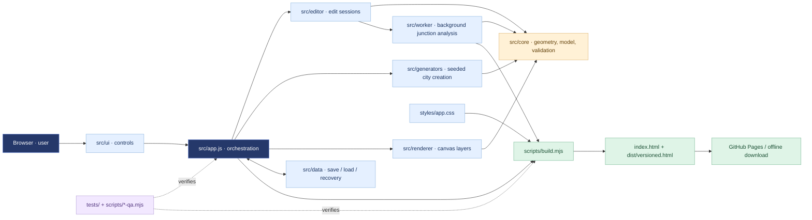
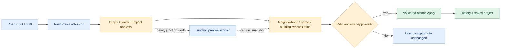

# 🗺️ Mappo · Repository Architecture Atlas

> **A complete, navigable guide to Mappo's repository.** Every tracked file has a place in the hierarchy and a concise explanation of its purpose.
>
> **Snapshot:** `main` · **Verified:** November 19, 2026 (Pacific) · **Main commit:** `6957509ef48886331bcfadcf581f16a6e869a00d` · **Tracked files:** **408** · **Directories:** **30**

**[Source repository](https://github.com/xbwtyz/Mappo)** · **[Development guide](https://github.com/xbwtyz/Mappo/blob/main/docs/development.md)** · **[Current roadmap](https://github.com/xbwtyz/Mappo/blob/main/docs/plans/0.2/README.md)** · **[Open D3 PR](https://github.com/xbwtyz/Mappo/pull/53)**

> [!NOTE]
> This atlas documents the complete **tracked tree on `main`**, not every file in Git history, untracked local files, or unmerged branches. At verification, **0.2D D3 was pending in PR #53**; its unmerged changes are not included. The historical `dist/` builds are counted individually because they are each tracked files. The root README still references the earlier A4 phase, whereas package metadata identifies D2; treat release/version metadata as authoritative for this snapshot.

## Start here — how Mappo fits together

Mappo is an **offline-first 2D city generator and editor** written as modular JavaScript. Developers change files in `src/`, `styles/`, and the build tooling. A build then embeds the runtime and styles into a standalone HTML page. The existing `index.html` and `dist/*.html` files are *generated outputs*, not additional competing implementations of the app.



### Road editing — safety pipeline



**Key principle:** preview and impact computations operate on *proposals*. Only the validated Apply path changes the accepted city. Source folders are responsibilities, not independent applications.

## Repository composition

| Area | Files | Responsibility |
|---|---:|---|
| [`src/`](https://github.com/xbwtyz/Mappo/tree/main/src) | 132 | Modular JavaScript application entry point. |
| [`tests/`](https://github.com/xbwtyz/Mappo/tree/main/tests) | 83 | Automated Node.js regressions and integration checks. |
| [`dist/`](https://github.com/xbwtyz/Mappo/tree/main/dist) | 83 | Versioned, self-contained historical browser builds; outputs, not hand-edited source. |
| [`docs/`](https://github.com/xbwtyz/Mappo/tree/main/docs) | 87 | Public developer, user, operations and planning documentation. |
| [`scripts/`](https://github.com/xbwtyz/Mappo/tree/main/scripts) | 8 | Build tooling, automated browser QA and performance measurement. |
| [`.github/`](https://github.com/xbwtyz/Mappo/tree/main/.github) | 5 | Contribution conventions and pull-request template. |
| [`styles/`](https://github.com/xbwtyz/Mappo/tree/main/styles) | 1 | Visual styling and responsive layouts. |
| Repository root | 9 | Entrypoints, metadata and aliases. |

## Full hierarchy diagram

The companion **[full-tree SVG](Mappo_Repository_Hierarchy.svg)** shows **every file** as an individual leaf and **every folder** as a branch. It is a vector diagram, so you can zoom without blur. Hover over file nodes in an SVG viewer for a purpose description and use the linked filenames in the inventory below to open their source.

<details>
<summary><strong>🌲 Expand the entire repository tree (408 files)</strong></summary>

```text
Mappo/
├── .github/
│   ├── workflows/
│   │   ├── ci-fast.yml
│   │   ├── ci.yml
│   │   ├── pages.yml
│   │   └── release.yml
│   └── PULL_REQUEST_TEMPLATE.md
├── dist/
│   ├── mappo-0.1-dev.1.html
│   ├── mappo-0.1-dev.2.html
│   ├── mappo-0.1-dev.3a.html
│   ├── mappo-0.1-dev.3a1.html
│   ├── mappo-0.1-dev.3a2.html
│   ├── mappo-0.1-dev.3b.html
│   ├── mappo-0.1-dev.3b1.html
│   ├── mappo-0.1-dev.3c.html
│   ├── mappo-0.1-dev.3d.html
│   ├── mappo-0.1-dev.3e.html
│   ├── mappo-0.1-dev.3e1.html
│   ├── mappo-0.1-dev.3e2.html
│   ├── mappo-0.1-dev.3e3.html
│   ├── mappo-0.1-dev.3e4.html
│   ├── mappo-0.1-dev.3e5.html
│   ├── mappo-0.1-dev.3e6.html
│   ├── mappo-0.1-dev.3fa.html
│   ├── mappo-0.1-dev.3faa.html
│   ├── mappo-0.1-dev.3fb.html
│   ├── mappo-0.1-dev.3fc.html
│   ├── mappo-0.1-dev.3fd.html
│   ├── mappo-0.1-dev.3ga.html
│   ├── mappo-0.1-dev.3gb.html
│   ├── mappo-0.1-dev.3gc.html
│   ├── mappo-0.1-dev.3gd.html
│   ├── mappo-0.1-dev.3he.html
│   ├── mappo-0.1-dev.3ia.html
│   ├── mappo-0.1-dev.3ib.html
│   ├── mappo-0.1-dev.3ic.html
│   ├── mappo-0.1-dev.3id.html
│   ├── mappo-0.1-dev.3ie.html
│   ├── mappo-0.1-dev.4b.html
│   ├── mappo-0.1-dev.4c.html
│   ├── mappo-0.1-dev.4d.html
│   ├── mappo-0.1-dev.4e.html
│   ├── mappo-0.1-dev.4f.html
│   ├── mappo-0.1-dev.ui1.html
│   ├── mappo-0.1-dev.ui2.html
│   ├── mappo-0.1-dev.ui3.html
│   ├── mappo-0.1-dev.ui4a.html
│   ├── mappo-0.1-dev.ui4b.html
│   ├── mappo-0.1-dev.ui4c.html
│   ├── mappo-0.1-dev.ui5a.html
│   ├── mappo-0.1-dev.ui5b.html
│   ├── mappo-0.1-dev.ui5c.html
│   ├── mappo-0.1-dev.ui5d.html
│   ├── mappo-0.1-dev.ui6a.html
│   ├── mappo-0.1-dev.ui6b.html
│   ├── mappo-0.1-dev.ui6c.html
│   ├── mappo-0.1-dev.ui6d.html
│   ├── mappo-0.1-dev.ui7a.html
│   ├── mappo-0.1-dev.ui7b.html
│   ├── mappo-0.1-dev.ui7c.html
│   ├── mappo-0.1-dev.ui7d.html
│   ├── mappo-0.1.0.html
│   ├── mappo-0.2-dev.a1.html
│   ├── mappo-0.2-dev.a2.html
│   ├── mappo-0.2-dev.a3.html
│   ├── mappo-0.2-dev.a4.html
│   ├── mappo-0.2-dev.a5.html
│   ├── mappo-0.2-dev.b1.html
│   ├── mappo-0.2-dev.b2.html
│   ├── mappo-0.2-dev.b3.html
│   ├── mappo-0.2-dev.b4.html
│   ├── mappo-0.2-dev.b5.html
│   ├── mappo-0.2-dev.c1-roadfirst.html
│   ├── mappo-0.2-dev.c2-reflow.html
│   ├── mappo-0.2-dev.c3-adaptive.html
│   ├── mappo-0.2-dev.c3-buildings.html
│   ├── mappo-0.2-dev.c3-topology.html
│   ├── mappo-0.2-dev.c4-shaping.html
│   ├── mappo-0.2-dev.c5-buildings.html
│   ├── mappo-0.2-dev.c6-road-editor.html
│   ├── mappo-0.2-dev.c7-finalization.html
│   ├── mappo-0.2-dev.c7-junctions.html
│   ├── mappo-0.2-dev.c7-p1.html
│   ├── mappo-0.2-dev.c7-p2.html
│   ├── mappo-0.2-dev.c7-p4.html
│   ├── mappo-0.2-dev.c7-p5.html
│   ├── mappo-0.2-dev.c7-p6.html
│   ├── mappo-0.2-dev.c7-p7.html
│   ├── mappo-0.2-dev.d1.html
│   └── mappo-0.2-dev.d2.html
├── docs/
│   ├── history/
│   │   ├── 3f/
│   │   │   ├── MILESTONE_3F_PLAN.md
│   │   │   ├── MILESTONE_3FA_QA.md
│   │   │   ├── MILESTONE_3FAA_PLAN.md
│   │   │   ├── MILESTONE_3FAA_QA.md
│   │   │   ├── MILESTONE_3FB_QA.md
│   │   │   ├── MILESTONE_3FC_QA.md
│   │   │   ├── MILESTONE_3FD_QA.md
│   │   │   └── README.md
│   │   ├── 3g/
│   │   │   ├── MILESTONE_3GA_QA.md
│   │   │   ├── MILESTONE_3GB_QA.md
│   │   │   ├── MILESTONE_3GC_QA.md
│   │   │   └── MILESTONE_3GD_QA.md
│   │   ├── 3h/
│   │   │   └── MILESTONE_3H_QA.md
│   │   ├── 3i/
│   │   │   ├── MILESTONE_3I_PLAN.md
│   │   │   ├── MILESTONE_3I_QA.md
│   │   │   └── MILESTONE_3IA_QA.md
│   │   ├── dev4/
│   │   │   ├── DEV4A_PROPERTY_DELETION.md
│   │   │   ├── DEV4B_MAP_INTERACTION_QA.md
│   │   │   ├── DEV4C_PRECISION_QA.md
│   │   │   ├── DEV4D_INSPECTOR_FEEDBACK_QA.md
│   │   │   ├── DEV4E_BULK_CLEAR_QA.md
│   │   │   └── DEV4F_EXPORT_QA.md
│   │   ├── ui/
│   │   │   ├── PHASE7_QA.md
│   │   │   ├── README.md
│   │   │   └── UI_OVERHAUL_PLAN.md
│   │   ├── QA-legacy.md
│   │   ├── README-pre-cleanup-3fd.md
│   │   └── README.md
│   ├── images/
│   │   ├── mappo-3fa-building-selection.jpg
│   │   ├── mappo-3faa-child.jpg
│   │   ├── mappo-3faa-property.jpg
│   │   ├── mappo-3fb-building.jpg
│   │   ├── mappo-3fb-property.jpg
│   │   ├── mappo-3fc-property.jpg
│   │   └── README.md
│   ├── maintenance/
│   │   ├── BRANCH_CLEANUP_REVIEW.md
│   │   ├── BUILD_RETENTION_POLICY.md
│   │   └── PASS_C_INVENTORY_AUDIT.md
│   ├── plans/
│   │   └── 0.2/
│   │       ├── A1_ROAD_GRAPH.md
│   │       ├── A2_FACE_IDENTITY.md
│   │       ├── A3_IMPACT_EXAMPLES.json
│   │       ├── A3_IMPACT_REPORT.md
│   │       ├── A4_ROAD_PREVIEW.md
│   │       ├── A5_IMPACT_USABILITY.md
│   │       ├── B1_LOCAL_RECONCILIATION.md
│   │       ├── B2_PARCEL_RECONCILIATION.md
│   │       ├── B3_RECONCILIATION_PREVIEW.md
│   │       ├── B4_ATOMIC_ROAD_APPLY.md
│   │       ├── B5_STABILIZATION.md
│   │       ├── C1_ROAD_FIRST_PREVIEW.md
│   │       ├── C1_ROAD_FIRST_TRANSITION.md
│   │       ├── C6_ROAD_EDITOR_ACCEPTANCE.md
│   │       ├── C7_CLOSEOUT_REVIEW.md
│   │       ├── C7_JUNCTION_FINALIZATION_PLAN.md
│   │       ├── C7_P1_BACKGROUND_PREVIEW_PLAN.md
│   │       ├── C7_P2_CANCELLATION_PLAN.md
│   │       ├── C7_P3_VERIFICATION_PLAN.md
│   │       ├── C7_P4_APPLY_RESPONSIVENESS.md
│   │       ├── C7_P5_PREVIEW_RESPONSIVENESS.md
│   │       ├── C7_P6_PREVIEW_COMPUTATION.md
│   │       ├── C7_P7_INPUT_RESPONSIVENESS.md
│   │       ├── C7_PERFORMANCE_BASELINE.md
│   │       ├── C7_PHYSICAL_QA.md
│   │       ├── MILESTONE_0_2A_PLAN.md
│   │       ├── MILESTONE_0_2B_DESIGN.md
│   │       ├── MILESTONE_0_2C_DESIGN.md
│   │       ├── MILESTONE_0_2D_ROAD_UX_PLAN.md
│   │       ├── README.md
│   │       └── ROAD_EDIT_CONTRACT.md
│   ├── reference/
│   │   ├── DISTRICTS.md
│   │   ├── FORTIFICATIONS.md
│   │   ├── PROJECT_FORMAT.md
│   │   ├── README.md
│   │   ├── TERRAIN.md
│   │   ├── UI_CONTROL_MAP.md
│   │   ├── WATER.md
│   │   └── WORKSPACE_UI.md
│   ├── releases/
│   │   └── v0.1.0.md
│   ├── CI.md
│   ├── CI_TEST_POLICY.md
│   ├── development.md
│   ├── gallery.md
│   ├── PASS_A_QA.md
│   ├── PASS_B_QA.md
│   ├── README.md
│   ├── ROADMAP.md
│   └── user-guide.md
├── scripts/
│   ├── browser-qa.mjs
│   ├── build.mjs
│   ├── building-browser-qa.mjs
│   ├── c7-browser-performance.mjs
│   ├── c7-p2-browser-qa.mjs
│   ├── c7-p3-offline-qa.mjs
│   ├── road-browser-qa.mjs
│   └── road-impact-examples.mjs
├── src/
│   ├── core/
│   │   ├── boundary.js
│   │   ├── building-selection.js
│   │   ├── building-transform.js
│   │   ├── building-validation.js
│   │   ├── city-model.js
│   │   ├── district-model.js
│   │   ├── district-topology.js
│   │   ├── editing-precision-4c.js
│   │   ├── export-filenames-4f.js
│   │   ├── fortification-geometry.js
│   │   ├── fortification-model.js
│   │   ├── gate-geometry.js
│   │   ├── geometry.js
│   │   ├── identity.js
│   │   ├── inspector-feedback-4d.js
│   │   ├── lake-editing.js
│   │   ├── lake-geometry.js
│   │   ├── landscape-selection.js
│   │   ├── layer-presets-4f.js
│   │   ├── neighborhood-reflow.js
│   │   ├── parcel-reconciliation.js
│   │   ├── pending-changes.js
│   │   ├── placement.js
│   │   ├── prng.js
│   │   ├── property-geometry.js
│   │   ├── property-selection.js
│   │   ├── river-editing.js
│   │   ├── road-building-decisions.js
│   │   ├── road-building-reflow.js
│   │   ├── road-crossings.js
│   │   ├── road-face-geometry.js
│   │   ├── road-faces.js
│   │   ├── road-graph.js
│   │   ├── road-impact-dependencies.js
│   │   ├── road-impact-model.js
│   │   ├── road-impact.js
│   │   ├── road-inspection.js
│   │   ├── road-intent-c1.js
│   │   ├── road-provenance.js
│   │   ├── road-reconciliation.js
│   │   ├── road-shape.js
│   │   ├── road-topology-reflow.js
│   │   ├── road-topology.js
│   │   ├── selection-focus-4b.js
│   │   ├── selection-information.js
│   │   ├── shortcut-scope.js
│   │   ├── structure-history-feedback-4e.js
│   │   ├── terrain-editing.js
│   │   ├── terrain-fortifications.js
│   │   ├── terrain-geometry.js
│   │   ├── terrain-model.js
│   │   ├── undo-context.js
│   │   ├── validate-development.js
│   │   ├── validate-layout.js
│   │   ├── validation-feedback.js
│   │   ├── version.js
│   │   ├── water-editing.js
│   │   ├── water-fortifications.js
│   │   ├── water-geometry.js
│   │   ├── water-model.js
│   │   ├── water-regions.js
│   │   ├── water-shore-topology.js
│   │   ├── workspace-presentation.js
│   │   └── workspace-state.js
│   ├── data/
│   │   ├── file-io.js
│   │   ├── migrations.js
│   │   ├── png-export-4f.js
│   │   ├── project-format.js
│   │   ├── project-validation.js
│   │   └── recovery-store.js
│   ├── editor/
│   │   ├── building-application.js
│   │   ├── building-history.js
│   │   ├── building-structure-history.js
│   │   ├── building-structures.js
│   │   ├── building.js
│   │   ├── districts.js
│   │   ├── fortifications.js
│   │   ├── junction-preview-worker-client.js
│   │   ├── outline.js
│   │   ├── property-application.js
│   │   ├── property-building-clear-4e.js
│   │   ├── property-deletion.js
│   │   ├── property-edit.js
│   │   ├── property-history.js
│   │   ├── road-application.js
│   │   ├── road-history.js
│   │   ├── road-preview.js
│   │   ├── terrain.js
│   │   └── water.js
│   ├── generators/
│   │   ├── buildings.js
│   │   ├── coast.js
│   │   ├── districts.js
│   │   ├── fortifications.js
│   │   ├── gates.js
│   │   ├── lakes.js
│   │   ├── layout.js
│   │   ├── survey.js
│   │   ├── terrain.js
│   │   ├── towers.js
│   │   └── water.js
│   ├── renderer/
│   │   ├── building-editing.js
│   │   ├── building-selection.js
│   │   ├── building-structure-preview.js
│   │   ├── buildings.js
│   │   ├── camera.js
│   │   ├── canvas.js
│   │   ├── districts.js
│   │   ├── fortifications.js
│   │   ├── landscape-selection.js
│   │   ├── property-edit-preview.js
│   │   ├── property-selection.js
│   │   ├── road-inspection.js
│   │   ├── selection-accents-4b.js
│   │   ├── terrain.js
│   │   └── water.js
│   ├── ui/
│   │   ├── building-workspace.js
│   │   ├── controllers.js
│   │   ├── district-workspace.js
│   │   ├── districts.js
│   │   ├── fortifications.js
│   │   ├── identity-workspace.js
│   │   ├── landscape.js
│   │   ├── project-files.js
│   │   ├── property-workspace.js
│   │   ├── road-inspection.js
│   │   ├── terrain.js
│   │   ├── water.js
│   │   ├── workspace-inspectors.js
│   │   ├── workspace-menus.js
│   │   └── workspace.js
│   ├── worker/
│   │   └── junction-preview-worker.js
│   └── app.js
├── styles/
│   └── app.css
├── tests/
│   ├── fixtures/
│   │   ├── legacy-3a2-schema1.json
│   │   ├── legacy-3b-schema1.json
│   │   ├── road-generation-parity-0.1.json
│   │   ├── save-3b1-format1-schema2.json
│   │   ├── save-3c-format1-schema3.json
│   │   ├── save-3d-format1-schema4.json
│   │   ├── save-3e-format1-schema5.json
│   │   ├── save-3e1-format1-schema6.json
│   │   ├── save-3e4-format1-schema7.json
│   │   └── save-3e5-format1-schema8.json
│   ├── helpers/
│   │   └── building-app.js
│   ├── build.test.js
│   ├── building-application.test.js
│   ├── building-editing-workflow.test.js
│   ├── building-editing.test.js
│   ├── building-history.test.js
│   ├── building-selection.test.js
│   ├── building-structures.test.js
│   ├── building-transform-workflow.test.js
│   ├── building-transform.test.js
│   ├── building-validation-workflow.test.js
│   ├── building-validation.test.js
│   ├── building-workflow.test.js
│   ├── buildings.test.js
│   ├── c7-junction-preview-worker.test.js
│   ├── c7-p2-worker-cancellation.test.js
│   ├── c7-preview-cache.test.js
│   ├── canvas-pointer.test.js
│   ├── coast-editing.test.js
│   ├── coast.test.js
│   ├── core.test.js
│   ├── defense-workflow.test.js
│   ├── dev4f-export.test.js
│   ├── district-workspace.test.js
│   ├── districts.test.js
│   ├── editing-precision-4c.test.js
│   ├── fortifications.test.js
│   ├── geometry.test.js
│   ├── identity-workflow.test.js
│   ├── identity.test.js
│   ├── inspection-workflow.test.js
│   ├── inspector-feedback-4d.test.js
│   ├── lakes.test.js
│   ├── landscape.test.js
│   ├── map-interaction-4b.test.js
│   ├── neighborhood-reflow.test.js
│   ├── outline.test.js
│   ├── parcel-reconciliation.test.js
│   ├── pending-changes.test.js
│   ├── persistence.test.js
│   ├── phase7-control-inventory.test.js
│   ├── phase7-integration.test.js
│   ├── property-building-clear-4e.test.js
│   ├── property-deletion.test.js
│   ├── property-edit.test.js
│   ├── property-selection.test.js
│   ├── readability.test.js
│   ├── responsive-layout.test.js
│   ├── river-editing.test.js
│   ├── road-application.test.js
│   ├── road-b5-hardening.test.js
│   ├── road-building-decisions.test.js
│   ├── road-editor-acceptance.test.js
│   ├── road-faces.test.js
│   ├── road-first-c1.test.js
│   ├── road-graph.test.js
│   ├── road-impact-usability.test.js
│   ├── road-impact.test.js
│   ├── road-preview.test.js
│   ├── road-reconciliation-preview.test.js
│   ├── road-reconciliation.test.js
│   ├── road-shape.test.js
│   ├── road-topology-reflow.test.js
│   ├── selection-information.test.js
│   ├── shortcut-scope.test.js
│   ├── terrain.test.js
│   ├── undo-context.test.js
│   ├── validation-feedback.test.js
│   ├── water-composition.test.js
│   ├── water.test.js
│   ├── workspace-menus.test.js
│   ├── workspace-presentation.test.js
│   └── workspace.test.js
├── .gitignore
├── index.html
├── index.template.html
├── MILESTONE_3F_PLAN.md
├── package.json
├── PROJECT_FORMAT.md
├── QA.md
├── README.md
└── WORKSPACE_UI.md
```

</details>

## Complete file-by-file guide

Each directory can be expanded independently. Every row names **one real tracked file**, links to its GitHub source, and explains its role. The files are intentionally documented rather than removed or renamed.

<details>
<summary><strong>📁 Repository root — 9 files</strong> · Repository configuration, the HTML entry point, metadata and convenience links.</summary>

| File | What it does |
|---|---|
| [`.gitignore`](https://github.com/xbwtyz/Mappo/blob/main/.gitignore) | Excludes local dependencies, caches and machine-generated files from version control. |
| [`MILESTONE_3F_PLAN.md`](https://github.com/xbwtyz/Mappo/blob/main/MILESTONE_3F_PLAN.md) | Legacy root reference pointing toward the archived 3F design plan. |
| [`PROJECT_FORMAT.md`](https://github.com/xbwtyz/Mappo/blob/main/PROJECT_FORMAT.md) | Legacy root reference to the authoritative project format documentation. |
| [`QA.md`](https://github.com/xbwtyz/Mappo/blob/main/QA.md) | Legacy root reference to current and archived QA documentation. |
| [`README.md`](https://github.com/xbwtyz/Mappo/blob/main/README.md) | Repository landing page with product overview, setup and release links. |
| [`WORKSPACE_UI.md`](https://github.com/xbwtyz/Mappo/blob/main/WORKSPACE_UI.md) | Legacy root reference to workspace UI documentation. |
| [`index.html`](https://github.com/xbwtyz/Mappo/blob/main/index.html) | Generated current standalone application and GitHub Pages entry point; do not hand-edit. |
| [`index.template.html`](https://github.com/xbwtyz/Mappo/blob/main/index.template.html) | HTML shell and UI markup populated with bundled scripts/styles at build time. |
| [`package.json`](https://github.com/xbwtyz/Mappo/blob/main/package.json) | NPM scripts, package metadata, app version and development commands. |

</details>

<details>
<summary><strong>📁 .github/ — 1 files</strong> · Contribution conventions and pull-request template.</summary>

| File | What it does |
|---|---|
| [`PULL_REQUEST_TEMPLATE.md`](https://github.com/xbwtyz/Mappo/blob/main/.github/PULL_REQUEST_TEMPLATE.md) | Pull request checklist for scope, tests and reviewer handoff. |

</details>

<details>
<summary><strong>📁 .github/workflows/ — 4 files</strong> · GitHub Actions build, QA, Pages and release automation.</summary>

| File | What it does |
|---|---|
| [`ci-fast.yml`](https://github.com/xbwtyz/Mappo/blob/main/.github/workflows/ci-fast.yml) | Fast GitHub Actions checks for rapid pull request feedback. |
| [`ci.yml`](https://github.com/xbwtyz/Mappo/blob/main/.github/workflows/ci.yml) | Full GitHub Actions build and automated regression checks. |
| [`pages.yml`](https://github.com/xbwtyz/Mappo/blob/main/.github/workflows/pages.yml) | GitHub Pages site publishing workflow. |
| [`release.yml`](https://github.com/xbwtyz/Mappo/blob/main/.github/workflows/release.yml) | GitHub Actions workflow for release packaging and publication. |

</details>

<details>
<summary><strong>📁 src/ — 1 files</strong> · Modular JavaScript application entry point.</summary>

| File | What it does |
|---|---|
| [`app.js`](https://github.com/xbwtyz/Mappo/blob/main/src/app.js) | Main application composition: initializes state, binds UI/editors and schedules redraws. |

</details>

<details>
<summary><strong>📁 src/core/ — 64 files</strong> · Pure or shared geometry, models, validation and preservation rules.</summary>

| File | What it does |
|---|---|
| [`boundary.js`](https://github.com/xbwtyz/Mappo/blob/main/src/core/boundary.js) | Boundary cleanup, containment, segment-intersection and clearance helpers for city geometry. |
| [`building-selection.js`](https://github.com/xbwtyz/Mappo/blob/main/src/core/building-selection.js) | Building hit-testing and selection logic used by map interaction. |
| [`building-transform.js`](https://github.com/xbwtyz/Mappo/blob/main/src/core/building-transform.js) | Computes editable building frames, rotations, dimensions and transform previews. |
| [`building-validation.js`](https://github.com/xbwtyz/Mappo/blob/main/src/core/building-validation.js) | Validates proposed building shapes, containment and collisions before acceptance. |
| [`city-model.js`](https://github.com/xbwtyz/Mappo/blob/main/src/core/city-model.js) | Creates a complete initial city/project model from generation settings. |
| [`district-model.js`](https://github.com/xbwtyz/Mappo/blob/main/src/core/district-model.js) | District records, constraints and validation rules. |
| [`district-topology.js`](https://github.com/xbwtyz/Mappo/blob/main/src/core/district-topology.js) | Builds district connectivity and adjacency data; checks connected district selections. |
| [`editing-precision-4c.js`](https://github.com/xbwtyz/Mappo/blob/main/src/core/editing-precision-4c.js) | Precision-edit controls and numeric nudge calculations introduced in Dev 4C. |
| [`export-filenames-4f.js`](https://github.com/xbwtyz/Mappo/blob/main/src/core/export-filenames-4f.js) | Sanitizes and coordinates filenames for project and map exports. |
| [`fortification-geometry.js`](https://github.com/xbwtyz/Mappo/blob/main/src/core/fortification-geometry.js) | Wall paths, measurements and geometry used for fortification placement. |
| [`fortification-model.js`](https://github.com/xbwtyz/Mappo/blob/main/src/core/fortification-model.js) | Fortification model constraints and integrity checks. |
| [`gate-geometry.js`](https://github.com/xbwtyz/Mappo/blob/main/src/core/gate-geometry.js) | Gate position, post and entrance geometry along walls and roads. |
| [`geometry.js`](https://github.com/xbwtyz/Mappo/blob/main/src/core/geometry.js) | Shared polygon areas, bounds and point-in-polygon calculations. |
| [`identity.js`](https://github.com/xbwtyz/Mappo/blob/main/src/core/identity.js) | Names, descriptions and identity validation for editable city objects. |
| [`inspector-feedback-4d.js`](https://github.com/xbwtyz/Mappo/blob/main/src/core/inspector-feedback-4d.js) | Converts validation and selection state into actionable inspector feedback. |
| [`lake-editing.js`](https://github.com/xbwtyz/Mappo/blob/main/src/core/lake-editing.js) | Lake control-point draft operations and editable lake shape handling. |
| [`lake-geometry.js`](https://github.com/xbwtyz/Mappo/blob/main/src/core/lake-geometry.js) | Lake polygons, access segments and geometric validation. |
| [`landscape-selection.js`](https://github.com/xbwtyz/Mappo/blob/main/src/core/landscape-selection.js) | Unified selection and lookup of landscape features in the editor. |
| [`layer-presets-4f.js`](https://github.com/xbwtyz/Mappo/blob/main/src/core/layer-presets-4f.js) | Named map-layer visibility presets and preset selection logic. |
| [`neighborhood-reflow.js`](https://github.com/xbwtyz/Mappo/blob/main/src/core/neighborhood-reflow.js) | Plans road/junction edits and locally adapts generated neighborhood geometry. |
| [`parcel-reconciliation.js`](https://github.com/xbwtyz/Mappo/blob/main/src/core/parcel-reconciliation.js) | Warps affected property frontages and reconciles parcels after road changes. |
| [`pending-changes.js`](https://github.com/xbwtyz/Mappo/blob/main/src/core/pending-changes.js) | Read-only summaries of uncommitted changes and rebuild consequences. |
| [`placement.js`](https://github.com/xbwtyz/Mappo/blob/main/src/core/placement.js) | Plot placement, polygon clipping and fit/collision utilities. |
| [`prng.js`](https://github.com/xbwtyz/Mappo/blob/main/src/core/prng.js) | Seeded deterministic random-number generator and seed hashing. |
| [`property-geometry.js`](https://github.com/xbwtyz/Mappo/blob/main/src/core/property-geometry.js) | Property corner, divider and boundary geometry transformations. |
| [`property-selection.js`](https://github.com/xbwtyz/Mappo/blob/main/src/core/property-selection.js) | Property hit-testing, selection state and property-first selection behavior. |
| [`river-editing.js`](https://github.com/xbwtyz/Mappo/blob/main/src/core/river-editing.js) | River editing helper entry points shared with water editing. |
| [`road-building-decisions.js`](https://github.com/xbwtyz/Mappo/blob/main/src/core/road-building-decisions.js) | Evaluates building displacement decisions when proposed roads affect existing structures. |
| [`road-building-reflow.js`](https://github.com/xbwtyz/Mappo/blob/main/src/core/road-building-reflow.js) | Repositions/recreates eligible generated buildings during road-driven neighborhood reflow. |
| [`road-crossings.js`](https://github.com/xbwtyz/Mappo/blob/main/src/core/road-crossings.js) | Normalizes road crossings, drafts connections and assigns stable topology IDs. |
| [`road-face-geometry.js`](https://github.com/xbwtyz/Mappo/blob/main/src/core/road-face-geometry.js) | Road-face triangulation and overlap-area measurement for face identity matching. |
| [`road-faces.js`](https://github.com/xbwtyz/Mappo/blob/main/src/core/road-faces.js) | Extracts blocks/faces from the road graph and matches old faces to changed geometry. |
| [`road-graph.js`](https://github.com/xbwtyz/Mappo/blob/main/src/core/road-graph.js) | Builds transient road-node graphs, analyzes junctions and proposes junction moves. |
| [`road-impact-dependencies.js`](https://github.com/xbwtyz/Mappo/blob/main/src/core/road-impact-dependencies.js) | Detects dependencies of roads on walls, districts, water and other referenced features. |
| [`road-impact-model.js`](https://github.com/xbwtyz/Mappo/blob/main/src/core/road-impact-model.js) | Shared road-impact records, comparisons, budgets and report-format primitives. |
| [`road-impact.js`](https://github.com/xbwtyz/Mappo/blob/main/src/core/road-impact.js) | Runs impact analysis for proposed road edits without changing accepted project data. |
| [`road-inspection.js`](https://github.com/xbwtyz/Mappo/blob/main/src/core/road-inspection.js) | Read-only road hit-testing, inspection details and impact highlighting. |
| [`road-intent-c1.js`](https://github.com/xbwtyz/Mappo/blob/main/src/core/road-intent-c1.js) | Constructs road-first and junction edit intentions before local reconciliation. |
| [`road-provenance.js`](https://github.com/xbwtyz/Mappo/blob/main/src/core/road-provenance.js) | Tracks whether roads are generator-owned, user-edited or of unknown provenance. |
| [`road-reconciliation.js`](https://github.com/xbwtyz/Mappo/blob/main/src/core/road-reconciliation.js) | Prepares detached topology reconciliation candidates and preservation diagnostics. |
| [`road-shape.js`](https://github.com/xbwtyz/Mappo/blob/main/src/core/road-shape.js) | Validates and drafts editable road polylines, including bend limits. |
| [`road-topology-reflow.js`](https://github.com/xbwtyz/Mappo/blob/main/src/core/road-topology-reflow.js) | Rebuilds and validates topology after road edits, including connected parcels and buildings. |
| [`road-topology.js`](https://github.com/xbwtyz/Mappo/blob/main/src/core/road-topology.js) | Shared road-node normalization and planar face tracing used during generation. |
| [`selection-focus-4b.js`](https://github.com/xbwtyz/Mappo/blob/main/src/core/selection-focus-4b.js) | Selection-focus utilities for map interaction and keyboard navigation. |
| [`selection-information.js`](https://github.com/xbwtyz/Mappo/blob/main/src/core/selection-information.js) | Produces structured inspector summaries for selected city features. |
| [`shortcut-scope.js`](https://github.com/xbwtyz/Mappo/blob/main/src/core/shortcut-scope.js) | Guards keyboard shortcuts so map commands do not fire inside text inputs. |
| [`structure-history-feedback-4e.js`](https://github.com/xbwtyz/Mappo/blob/main/src/core/structure-history-feedback-4e.js) | User-facing feedback for building clear/delete undo and redo operations. |
| [`terrain-editing.js`](https://github.com/xbwtyz/Mappo/blob/main/src/core/terrain-editing.js) | Terrain draft editing, shape controls and edit state. |
| [`terrain-fortifications.js`](https://github.com/xbwtyz/Mappo/blob/main/src/core/terrain-fortifications.js) | Terrain-aware placement checks for defensive structures. |
| [`terrain-geometry.js`](https://github.com/xbwtyz/Mappo/blob/main/src/core/terrain-geometry.js) | Mountain/terrain geometry, contours and traversal/access constraints. |
| [`terrain-model.js`](https://github.com/xbwtyz/Mappo/blob/main/src/core/terrain-model.js) | Terrain feature records and validation rules. |
| [`undo-context.js`](https://github.com/xbwtyz/Mappo/blob/main/src/core/undo-context.js) | Context handling for session undo/redo boundaries and related state. |
| [`validate-development.js`](https://github.com/xbwtyz/Mappo/blob/main/src/core/validate-development.js) | Checks generated buildings, parcels and development geometry consistency. |
| [`validate-layout.js`](https://github.com/xbwtyz/Mappo/blob/main/src/core/validate-layout.js) | Rejects malformed or numerically invalid generated street and block layouts. |
| [`validation-feedback.js`](https://github.com/xbwtyz/Mappo/blob/main/src/core/validation-feedback.js) | Normalizes validation errors into concise, user-readable feedback. |
| [`version.js`](https://github.com/xbwtyz/Mappo/blob/main/src/core/version.js) | Canonical application version string checked by the build. |
| [`water-editing.js`](https://github.com/xbwtyz/Mappo/blob/main/src/core/water-editing.js) | Shared edits for rivers, coasts and lakes, including preview/commit handling. |
| [`water-fortifications.js`](https://github.com/xbwtyz/Mappo/blob/main/src/core/water-fortifications.js) | Checks interaction between shoreline/water features and fortifications. |
| [`water-geometry.js`](https://github.com/xbwtyz/Mappo/blob/main/src/core/water-geometry.js) | Water polygons, bridge access, shoreline containment and geometric utilities. |
| [`water-model.js`](https://github.com/xbwtyz/Mappo/blob/main/src/core/water-model.js) | Water feature constraints, identities and integrity validation. |
| [`water-regions.js`](https://github.com/xbwtyz/Mappo/blob/main/src/core/water-regions.js) | Computes connected land/water regions for placement and topology. |
| [`water-shore-topology.js`](https://github.com/xbwtyz/Mappo/blob/main/src/core/water-shore-topology.js) | Identifies shoreline components and accessible shore segments. |
| [`workspace-presentation.js`](https://github.com/xbwtyz/Mappo/blob/main/src/core/workspace-presentation.js) | Pure presentation helpers for workspace controls and inspector status. |
| [`workspace-state.js`](https://github.com/xbwtyz/Mappo/blob/main/src/core/workspace-state.js) | Workspace section definitions, selection state and UI transitions. |

</details>

<details>
<summary><strong>📁 src/data/ — 6 files</strong> · Portable save files, schema migration and recovery.</summary>

| File | What it does |
|---|---|
| [`file-io.js`](https://github.com/xbwtyz/Mappo/blob/main/src/data/file-io.js) | Browser file download/read primitives for portable project files. |
| [`migrations.js`](https://github.com/xbwtyz/Mappo/blob/main/src/data/migrations.js) | Upgrades older saved project schema versions to the current format. |
| [`png-export-4f.js`](https://github.com/xbwtyz/Mappo/blob/main/src/data/png-export-4f.js) | Exports the visible canvas as PNG with safe filename handling. |
| [`project-format.js`](https://github.com/xbwtyz/Mappo/blob/main/src/data/project-format.js) | Encodes/decodes versioned .mappo.json documents and project metadata. |
| [`project-validation.js`](https://github.com/xbwtyz/Mappo/blob/main/src/data/project-validation.js) | Deep validation, limits and structural checks for saved project data. |
| [`recovery-store.js`](https://github.com/xbwtyz/Mappo/blob/main/src/data/recovery-store.js) | Manages browser-local recovery snapshots separate from downloaded backups. |

</details>

<details>
<summary><strong>📁 src/editor/ — 19 files</strong> · Stateful editing sessions, previews, history and Apply gates.</summary>

| File | What it does |
|---|---|
| [`building-application.js`](https://github.com/xbwtyz/Mappo/blob/main/src/editor/building-application.js) | Validates and atomically applies building transformations and plot attachment. |
| [`building-history.js`](https://github.com/xbwtyz/Mappo/blob/main/src/editor/building-history.js) | Undo/redo commands for building edits. |
| [`building-structure-history.js`](https://github.com/xbwtyz/Mappo/blob/main/src/editor/building-structure-history.js) | Undo/redo for adding, replacing, clearing or deleting structures. |
| [`building-structures.js`](https://github.com/xbwtyz/Mappo/blob/main/src/editor/building-structures.js) | Building creation, replacement, deletion and structure session operations. |
| [`building.js`](https://github.com/xbwtyz/Mappo/blob/main/src/editor/building.js) | Interactive building movement, rotation and resize sessions. |
| [`districts.js`](https://github.com/xbwtyz/Mappo/blob/main/src/editor/districts.js) | Editable district assignment and district-level operations. |
| [`fortifications.js`](https://github.com/xbwtyz/Mappo/blob/main/src/editor/fortifications.js) | Edit sessions for perimeter walls, gates and towers. |
| [`junction-preview-worker-client.js`](https://github.com/xbwtyz/Mappo/blob/main/src/editor/junction-preview-worker-client.js) | Browser worker lifecycle, cancellation and fallback for junction previews. |
| [`outline.js`](https://github.com/xbwtyz/Mappo/blob/main/src/editor/outline.js) | Starting boundary presets plus interactive city-outline drawing/editing. |
| [`property-application.js`](https://github.com/xbwtyz/Mappo/blob/main/src/editor/property-application.js) | Validates and commits edits to property boundaries/dividers. |
| [`property-building-clear-4e.js`](https://github.com/xbwtyz/Mappo/blob/main/src/editor/property-building-clear-4e.js) | Clears all buildings on a property as a reversible operation. |
| [`property-deletion.js`](https://github.com/xbwtyz/Mappo/blob/main/src/editor/property-deletion.js) | Confirms/deletes properties and supports session restoration. |
| [`property-edit.js`](https://github.com/xbwtyz/Mappo/blob/main/src/editor/property-edit.js) | Drafts property corner and divider edits before Apply. |
| [`property-history.js`](https://github.com/xbwtyz/Mappo/blob/main/src/editor/property-history.js) | Undo/redo for property edits. |
| [`road-application.js`](https://github.com/xbwtyz/Mappo/blob/main/src/editor/road-application.js) | Final road-edit acceptance gate; checks the full candidate and applies atomically. |
| [`road-history.js`](https://github.com/xbwtyz/Mappo/blob/main/src/editor/road-history.js) | Undo/redo for accepted road changes. |
| [`road-preview.js`](https://github.com/xbwtyz/Mappo/blob/main/src/editor/road-preview.js) | Holds non-destructive road/junction previews, revisions and cancellation. |
| [`terrain.js`](https://github.com/xbwtyz/Mappo/blob/main/src/editor/terrain.js) | Interaction sessions for drawing, moving and reshaping terrain. |
| [`water.js`](https://github.com/xbwtyz/Mappo/blob/main/src/editor/water.js) | Interaction sessions for river, shoreline and lake editing. |

</details>

<details>
<summary><strong>📁 src/generators/ — 11 files</strong> · Seeded procedural city construction.</summary>

| File | What it does |
|---|---|
| [`buildings.js`](https://github.com/xbwtyz/Mappo/blob/main/src/generators/buildings.js) | Procedurally places and shapes buildings within generated properties. |
| [`coast.js`](https://github.com/xbwtyz/Mappo/blob/main/src/generators/coast.js) | Generates coastline paths from seed and landscape parameters. |
| [`districts.js`](https://github.com/xbwtyz/Mappo/blob/main/src/generators/districts.js) | Generates district regions and assignments across blocks. |
| [`fortifications.js`](https://github.com/xbwtyz/Mappo/blob/main/src/generators/fortifications.js) | Generates city walls and defensive perimeter structures. |
| [`gates.js`](https://github.com/xbwtyz/Mappo/blob/main/src/generators/gates.js) | Places entrances/gates into valid wall segments. |
| [`lakes.js`](https://github.com/xbwtyz/Mappo/blob/main/src/generators/lakes.js) | Procedurally generates configurable lake features. |
| [`layout.js`](https://github.com/xbwtyz/Mappo/blob/main/src/generators/layout.js) | Generates the initial street network, blocks and morphology-dependent plan. |
| [`survey.js`](https://github.com/xbwtyz/Mappo/blob/main/src/generators/survey.js) | Seeded city survey, density/morphology presets and boundary shape profiles. |
| [`terrain.js`](https://github.com/xbwtyz/Mappo/blob/main/src/generators/terrain.js) | Generates mountains and other terrain features. |
| [`towers.js`](https://github.com/xbwtyz/Mappo/blob/main/src/generators/towers.js) | Generates defensive towers along fortifications. |
| [`water.js`](https://github.com/xbwtyz/Mappo/blob/main/src/generators/water.js) | Generates river and water layouts compatible with city geometry. |

</details>

<details>
<summary><strong>📁 src/renderer/ — 15 files</strong> · Canvas drawing and editing overlays.</summary>

| File | What it does |
|---|---|
| [`building-editing.js`](https://github.com/xbwtyz/Mappo/blob/main/src/renderer/building-editing.js) | Draws building transform outlines, handles and editing overlays. |
| [`building-selection.js`](https://github.com/xbwtyz/Mappo/blob/main/src/renderer/building-selection.js) | Draws highlights for a selected building. |
| [`building-structure-preview.js`](https://github.com/xbwtyz/Mappo/blob/main/src/renderer/building-structure-preview.js) | Draws previews for add/replace/delete structure operations. |
| [`buildings.js`](https://github.com/xbwtyz/Mappo/blob/main/src/renderer/buildings.js) | Draws building shapes and visual details. |
| [`camera.js`](https://github.com/xbwtyz/Mappo/blob/main/src/renderer/camera.js) | Controls map pan/zoom and world-to-canvas coordinate transforms. |
| [`canvas.js`](https://github.com/xbwtyz/Mappo/blob/main/src/renderer/canvas.js) | Top-level draw orchestrator combining terrain, water, blocks and overlays. |
| [`districts.js`](https://github.com/xbwtyz/Mappo/blob/main/src/renderer/districts.js) | Renders districts and district selection cues. |
| [`fortifications.js`](https://github.com/xbwtyz/Mappo/blob/main/src/renderer/fortifications.js) | Renders walls, gates and towers. |
| [`landscape-selection.js`](https://github.com/xbwtyz/Mappo/blob/main/src/renderer/landscape-selection.js) | Highlights hovered/selected landscape elements. |
| [`property-edit-preview.js`](https://github.com/xbwtyz/Mappo/blob/main/src/renderer/property-edit-preview.js) | Draws tentative property geometry while editing. |
| [`property-selection.js`](https://github.com/xbwtyz/Mappo/blob/main/src/renderer/property-selection.js) | Draws selected-property outlines and handles. |
| [`road-inspection.js`](https://github.com/xbwtyz/Mappo/blob/main/src/renderer/road-inspection.js) | Draws road/junction previews, impact overlays and issue highlights. |
| [`selection-accents-4b.js`](https://github.com/xbwtyz/Mappo/blob/main/src/renderer/selection-accents-4b.js) | Selection accent styles and overlay painting added in Dev 4B. |
| [`terrain.js`](https://github.com/xbwtyz/Mappo/blob/main/src/renderer/terrain.js) | Paints mountains and terrain draft geometry. |
| [`water.js`](https://github.com/xbwtyz/Mappo/blob/main/src/renderer/water.js) | Draws rivers, lakes, coastlines and related water boundaries. |

</details>

<details>
<summary><strong>📁 src/ui/ — 15 files</strong> · DOM controls, workspace panels and user interactions.</summary>

| File | What it does |
|---|---|
| [`building-workspace.js`](https://github.com/xbwtyz/Mappo/blob/main/src/ui/building-workspace.js) | Building inspector panel and its interactive controls. |
| [`controllers.js`](https://github.com/xbwtyz/Mappo/blob/main/src/ui/controllers.js) | Binds pointer, keyboard, camera and map input events. |
| [`district-workspace.js`](https://github.com/xbwtyz/Mappo/blob/main/src/ui/district-workspace.js) | District inspector view and property controls. |
| [`districts.js`](https://github.com/xbwtyz/Mappo/blob/main/src/ui/districts.js) | District editing controls and UI event binding. |
| [`fortifications.js`](https://github.com/xbwtyz/Mappo/blob/main/src/ui/fortifications.js) | Wall/gate/tower editing UI. |
| [`identity-workspace.js`](https://github.com/xbwtyz/Mappo/blob/main/src/ui/identity-workspace.js) | Names and descriptions editor for selected records. |
| [`landscape.js`](https://github.com/xbwtyz/Mappo/blob/main/src/ui/landscape.js) | Landscape workspace coordinating water/terrain selection and controls. |
| [`project-files.js`](https://github.com/xbwtyz/Mappo/blob/main/src/ui/project-files.js) | Project save, load, download, recovery and PNG export UI. |
| [`property-workspace.js`](https://github.com/xbwtyz/Mappo/blob/main/src/ui/property-workspace.js) | Property inspector with plot and structure editing actions. |
| [`road-inspection.js`](https://github.com/xbwtyz/Mappo/blob/main/src/ui/road-inspection.js) | Road editing interface: status, blockers, live previews and user decisions. |
| [`terrain.js`](https://github.com/xbwtyz/Mappo/blob/main/src/ui/terrain.js) | Mountain and terrain controls. |
| [`water.js`](https://github.com/xbwtyz/Mappo/blob/main/src/ui/water.js) | River, coast and lake editing controls. |
| [`workspace-inspectors.js`](https://github.com/xbwtyz/Mappo/blob/main/src/ui/workspace-inspectors.js) | Inspector section composition and visibility wiring. |
| [`workspace-menus.js`](https://github.com/xbwtyz/Mappo/blob/main/src/ui/workspace-menus.js) | Top-level workspace menus and section switches. |
| [`workspace.js`](https://github.com/xbwtyz/Mappo/blob/main/src/ui/workspace.js) | Shared workspace shell, control state and panel lifecycle. |

</details>

<details>
<summary><strong>📁 src/worker/ — 1 files</strong> · Background computation separated from the main UI thread.</summary>

| File | What it does |
|---|---|
| [`junction-preview-worker.js`](https://github.com/xbwtyz/Mappo/blob/main/src/worker/junction-preview-worker.js) | Detached worker computation for non-blocking junction impact previews. |

</details>

<details>
<summary><strong>📁 styles/ — 1 files</strong> · Visual styling and responsive layouts.</summary>

| File | What it does |
|---|---|
| [`app.css`](https://github.com/xbwtyz/Mappo/blob/main/styles/app.css) | All application styling, responsive layout and editor visual states. |

</details>

<details>
<summary><strong>📁 scripts/ — 8 files</strong> · Build tooling, automated browser QA and performance measurement.</summary>

| File | What it does |
|---|---|
| [`browser-qa.mjs`](https://github.com/xbwtyz/Mappo/blob/main/scripts/browser-qa.mjs) | Browser smoke and interface QA runner. |
| [`build.mjs`](https://github.com/xbwtyz/Mappo/blob/main/scripts/build.mjs) | Bundles JS modules and CSS into standalone index.html and versioned dist output. |
| [`building-browser-qa.mjs`](https://github.com/xbwtyz/Mappo/blob/main/scripts/building-browser-qa.mjs) | Automated browser interaction checks for building editing workflows. |
| [`c7-browser-performance.mjs`](https://github.com/xbwtyz/Mappo/blob/main/scripts/c7-browser-performance.mjs) | Browser performance benchmarks for C7 road/junction operations. |
| [`c7-p2-browser-qa.mjs`](https://github.com/xbwtyz/Mappo/blob/main/scripts/c7-p2-browser-qa.mjs) | Checks cancellation and responsiveness of background junction previews. |
| [`c7-p3-offline-qa.mjs`](https://github.com/xbwtyz/Mappo/blob/main/scripts/c7-p3-offline-qa.mjs) | Verifies compiled offline operation and worker fallback behavior. |
| [`road-browser-qa.mjs`](https://github.com/xbwtyz/Mappo/blob/main/scripts/road-browser-qa.mjs) | Automated browser QA for road editing and preview workflows. |
| [`road-impact-examples.mjs`](https://github.com/xbwtyz/Mappo/blob/main/scripts/road-impact-examples.mjs) | Regenerates A3 road impact report example data. |

</details>

<details>
<summary><strong>📁 tests/ — 72 files</strong> · Automated Node.js regressions and integration checks.</summary>

| File | What it does |
|---|---|
| [`build.test.js`](https://github.com/xbwtyz/Mappo/blob/main/tests/build.test.js) | Automated regression tests for build output integrity, bundle reproducibility and generated HTML contracts. |
| [`building-application.test.js`](https://github.com/xbwtyz/Mappo/blob/main/tests/building-application.test.js) | Automated regression tests for atomic building Apply and validation gate behavior. |
| [`building-editing-workflow.test.js`](https://github.com/xbwtyz/Mappo/blob/main/tests/building-editing-workflow.test.js) | Automated regression tests for end-to-end building transform editing interactions. |
| [`building-editing.test.js`](https://github.com/xbwtyz/Mappo/blob/main/tests/building-editing.test.js) | Automated regression tests for building transforms and geometry edit calculations. |
| [`building-history.test.js`](https://github.com/xbwtyz/Mappo/blob/main/tests/building-history.test.js) | Automated regression tests for building editing undo/redo behavior. |
| [`building-selection.test.js`](https://github.com/xbwtyz/Mappo/blob/main/tests/building-selection.test.js) | Automated regression tests for building hit detection and selection behavior. |
| [`building-structures.test.js`](https://github.com/xbwtyz/Mappo/blob/main/tests/building-structures.test.js) | Automated regression tests for building add, replace, delete and clear operations. |
| [`building-transform-workflow.test.js`](https://github.com/xbwtyz/Mappo/blob/main/tests/building-transform-workflow.test.js) | Automated regression tests for interactive building rotation, resize and movement flow. |
| [`building-transform.test.js`](https://github.com/xbwtyz/Mappo/blob/main/tests/building-transform.test.js) | Automated regression tests for pure building transform geometry. |
| [`building-validation-workflow.test.js`](https://github.com/xbwtyz/Mappo/blob/main/tests/building-validation-workflow.test.js) | Automated regression tests for building validation in full editing sessions. |
| [`building-validation.test.js`](https://github.com/xbwtyz/Mappo/blob/main/tests/building-validation.test.js) | Automated regression tests for building overlap, boundary and containment validation. |
| [`building-workflow.test.js`](https://github.com/xbwtyz/Mappo/blob/main/tests/building-workflow.test.js) | Automated regression tests for building generation-to-edit integration behavior. |
| [`buildings.test.js`](https://github.com/xbwtyz/Mappo/blob/main/tests/buildings.test.js) | Automated regression tests for procedural building generation and placement invariants. |
| [`c7-junction-preview-worker.test.js`](https://github.com/xbwtyz/Mappo/blob/main/tests/c7-junction-preview-worker.test.js) | Automated regression tests for junction worker preview computation and message behavior. |
| [`c7-p2-worker-cancellation.test.js`](https://github.com/xbwtyz/Mappo/blob/main/tests/c7-p2-worker-cancellation.test.js) | Automated regression tests for worker cancellation, supersession and stale-result handling. |
| [`c7-preview-cache.test.js`](https://github.com/xbwtyz/Mappo/blob/main/tests/c7-preview-cache.test.js) | Automated regression tests for c7 preview cache reuse and invalidation. |
| [`canvas-pointer.test.js`](https://github.com/xbwtyz/Mappo/blob/main/tests/canvas-pointer.test.js) | Automated regression tests for canvas pointer-event mapping and click/drag behavior. |
| [`coast-editing.test.js`](https://github.com/xbwtyz/Mappo/blob/main/tests/coast-editing.test.js) | Automated regression tests for coastline editing shape controls and constraints. |
| [`coast.test.js`](https://github.com/xbwtyz/Mappo/blob/main/tests/coast.test.js) | Automated regression tests for procedural coastline generation. |
| [`core.test.js`](https://github.com/xbwtyz/Mappo/blob/main/tests/core.test.js) | Automated regression tests for core generation/model invariants. |
| [`defense-workflow.test.js`](https://github.com/xbwtyz/Mappo/blob/main/tests/defense-workflow.test.js) | Automated regression tests for full fortification editing flow. |
| [`dev4f-export.test.js`](https://github.com/xbwtyz/Mappo/blob/main/tests/dev4f-export.test.js) | Automated regression tests for dev 4F PNG and project-export enhancements. |
| [`district-workspace.test.js`](https://github.com/xbwtyz/Mappo/blob/main/tests/district-workspace.test.js) | Automated regression tests for district workspace UI transitions and inspector state. |
| [`districts.test.js`](https://github.com/xbwtyz/Mappo/blob/main/tests/districts.test.js) | Automated regression tests for district generation, topology and assignments. |
| [`editing-precision-4c.test.js`](https://github.com/xbwtyz/Mappo/blob/main/tests/editing-precision-4c.test.js) | Automated regression tests for dev 4C numeric edit precision and shortcuts. |
| [`fortifications.test.js`](https://github.com/xbwtyz/Mappo/blob/main/tests/fortifications.test.js) | Automated regression tests for walls, towers and gates geometry/validation. |
| [`geometry.test.js`](https://github.com/xbwtyz/Mappo/blob/main/tests/geometry.test.js) | Automated regression tests for general polygon and intersection primitives. |
| [`identity-workflow.test.js`](https://github.com/xbwtyz/Mappo/blob/main/tests/identity-workflow.test.js) | Automated regression tests for identity editor interactions and persistence. |
| [`identity.test.js`](https://github.com/xbwtyz/Mappo/blob/main/tests/identity.test.js) | Automated regression tests for identity model validation. |
| [`inspection-workflow.test.js`](https://github.com/xbwtyz/Mappo/blob/main/tests/inspection-workflow.test.js) | Automated regression tests for inspector selection and edit workflow integration. |
| [`inspector-feedback-4d.test.js`](https://github.com/xbwtyz/Mappo/blob/main/tests/inspector-feedback-4d.test.js) | Automated regression tests for dev 4D inspector feedback details. |
| [`lakes.test.js`](https://github.com/xbwtyz/Mappo/blob/main/tests/lakes.test.js) | Automated regression tests for multiple editable lake generation and geometry. |
| [`landscape.test.js`](https://github.com/xbwtyz/Mappo/blob/main/tests/landscape.test.js) | Automated regression tests for landscape selection and user controls. |
| [`map-interaction-4b.test.js`](https://github.com/xbwtyz/Mappo/blob/main/tests/map-interaction-4b.test.js) | Automated regression tests for dev 4B selection and navigation interactions. |
| [`neighborhood-reflow.test.js`](https://github.com/xbwtyz/Mappo/blob/main/tests/neighborhood-reflow.test.js) | Automated regression tests for road-driven neighborhood reflow safeguards. |
| [`outline.test.js`](https://github.com/xbwtyz/Mappo/blob/main/tests/outline.test.js) | Automated regression tests for city boundary presets and custom outline editing. |
| [`parcel-reconciliation.test.js`](https://github.com/xbwtyz/Mappo/blob/main/tests/parcel-reconciliation.test.js) | Automated regression tests for parcel adaptation under candidate road geometry. |
| [`pending-changes.test.js`](https://github.com/xbwtyz/Mappo/blob/main/tests/pending-changes.test.js) | Automated regression tests for pending-change summaries and rebuild warnings. |
| [`persistence.test.js`](https://github.com/xbwtyz/Mappo/blob/main/tests/persistence.test.js) | Automated regression tests for save/load, format migration, validation and recovery. |
| [`phase7-control-inventory.test.js`](https://github.com/xbwtyz/Mappo/blob/main/tests/phase7-control-inventory.test.js) | Automated regression tests for uI phase 7 expected controls and element IDs. |
| [`phase7-integration.test.js`](https://github.com/xbwtyz/Mappo/blob/main/tests/phase7-integration.test.js) | Automated regression tests for uI phase 7 end-to-end composition. |
| [`property-building-clear-4e.test.js`](https://github.com/xbwtyz/Mappo/blob/main/tests/property-building-clear-4e.test.js) | Automated regression tests for dev 4E reversible property structure clearing. |
| [`property-deletion.test.js`](https://github.com/xbwtyz/Mappo/blob/main/tests/property-deletion.test.js) | Automated regression tests for property removal confirmation and restoration. |
| [`property-edit.test.js`](https://github.com/xbwtyz/Mappo/blob/main/tests/property-edit.test.js) | Automated regression tests for property corner and divider edit sessions. |
| [`property-selection.test.js`](https://github.com/xbwtyz/Mappo/blob/main/tests/property-selection.test.js) | Automated regression tests for property-first map selection logic. |
| [`readability.test.js`](https://github.com/xbwtyz/Mappo/blob/main/tests/readability.test.js) | Automated regression tests for source/build readability and naming safeguards. |
| [`responsive-layout.test.js`](https://github.com/xbwtyz/Mappo/blob/main/tests/responsive-layout.test.js) | Automated regression tests for responsive layout structure and CSS contract. |
| [`river-editing.test.js`](https://github.com/xbwtyz/Mappo/blob/main/tests/river-editing.test.js) | Automated regression tests for river control-point editing and constraints. |
| [`road-application.test.js`](https://github.com/xbwtyz/Mappo/blob/main/tests/road-application.test.js) | Automated regression tests for road Apply validation, atomicity and preservation. |
| [`road-b5-hardening.test.js`](https://github.com/xbwtyz/Mappo/blob/main/tests/road-b5-hardening.test.js) | Automated regression tests for post-0.2B road editing robustness. |
| [`road-building-decisions.test.js`](https://github.com/xbwtyz/Mappo/blob/main/tests/road-building-decisions.test.js) | Automated regression tests for road conflict choices for existing buildings. |
| [`road-editor-acceptance.test.js`](https://github.com/xbwtyz/Mappo/blob/main/tests/road-editor-acceptance.test.js) | Automated regression tests for road editor end-to-end acceptance criteria. |
| [`road-faces.test.js`](https://github.com/xbwtyz/Mappo/blob/main/tests/road-faces.test.js) | Automated regression tests for road blocks/faces matching and preservation. |
| [`road-first-c1.test.js`](https://github.com/xbwtyz/Mappo/blob/main/tests/road-first-c1.test.js) | Automated regression tests for c1 road-first intent and preview flow. |
| [`road-graph.test.js`](https://github.com/xbwtyz/Mappo/blob/main/tests/road-graph.test.js) | Automated regression tests for graph/junction extraction and moves. |
| [`road-impact-usability.test.js`](https://github.com/xbwtyz/Mappo/blob/main/tests/road-impact-usability.test.js) | Automated regression tests for readable impact reports and status summaries. |
| [`road-impact.test.js`](https://github.com/xbwtyz/Mappo/blob/main/tests/road-impact.test.js) | Automated regression tests for road edit dependency and conflict analysis. |
| [`road-preview.test.js`](https://github.com/xbwtyz/Mappo/blob/main/tests/road-preview.test.js) | Automated regression tests for non-destructive road draft preview lifecycle. |
| [`road-reconciliation-preview.test.js`](https://github.com/xbwtyz/Mappo/blob/main/tests/road-reconciliation-preview.test.js) | Automated regression tests for b3 candidate/impact preview composition. |
| [`road-reconciliation.test.js`](https://github.com/xbwtyz/Mappo/blob/main/tests/road-reconciliation.test.js) | Automated regression tests for b1/B2 road and parcel reconciliation proposals. |
| [`road-shape.test.js`](https://github.com/xbwtyz/Mappo/blob/main/tests/road-shape.test.js) | Automated regression tests for editable road polylines and geometric constraints. |
| [`road-topology-reflow.test.js`](https://github.com/xbwtyz/Mappo/blob/main/tests/road-topology-reflow.test.js) | Automated regression tests for road intersections and generated-neighborhood reflow. |
| [`selection-information.test.js`](https://github.com/xbwtyz/Mappo/blob/main/tests/selection-information.test.js) | Automated regression tests for selection summaries and inspector data. |
| [`shortcut-scope.test.js`](https://github.com/xbwtyz/Mappo/blob/main/tests/shortcut-scope.test.js) | Automated regression tests for shortcut suppression in inputs and non-map contexts. |
| [`terrain.test.js`](https://github.com/xbwtyz/Mappo/blob/main/tests/terrain.test.js) | Automated regression tests for terrain geometry/generation and edits. |
| [`undo-context.test.js`](https://github.com/xbwtyz/Mappo/blob/main/tests/undo-context.test.js) | Automated regression tests for undo/redo contextual restrictions. |
| [`validation-feedback.test.js`](https://github.com/xbwtyz/Mappo/blob/main/tests/validation-feedback.test.js) | Automated regression tests for actionable validation feedback generation. |
| [`water-composition.test.js`](https://github.com/xbwtyz/Mappo/blob/main/tests/water-composition.test.js) | Automated regression tests for cross-feature water geography and composition. |
| [`water.test.js`](https://github.com/xbwtyz/Mappo/blob/main/tests/water.test.js) | Automated regression tests for water/coast/lake model and editing behavior. |
| [`workspace-menus.test.js`](https://github.com/xbwtyz/Mappo/blob/main/tests/workspace-menus.test.js) | Automated regression tests for workspace menu and section controls. |
| [`workspace-presentation.test.js`](https://github.com/xbwtyz/Mappo/blob/main/tests/workspace-presentation.test.js) | Automated regression tests for workspace presentation and selection feedback. |
| [`workspace.test.js`](https://github.com/xbwtyz/Mappo/blob/main/tests/workspace.test.js) | Automated regression tests for workspace state, shell and inspectors. |

</details>

<details>
<summary><strong>📁 tests/helpers/ — 1 files</strong> · Reusable test harness utilities.</summary>

| File | What it does |
|---|---|
| [`building-app.js`](https://github.com/xbwtyz/Mappo/blob/main/tests/helpers/building-app.js) | Shared mock application fixture used by building-related tests. |

</details>

<details>
<summary><strong>📁 tests/fixtures/ — 10 files</strong> · Frozen historical project files and generation-parity reference data.</summary>

| File | What it does |
|---|---|
| [`legacy-3a2-schema1.json`](https://github.com/xbwtyz/Mappo/blob/main/tests/fixtures/legacy-3a2-schema1.json) | Historical saved project using schema 1; validates backward compatibility and migration. |
| [`legacy-3b-schema1.json`](https://github.com/xbwtyz/Mappo/blob/main/tests/fixtures/legacy-3b-schema1.json) | Historical saved project using schema 1; validates backward compatibility and migration. |
| [`road-generation-parity-0.1.json`](https://github.com/xbwtyz/Mappo/blob/main/tests/fixtures/road-generation-parity-0.1.json) | Frozen 0.1 street-generation output used to catch unintended geometry changes. |
| [`save-3b1-format1-schema2.json`](https://github.com/xbwtyz/Mappo/blob/main/tests/fixtures/save-3b1-format1-schema2.json) | Historical saved project using schema 2; validates backward compatibility and migration. |
| [`save-3c-format1-schema3.json`](https://github.com/xbwtyz/Mappo/blob/main/tests/fixtures/save-3c-format1-schema3.json) | Historical saved project using schema 3; validates backward compatibility and migration. |
| [`save-3d-format1-schema4.json`](https://github.com/xbwtyz/Mappo/blob/main/tests/fixtures/save-3d-format1-schema4.json) | Historical saved project using schema 4; validates backward compatibility and migration. |
| [`save-3e-format1-schema5.json`](https://github.com/xbwtyz/Mappo/blob/main/tests/fixtures/save-3e-format1-schema5.json) | Historical saved project using schema 5; validates backward compatibility and migration. |
| [`save-3e1-format1-schema6.json`](https://github.com/xbwtyz/Mappo/blob/main/tests/fixtures/save-3e1-format1-schema6.json) | Historical saved project using schema 6; validates backward compatibility and migration. |
| [`save-3e4-format1-schema7.json`](https://github.com/xbwtyz/Mappo/blob/main/tests/fixtures/save-3e4-format1-schema7.json) | Historical saved project using schema 7; validates backward compatibility and migration. |
| [`save-3e5-format1-schema8.json`](https://github.com/xbwtyz/Mappo/blob/main/tests/fixtures/save-3e5-format1-schema8.json) | Historical saved project using schema 8; validates backward compatibility and migration. |

</details>

<details>
<summary><strong>📁 docs/ — 9 files</strong> · Public developer, user, operations and planning documentation.</summary>

| File | What it does |
|---|---|
| [`CI.md`](https://github.com/xbwtyz/Mappo/blob/main/docs/CI.md) | Explains GitHub Actions workflows and build/test verification. |
| [`CI_TEST_POLICY.md`](https://github.com/xbwtyz/Mappo/blob/main/docs/CI_TEST_POLICY.md) | Defines fast/full CI test cadence and merge/release gates. |
| [`PASS_A_QA.md`](https://github.com/xbwtyz/Mappo/blob/main/docs/PASS_A_QA.md) | Documented QA checks from repository maintenance pass A. |
| [`PASS_B_QA.md`](https://github.com/xbwtyz/Mappo/blob/main/docs/PASS_B_QA.md) | Documented QA checks from repository maintenance pass B. |
| [`README.md`](https://github.com/xbwtyz/Mappo/blob/main/docs/README.md) | Documentation index and links by purpose. |
| [`ROADMAP.md`](https://github.com/xbwtyz/Mappo/blob/main/docs/ROADMAP.md) | Project development direction and milestone overview. |
| [`development.md`](https://github.com/xbwtyz/Mappo/blob/main/docs/development.md) | Developer guide: folder roles, build process, QA and contribution rules. |
| [`gallery.md`](https://github.com/xbwtyz/Mappo/blob/main/docs/gallery.md) | Screenshot gallery index and descriptions. |
| [`user-guide.md`](https://github.com/xbwtyz/Mappo/blob/main/docs/user-guide.md) | End-user instructions for generating, editing, saving and exporting cities. |

</details>

<details>
<summary><strong>📁 docs/reference/ — 8 files</strong> · System and format references for developers.</summary>

| File | What it does |
|---|---|
| [`DISTRICTS.md`](https://github.com/xbwtyz/Mappo/blob/main/docs/reference/DISTRICTS.md) | District model behavior and editing reference. |
| [`FORTIFICATIONS.md`](https://github.com/xbwtyz/Mappo/blob/main/docs/reference/FORTIFICATIONS.md) | Wall, gate and tower reference design. |
| [`PROJECT_FORMAT.md`](https://github.com/xbwtyz/Mappo/blob/main/docs/reference/PROJECT_FORMAT.md) | Save file format, versioning, schema and persistence rules. |
| [`README.md`](https://github.com/xbwtyz/Mappo/blob/main/docs/reference/README.md) | Index of reference documentation. |
| [`TERRAIN.md`](https://github.com/xbwtyz/Mappo/blob/main/docs/reference/TERRAIN.md) | Terrain representation and editing reference. |
| [`UI_CONTROL_MAP.md`](https://github.com/xbwtyz/Mappo/blob/main/docs/reference/UI_CONTROL_MAP.md) | Inventory of interface controls and the code/actions they connect to. |
| [`WATER.md`](https://github.com/xbwtyz/Mappo/blob/main/docs/reference/WATER.md) | Rivers, lakes, coasts and water modeling reference. |
| [`WORKSPACE_UI.md`](https://github.com/xbwtyz/Mappo/blob/main/docs/reference/WORKSPACE_UI.md) | Workspace interaction and inspector architecture reference. |

</details>

<details>
<summary><strong>📁 docs/plans/0.2/ — 31 files</strong> · Design contracts, milestone plans and road editing evidence.</summary>

| File | What it does |
|---|---|
| [`A1_ROAD_GRAPH.md`](https://github.com/xbwtyz/Mappo/blob/main/docs/plans/0.2/A1_ROAD_GRAPH.md) | Defines transient road graph and junction inspection design. |
| [`A2_FACE_IDENTITY.md`](https://github.com/xbwtyz/Mappo/blob/main/docs/plans/0.2/A2_FACE_IDENTITY.md) | Defines stable face identity tracking through road changes. |
| [`A3_IMPACT_EXAMPLES.json`](https://github.com/xbwtyz/Mappo/blob/main/docs/plans/0.2/A3_IMPACT_EXAMPLES.json) | Machine-readable reference examples of road impact analysis output. |
| [`A3_IMPACT_REPORT.md`](https://github.com/xbwtyz/Mappo/blob/main/docs/plans/0.2/A3_IMPACT_REPORT.md) | Design and acceptance criteria for non-destructive impact reports. |
| [`A4_ROAD_PREVIEW.md`](https://github.com/xbwtyz/Mappo/blob/main/docs/plans/0.2/A4_ROAD_PREVIEW.md) | Road/junction inspection and temporary preview design. |
| [`A5_IMPACT_USABILITY.md`](https://github.com/xbwtyz/Mappo/blob/main/docs/plans/0.2/A5_IMPACT_USABILITY.md) | Improves clarity and usefulness of impact report summaries. |
| [`B1_LOCAL_RECONCILIATION.md`](https://github.com/xbwtyz/Mappo/blob/main/docs/plans/0.2/B1_LOCAL_RECONCILIATION.md) | Detached local road topology reconciliation design. |
| [`B2_PARCEL_RECONCILIATION.md`](https://github.com/xbwtyz/Mappo/blob/main/docs/plans/0.2/B2_PARCEL_RECONCILIATION.md) | Rules for adapting local parcels to a road move. |
| [`B3_RECONCILIATION_PREVIEW.md`](https://github.com/xbwtyz/Mappo/blob/main/docs/plans/0.2/B3_RECONCILIATION_PREVIEW.md) | Reconciliation preview statuses, blockers and user choices. |
| [`B4_ATOMIC_ROAD_APPLY.md`](https://github.com/xbwtyz/Mappo/blob/main/docs/plans/0.2/B4_ATOMIC_ROAD_APPLY.md) | Atomic, validated Apply contract for road changes. |
| [`B5_STABILIZATION.md`](https://github.com/xbwtyz/Mappo/blob/main/docs/plans/0.2/B5_STABILIZATION.md) | Hardening and acceptance checks after 0.2B. |
| [`C1_ROAD_FIRST_PREVIEW.md`](https://github.com/xbwtyz/Mappo/blob/main/docs/plans/0.2/C1_ROAD_FIRST_PREVIEW.md) | Proposed road-first preview experience. |
| [`C1_ROAD_FIRST_TRANSITION.md`](https://github.com/xbwtyz/Mappo/blob/main/docs/plans/0.2/C1_ROAD_FIRST_TRANSITION.md) | Rationale and migration toward roads as primary layout authority. |
| [`C6_ROAD_EDITOR_ACCEPTANCE.md`](https://github.com/xbwtyz/Mappo/blob/main/docs/plans/0.2/C6_ROAD_EDITOR_ACCEPTANCE.md) | Acceptance checklist for the C6 road editor. |
| [`C7_CLOSEOUT_REVIEW.md`](https://github.com/xbwtyz/Mappo/blob/main/docs/plans/0.2/C7_CLOSEOUT_REVIEW.md) | Final review and remaining issues from C7. |
| [`C7_JUNCTION_FINALIZATION_PLAN.md`](https://github.com/xbwtyz/Mappo/blob/main/docs/plans/0.2/C7_JUNCTION_FINALIZATION_PLAN.md) | Junction editor completion work and validation gates. |
| [`C7_P1_BACKGROUND_PREVIEW_PLAN.md`](https://github.com/xbwtyz/Mappo/blob/main/docs/plans/0.2/C7_P1_BACKGROUND_PREVIEW_PLAN.md) | Worker-based background junction preview plan. |
| [`C7_P2_CANCELLATION_PLAN.md`](https://github.com/xbwtyz/Mappo/blob/main/docs/plans/0.2/C7_P2_CANCELLATION_PLAN.md) | Cancellation of superseded junction preview work. |
| [`C7_P3_VERIFICATION_PLAN.md`](https://github.com/xbwtyz/Mappo/blob/main/docs/plans/0.2/C7_P3_VERIFICATION_PLAN.md) | Browser/offline verification of junction previews. |
| [`C7_P4_APPLY_RESPONSIVENESS.md`](https://github.com/xbwtyz/Mappo/blob/main/docs/plans/0.2/C7_P4_APPLY_RESPONSIVENESS.md) | Performance design for responsive road Apply. |
| [`C7_P5_PREVIEW_RESPONSIVENESS.md`](https://github.com/xbwtyz/Mappo/blob/main/docs/plans/0.2/C7_P5_PREVIEW_RESPONSIVENESS.md) | Responsiveness targets for live road previews. |
| [`C7_P6_PREVIEW_COMPUTATION.md`](https://github.com/xbwtyz/Mappo/blob/main/docs/plans/0.2/C7_P6_PREVIEW_COMPUTATION.md) | Reducing redundant preview computation and caching work. |
| [`C7_P7_INPUT_RESPONSIVENESS.md`](https://github.com/xbwtyz/Mappo/blob/main/docs/plans/0.2/C7_P7_INPUT_RESPONSIVENESS.md) | Keeping pointer and editor input responsive on large maps. |
| [`C7_PERFORMANCE_BASELINE.md`](https://github.com/xbwtyz/Mappo/blob/main/docs/plans/0.2/C7_PERFORMANCE_BASELINE.md) | Measured baseline and methodology for C7 performance work. |
| [`C7_PHYSICAL_QA.md`](https://github.com/xbwtyz/Mappo/blob/main/docs/plans/0.2/C7_PHYSICAL_QA.md) | Manual, physical-device/browser acceptance checks for C7. |
| [`MILESTONE_0_2A_PLAN.md`](https://github.com/xbwtyz/Mappo/blob/main/docs/plans/0.2/MILESTONE_0_2A_PLAN.md) | Complete 0.2A road foundations implementation plan. |
| [`MILESTONE_0_2B_DESIGN.md`](https://github.com/xbwtyz/Mappo/blob/main/docs/plans/0.2/MILESTONE_0_2B_DESIGN.md) | Complete 0.2B conservative adaptation and preservation design. |
| [`MILESTONE_0_2C_DESIGN.md`](https://github.com/xbwtyz/Mappo/blob/main/docs/plans/0.2/MILESTONE_0_2C_DESIGN.md) | Complete 0.2C road-first editing design. |
| [`MILESTONE_0_2D_ROAD_UX_PLAN.md`](https://github.com/xbwtyz/Mappo/blob/main/docs/plans/0.2/MILESTONE_0_2D_ROAD_UX_PLAN.md) | D1–D series plan for improving road editing usability. |
| [`README.md`](https://github.com/xbwtyz/Mappo/blob/main/docs/plans/0.2/README.md) | 2D city designer roadmap and navigation hub. |
| [`ROAD_EDIT_CONTRACT.md`](https://github.com/xbwtyz/Mappo/blob/main/docs/plans/0.2/ROAD_EDIT_CONTRACT.md) | Authoritative invariants: what a road edit may modify or preserve. |

</details>

<details>
<summary><strong>📁 docs/maintenance/ — 3 files</strong> · Codebase housekeeping and audit decisions.</summary>

| File | What it does |
|---|---|
| [`BRANCH_CLEANUP_REVIEW.md`](https://github.com/xbwtyz/Mappo/blob/main/docs/maintenance/BRANCH_CLEANUP_REVIEW.md) | Review of historical branches and safe cleanup candidates. |
| [`BUILD_RETENTION_POLICY.md`](https://github.com/xbwtyz/Mappo/blob/main/docs/maintenance/BUILD_RETENTION_POLICY.md) | Rules for keeping historical standalone HTML builds. |
| [`PASS_C_INVENTORY_AUDIT.md`](https://github.com/xbwtyz/Mappo/blob/main/docs/maintenance/PASS_C_INVENTORY_AUDIT.md) | Maintenance pass C audit of files, ownership and retained assets. |

</details>

<details>
<summary><strong>📁 docs/releases/ — 1 files</strong> · Versioned public release notes.</summary>

| File | What it does |
|---|---|
| [`v0.1.0.md`](https://github.com/xbwtyz/Mappo/blob/main/docs/releases/v0.1.0.md) | Stable v0.1.0 release announcement and notes. |

</details>

<details>
<summary><strong>📁 docs/images/ — 7 files</strong> · Screenshots and illustrations used by the documentation.</summary>

| File | What it does |
|---|---|
| [`README.md`](https://github.com/xbwtyz/Mappo/blob/main/docs/images/README.md) | How screenshot assets are organized and used by docs. |
| [`mappo-3fa-building-selection.jpg`](https://github.com/xbwtyz/Mappo/blob/main/docs/images/mappo-3fa-building-selection.jpg) | Screenshot: 3fa building selection selection or inspector state. |
| [`mappo-3faa-child.jpg`](https://github.com/xbwtyz/Mappo/blob/main/docs/images/mappo-3faa-child.jpg) | Screenshot: 3faa child selection or inspector state. |
| [`mappo-3faa-property.jpg`](https://github.com/xbwtyz/Mappo/blob/main/docs/images/mappo-3faa-property.jpg) | Screenshot: 3faa property selection or inspector state. |
| [`mappo-3fb-building.jpg`](https://github.com/xbwtyz/Mappo/blob/main/docs/images/mappo-3fb-building.jpg) | Screenshot: 3fb building selection or inspector state. |
| [`mappo-3fb-property.jpg`](https://github.com/xbwtyz/Mappo/blob/main/docs/images/mappo-3fb-property.jpg) | Screenshot: 3fb property selection or inspector state. |
| [`mappo-3fc-property.jpg`](https://github.com/xbwtyz/Mappo/blob/main/docs/images/mappo-3fc-property.jpg) | Screenshot: 3fc property selection or inspector state. |

</details>

<details>
<summary><strong>📁 docs/history/ — 3 files</strong> · Historical reference material; retained, not the canonical current contract.</summary>

| File | What it does |
|---|---|
| [`QA-legacy.md`](https://github.com/xbwtyz/Mappo/blob/main/docs/history/QA-legacy.md) | Long-form legacy QA checklist retained for historical reference. |
| [`README-pre-cleanup-3fd.md`](https://github.com/xbwtyz/Mappo/blob/main/docs/history/README-pre-cleanup-3fd.md) | Archived README before the 3FD documentation cleanup. |
| [`README.md`](https://github.com/xbwtyz/Mappo/blob/main/docs/history/README.md) | Index and policy for historical planning/QA archives. |

</details>

<details>
<summary><strong>📁 docs/history/3f/ — 8 files</strong> · Archived property/building selection and inspector development records.</summary>

| File | What it does |
|---|---|
| [`MILESTONE_3FAA_PLAN.md`](https://github.com/xbwtyz/Mappo/blob/main/docs/history/3f/MILESTONE_3FAA_PLAN.md) | Property-first selection adjustment plan from phase 3FAA. |
| [`MILESTONE_3FAA_QA.md`](https://github.com/xbwtyz/Mappo/blob/main/docs/history/3f/MILESTONE_3FAA_QA.md) | Archived verification and acceptance notes for milestone 3FAA. |
| [`MILESTONE_3FA_QA.md`](https://github.com/xbwtyz/Mappo/blob/main/docs/history/3f/MILESTONE_3FA_QA.md) | Archived verification and acceptance notes for milestone 3FA. |
| [`MILESTONE_3FB_QA.md`](https://github.com/xbwtyz/Mappo/blob/main/docs/history/3f/MILESTONE_3FB_QA.md) | Archived verification and acceptance notes for milestone 3FB. |
| [`MILESTONE_3FC_QA.md`](https://github.com/xbwtyz/Mappo/blob/main/docs/history/3f/MILESTONE_3FC_QA.md) | Archived verification and acceptance notes for milestone 3FC. |
| [`MILESTONE_3FD_QA.md`](https://github.com/xbwtyz/Mappo/blob/main/docs/history/3f/MILESTONE_3FD_QA.md) | Archived verification and acceptance notes for milestone 3FD. |
| [`MILESTONE_3F_PLAN.md`](https://github.com/xbwtyz/Mappo/blob/main/docs/history/3f/MILESTONE_3F_PLAN.md) | Original building selection and inspector milestone plan. |
| [`README.md`](https://github.com/xbwtyz/Mappo/blob/main/docs/history/3f/README.md) | Index of 3F design and QA materials. |

</details>

<details>
<summary><strong>📁 docs/history/3g/ — 4 files</strong> · Archived building transformation and validation QA.</summary>

| File | What it does |
|---|---|
| [`MILESTONE_3GA_QA.md`](https://github.com/xbwtyz/Mappo/blob/main/docs/history/3g/MILESTONE_3GA_QA.md) | Archived verification and acceptance notes for milestone 3GA. |
| [`MILESTONE_3GB_QA.md`](https://github.com/xbwtyz/Mappo/blob/main/docs/history/3g/MILESTONE_3GB_QA.md) | Archived verification and acceptance notes for milestone 3GB. |
| [`MILESTONE_3GC_QA.md`](https://github.com/xbwtyz/Mappo/blob/main/docs/history/3g/MILESTONE_3GC_QA.md) | Archived verification and acceptance notes for milestone 3GC. |
| [`MILESTONE_3GD_QA.md`](https://github.com/xbwtyz/Mappo/blob/main/docs/history/3g/MILESTONE_3GD_QA.md) | Archived verification and acceptance notes for milestone 3GD. |

</details>

<details>
<summary><strong>📁 docs/history/3h/ — 1 files</strong> · Archived structure-editing QA.</summary>

| File | What it does |
|---|---|
| [`MILESTONE_3H_QA.md`](https://github.com/xbwtyz/Mappo/blob/main/docs/history/3h/MILESTONE_3H_QA.md) | Archived verification and acceptance notes for milestone 3H. |

</details>

<details>
<summary><strong>📁 docs/history/3i/ — 3 files</strong> · Archived property geometry editing QA and plans.</summary>

| File | What it does |
|---|---|
| [`MILESTONE_3IA_QA.md`](https://github.com/xbwtyz/Mappo/blob/main/docs/history/3i/MILESTONE_3IA_QA.md) | Archived verification and acceptance notes for milestone 3IA. |
| [`MILESTONE_3I_PLAN.md`](https://github.com/xbwtyz/Mappo/blob/main/docs/history/3i/MILESTONE_3I_PLAN.md) | Property geometry editing milestone plan. |
| [`MILESTONE_3I_QA.md`](https://github.com/xbwtyz/Mappo/blob/main/docs/history/3i/MILESTONE_3I_QA.md) | Archived verification and acceptance notes for milestone 3I. |

</details>

<details>
<summary><strong>📁 docs/history/dev4/ — 6 files</strong> · Archived Dev 4 small improvements and acceptance checks.</summary>

| File | What it does |
|---|---|
| [`DEV4A_PROPERTY_DELETION.md`](https://github.com/xbwtyz/Mappo/blob/main/docs/history/dev4/DEV4A_PROPERTY_DELETION.md) | Archived reference: Dev4a property deletion. |
| [`DEV4B_MAP_INTERACTION_QA.md`](https://github.com/xbwtyz/Mappo/blob/main/docs/history/dev4/DEV4B_MAP_INTERACTION_QA.md) | Archived verification and acceptance notes for Dev 4B MAP INTERACTION. |
| [`DEV4C_PRECISION_QA.md`](https://github.com/xbwtyz/Mappo/blob/main/docs/history/dev4/DEV4C_PRECISION_QA.md) | Archived verification and acceptance notes for Dev 4C PRECISION. |
| [`DEV4D_INSPECTOR_FEEDBACK_QA.md`](https://github.com/xbwtyz/Mappo/blob/main/docs/history/dev4/DEV4D_INSPECTOR_FEEDBACK_QA.md) | Archived verification and acceptance notes for Dev 4D INSPECTOR FEEDBACK. |
| [`DEV4E_BULK_CLEAR_QA.md`](https://github.com/xbwtyz/Mappo/blob/main/docs/history/dev4/DEV4E_BULK_CLEAR_QA.md) | Archived verification and acceptance notes for Dev 4E BULK CLEAR. |
| [`DEV4F_EXPORT_QA.md`](https://github.com/xbwtyz/Mappo/blob/main/docs/history/dev4/DEV4F_EXPORT_QA.md) | Archived verification and acceptance notes for Dev 4F EXPORT. |

</details>

<details>
<summary><strong>📁 docs/history/ui/ — 3 files</strong> · Archived UI overhaul plans and QA.</summary>

| File | What it does |
|---|---|
| [`PHASE7_QA.md`](https://github.com/xbwtyz/Mappo/blob/main/docs/history/ui/PHASE7_QA.md) | Archived UI phase 7 verification report. |
| [`README.md`](https://github.com/xbwtyz/Mappo/blob/main/docs/history/ui/README.md) | Index of archived UI overhaul materials. |
| [`UI_OVERHAUL_PLAN.md`](https://github.com/xbwtyz/Mappo/blob/main/docs/history/ui/UI_OVERHAUL_PLAN.md) | Archived multi-phase UI overhaul plan. |

</details>

<details>
<summary><strong>📁 dist/ — 83 files</strong> · Versioned, self-contained historical browser builds; outputs, not hand-edited source.</summary>

| File | What it does |
|---|---|
| [`mappo-0.1-dev.1.html`](https://github.com/xbwtyz/Mappo/blob/main/dist/mappo-0.1-dev.1.html) | Archived self-contained 0.1 development checkpoint `0.1-dev.1`; retained for testing and comparison. |
| [`mappo-0.1-dev.2.html`](https://github.com/xbwtyz/Mappo/blob/main/dist/mappo-0.1-dev.2.html) | Archived self-contained 0.1 development checkpoint `0.1-dev.2`; retained for testing and comparison. |
| [`mappo-0.1-dev.3a.html`](https://github.com/xbwtyz/Mappo/blob/main/dist/mappo-0.1-dev.3a.html) | Archived self-contained 0.1 development checkpoint `0.1-dev.3a`; retained for testing and comparison. |
| [`mappo-0.1-dev.3a1.html`](https://github.com/xbwtyz/Mappo/blob/main/dist/mappo-0.1-dev.3a1.html) | Archived self-contained 0.1 development checkpoint `0.1-dev.3a1`; retained for testing and comparison. |
| [`mappo-0.1-dev.3a2.html`](https://github.com/xbwtyz/Mappo/blob/main/dist/mappo-0.1-dev.3a2.html) | Archived self-contained 0.1 development checkpoint `0.1-dev.3a2`; retained for testing and comparison. |
| [`mappo-0.1-dev.3b.html`](https://github.com/xbwtyz/Mappo/blob/main/dist/mappo-0.1-dev.3b.html) | Archived self-contained 0.1 development checkpoint `0.1-dev.3b`; retained for testing and comparison. |
| [`mappo-0.1-dev.3b1.html`](https://github.com/xbwtyz/Mappo/blob/main/dist/mappo-0.1-dev.3b1.html) | Archived self-contained 0.1 development checkpoint `0.1-dev.3b1`; retained for testing and comparison. |
| [`mappo-0.1-dev.3c.html`](https://github.com/xbwtyz/Mappo/blob/main/dist/mappo-0.1-dev.3c.html) | Archived self-contained 0.1 development checkpoint `0.1-dev.3c`; retained for testing and comparison. |
| [`mappo-0.1-dev.3d.html`](https://github.com/xbwtyz/Mappo/blob/main/dist/mappo-0.1-dev.3d.html) | Archived self-contained 0.1 development checkpoint `0.1-dev.3d`; retained for testing and comparison. |
| [`mappo-0.1-dev.3e.html`](https://github.com/xbwtyz/Mappo/blob/main/dist/mappo-0.1-dev.3e.html) | Archived self-contained 0.1 development checkpoint `0.1-dev.3e`; retained for testing and comparison. |
| [`mappo-0.1-dev.3e1.html`](https://github.com/xbwtyz/Mappo/blob/main/dist/mappo-0.1-dev.3e1.html) | Archived self-contained 0.1 development checkpoint `0.1-dev.3e1`; retained for testing and comparison. |
| [`mappo-0.1-dev.3e2.html`](https://github.com/xbwtyz/Mappo/blob/main/dist/mappo-0.1-dev.3e2.html) | Archived self-contained 0.1 development checkpoint `0.1-dev.3e2`; retained for testing and comparison. |
| [`mappo-0.1-dev.3e3.html`](https://github.com/xbwtyz/Mappo/blob/main/dist/mappo-0.1-dev.3e3.html) | Archived self-contained 0.1 development checkpoint `0.1-dev.3e3`; retained for testing and comparison. |
| [`mappo-0.1-dev.3e4.html`](https://github.com/xbwtyz/Mappo/blob/main/dist/mappo-0.1-dev.3e4.html) | Archived self-contained 0.1 development checkpoint `0.1-dev.3e4`; retained for testing and comparison. |
| [`mappo-0.1-dev.3e5.html`](https://github.com/xbwtyz/Mappo/blob/main/dist/mappo-0.1-dev.3e5.html) | Archived self-contained 0.1 development checkpoint `0.1-dev.3e5`; retained for testing and comparison. |
| [`mappo-0.1-dev.3e6.html`](https://github.com/xbwtyz/Mappo/blob/main/dist/mappo-0.1-dev.3e6.html) | Archived self-contained 0.1 development checkpoint `0.1-dev.3e6`; retained for testing and comparison. |
| [`mappo-0.1-dev.3fa.html`](https://github.com/xbwtyz/Mappo/blob/main/dist/mappo-0.1-dev.3fa.html) | Archived self-contained 0.1 development checkpoint `0.1-dev.3fa`; retained for testing and comparison. |
| [`mappo-0.1-dev.3faa.html`](https://github.com/xbwtyz/Mappo/blob/main/dist/mappo-0.1-dev.3faa.html) | Archived self-contained 0.1 development checkpoint `0.1-dev.3faa`; retained for testing and comparison. |
| [`mappo-0.1-dev.3fb.html`](https://github.com/xbwtyz/Mappo/blob/main/dist/mappo-0.1-dev.3fb.html) | Archived self-contained 0.1 development checkpoint `0.1-dev.3fb`; retained for testing and comparison. |
| [`mappo-0.1-dev.3fc.html`](https://github.com/xbwtyz/Mappo/blob/main/dist/mappo-0.1-dev.3fc.html) | Archived self-contained 0.1 development checkpoint `0.1-dev.3fc`; retained for testing and comparison. |
| [`mappo-0.1-dev.3fd.html`](https://github.com/xbwtyz/Mappo/blob/main/dist/mappo-0.1-dev.3fd.html) | Archived self-contained 0.1 development checkpoint `0.1-dev.3fd`; retained for testing and comparison. |
| [`mappo-0.1-dev.3ga.html`](https://github.com/xbwtyz/Mappo/blob/main/dist/mappo-0.1-dev.3ga.html) | Archived self-contained 0.1 development checkpoint `0.1-dev.3ga`; retained for testing and comparison. |
| [`mappo-0.1-dev.3gb.html`](https://github.com/xbwtyz/Mappo/blob/main/dist/mappo-0.1-dev.3gb.html) | Archived self-contained 0.1 development checkpoint `0.1-dev.3gb`; retained for testing and comparison. |
| [`mappo-0.1-dev.3gc.html`](https://github.com/xbwtyz/Mappo/blob/main/dist/mappo-0.1-dev.3gc.html) | Archived self-contained 0.1 development checkpoint `0.1-dev.3gc`; retained for testing and comparison. |
| [`mappo-0.1-dev.3gd.html`](https://github.com/xbwtyz/Mappo/blob/main/dist/mappo-0.1-dev.3gd.html) | Archived self-contained 0.1 development checkpoint `0.1-dev.3gd`; retained for testing and comparison. |
| [`mappo-0.1-dev.3he.html`](https://github.com/xbwtyz/Mappo/blob/main/dist/mappo-0.1-dev.3he.html) | Archived self-contained 0.1 development checkpoint `0.1-dev.3he`; retained for testing and comparison. |
| [`mappo-0.1-dev.3ia.html`](https://github.com/xbwtyz/Mappo/blob/main/dist/mappo-0.1-dev.3ia.html) | Archived self-contained 0.1 development checkpoint `0.1-dev.3ia`; retained for testing and comparison. |
| [`mappo-0.1-dev.3ib.html`](https://github.com/xbwtyz/Mappo/blob/main/dist/mappo-0.1-dev.3ib.html) | Archived self-contained 0.1 development checkpoint `0.1-dev.3ib`; retained for testing and comparison. |
| [`mappo-0.1-dev.3ic.html`](https://github.com/xbwtyz/Mappo/blob/main/dist/mappo-0.1-dev.3ic.html) | Archived self-contained 0.1 development checkpoint `0.1-dev.3ic`; retained for testing and comparison. |
| [`mappo-0.1-dev.3id.html`](https://github.com/xbwtyz/Mappo/blob/main/dist/mappo-0.1-dev.3id.html) | Archived self-contained 0.1 development checkpoint `0.1-dev.3id`; retained for testing and comparison. |
| [`mappo-0.1-dev.3ie.html`](https://github.com/xbwtyz/Mappo/blob/main/dist/mappo-0.1-dev.3ie.html) | Archived self-contained 0.1 development checkpoint `0.1-dev.3ie`; retained for testing and comparison. |
| [`mappo-0.1-dev.4b.html`](https://github.com/xbwtyz/Mappo/blob/main/dist/mappo-0.1-dev.4b.html) | Archived self-contained 0.1 development checkpoint `0.1-dev.4b`; retained for testing and comparison. |
| [`mappo-0.1-dev.4c.html`](https://github.com/xbwtyz/Mappo/blob/main/dist/mappo-0.1-dev.4c.html) | Archived self-contained 0.1 development checkpoint `0.1-dev.4c`; retained for testing and comparison. |
| [`mappo-0.1-dev.4d.html`](https://github.com/xbwtyz/Mappo/blob/main/dist/mappo-0.1-dev.4d.html) | Archived self-contained 0.1 development checkpoint `0.1-dev.4d`; retained for testing and comparison. |
| [`mappo-0.1-dev.4e.html`](https://github.com/xbwtyz/Mappo/blob/main/dist/mappo-0.1-dev.4e.html) | Archived self-contained 0.1 development checkpoint `0.1-dev.4e`; retained for testing and comparison. |
| [`mappo-0.1-dev.4f.html`](https://github.com/xbwtyz/Mappo/blob/main/dist/mappo-0.1-dev.4f.html) | Archived self-contained 0.1 development checkpoint `0.1-dev.4f`; retained for testing and comparison. |
| [`mappo-0.1-dev.ui1.html`](https://github.com/xbwtyz/Mappo/blob/main/dist/mappo-0.1-dev.ui1.html) | Archived self-contained UI overhaul checkpoint `0.1-dev.ui1`; retained as a historical build. |
| [`mappo-0.1-dev.ui2.html`](https://github.com/xbwtyz/Mappo/blob/main/dist/mappo-0.1-dev.ui2.html) | Archived self-contained UI overhaul checkpoint `0.1-dev.ui2`; retained as a historical build. |
| [`mappo-0.1-dev.ui3.html`](https://github.com/xbwtyz/Mappo/blob/main/dist/mappo-0.1-dev.ui3.html) | Archived self-contained UI overhaul checkpoint `0.1-dev.ui3`; retained as a historical build. |
| [`mappo-0.1-dev.ui4a.html`](https://github.com/xbwtyz/Mappo/blob/main/dist/mappo-0.1-dev.ui4a.html) | Archived self-contained UI overhaul checkpoint `0.1-dev.ui4a`; retained as a historical build. |
| [`mappo-0.1-dev.ui4b.html`](https://github.com/xbwtyz/Mappo/blob/main/dist/mappo-0.1-dev.ui4b.html) | Archived self-contained UI overhaul checkpoint `0.1-dev.ui4b`; retained as a historical build. |
| [`mappo-0.1-dev.ui4c.html`](https://github.com/xbwtyz/Mappo/blob/main/dist/mappo-0.1-dev.ui4c.html) | Archived self-contained UI overhaul checkpoint `0.1-dev.ui4c`; retained as a historical build. |
| [`mappo-0.1-dev.ui5a.html`](https://github.com/xbwtyz/Mappo/blob/main/dist/mappo-0.1-dev.ui5a.html) | Archived self-contained UI overhaul checkpoint `0.1-dev.ui5a`; retained as a historical build. |
| [`mappo-0.1-dev.ui5b.html`](https://github.com/xbwtyz/Mappo/blob/main/dist/mappo-0.1-dev.ui5b.html) | Archived self-contained UI overhaul checkpoint `0.1-dev.ui5b`; retained as a historical build. |
| [`mappo-0.1-dev.ui5c.html`](https://github.com/xbwtyz/Mappo/blob/main/dist/mappo-0.1-dev.ui5c.html) | Archived self-contained UI overhaul checkpoint `0.1-dev.ui5c`; retained as a historical build. |
| [`mappo-0.1-dev.ui5d.html`](https://github.com/xbwtyz/Mappo/blob/main/dist/mappo-0.1-dev.ui5d.html) | Archived self-contained UI overhaul checkpoint `0.1-dev.ui5d`; retained as a historical build. |
| [`mappo-0.1-dev.ui6a.html`](https://github.com/xbwtyz/Mappo/blob/main/dist/mappo-0.1-dev.ui6a.html) | Archived self-contained UI overhaul checkpoint `0.1-dev.ui6a`; retained as a historical build. |
| [`mappo-0.1-dev.ui6b.html`](https://github.com/xbwtyz/Mappo/blob/main/dist/mappo-0.1-dev.ui6b.html) | Archived self-contained UI overhaul checkpoint `0.1-dev.ui6b`; retained as a historical build. |
| [`mappo-0.1-dev.ui6c.html`](https://github.com/xbwtyz/Mappo/blob/main/dist/mappo-0.1-dev.ui6c.html) | Archived self-contained UI overhaul checkpoint `0.1-dev.ui6c`; retained as a historical build. |
| [`mappo-0.1-dev.ui6d.html`](https://github.com/xbwtyz/Mappo/blob/main/dist/mappo-0.1-dev.ui6d.html) | Archived self-contained UI overhaul checkpoint `0.1-dev.ui6d`; retained as a historical build. |
| [`mappo-0.1-dev.ui7a.html`](https://github.com/xbwtyz/Mappo/blob/main/dist/mappo-0.1-dev.ui7a.html) | Archived self-contained UI overhaul checkpoint `0.1-dev.ui7a`; retained as a historical build. |
| [`mappo-0.1-dev.ui7b.html`](https://github.com/xbwtyz/Mappo/blob/main/dist/mappo-0.1-dev.ui7b.html) | Archived self-contained UI overhaul checkpoint `0.1-dev.ui7b`; retained as a historical build. |
| [`mappo-0.1-dev.ui7c.html`](https://github.com/xbwtyz/Mappo/blob/main/dist/mappo-0.1-dev.ui7c.html) | Archived self-contained UI overhaul checkpoint `0.1-dev.ui7c`; retained as a historical build. |
| [`mappo-0.1-dev.ui7d.html`](https://github.com/xbwtyz/Mappo/blob/main/dist/mappo-0.1-dev.ui7d.html) | Archived self-contained UI overhaul checkpoint `0.1-dev.ui7d`; retained as a historical build. |
| [`mappo-0.1.0.html`](https://github.com/xbwtyz/Mappo/blob/main/dist/mappo-0.1.0.html) | Stable v0.1.0 complete, offline-capable HTML release. |
| [`mappo-0.2-dev.a1.html`](https://github.com/xbwtyz/Mappo/blob/main/dist/mappo-0.2-dev.a1.html) | Versioned self-contained 0.2 development build `0.2-dev.a1`; retained for checkpoint comparison and recovery. |
| [`mappo-0.2-dev.a2.html`](https://github.com/xbwtyz/Mappo/blob/main/dist/mappo-0.2-dev.a2.html) | Versioned self-contained 0.2 development build `0.2-dev.a2`; retained for checkpoint comparison and recovery. |
| [`mappo-0.2-dev.a3.html`](https://github.com/xbwtyz/Mappo/blob/main/dist/mappo-0.2-dev.a3.html) | Versioned self-contained 0.2 development build `0.2-dev.a3`; retained for checkpoint comparison and recovery. |
| [`mappo-0.2-dev.a4.html`](https://github.com/xbwtyz/Mappo/blob/main/dist/mappo-0.2-dev.a4.html) | Versioned self-contained 0.2 development build `0.2-dev.a4`; retained for checkpoint comparison and recovery. |
| [`mappo-0.2-dev.a5.html`](https://github.com/xbwtyz/Mappo/blob/main/dist/mappo-0.2-dev.a5.html) | Versioned self-contained 0.2 development build `0.2-dev.a5`; retained for checkpoint comparison and recovery. |
| [`mappo-0.2-dev.b1.html`](https://github.com/xbwtyz/Mappo/blob/main/dist/mappo-0.2-dev.b1.html) | Versioned self-contained 0.2 development build `0.2-dev.b1`; retained for checkpoint comparison and recovery. |
| [`mappo-0.2-dev.b2.html`](https://github.com/xbwtyz/Mappo/blob/main/dist/mappo-0.2-dev.b2.html) | Versioned self-contained 0.2 development build `0.2-dev.b2`; retained for checkpoint comparison and recovery. |
| [`mappo-0.2-dev.b3.html`](https://github.com/xbwtyz/Mappo/blob/main/dist/mappo-0.2-dev.b3.html) | Versioned self-contained 0.2 development build `0.2-dev.b3`; retained for checkpoint comparison and recovery. |
| [`mappo-0.2-dev.b4.html`](https://github.com/xbwtyz/Mappo/blob/main/dist/mappo-0.2-dev.b4.html) | Versioned self-contained 0.2 development build `0.2-dev.b4`; retained for checkpoint comparison and recovery. |
| [`mappo-0.2-dev.b5.html`](https://github.com/xbwtyz/Mappo/blob/main/dist/mappo-0.2-dev.b5.html) | Versioned self-contained 0.2 development build `0.2-dev.b5`; retained for checkpoint comparison and recovery. |
| [`mappo-0.2-dev.c1-roadfirst.html`](https://github.com/xbwtyz/Mappo/blob/main/dist/mappo-0.2-dev.c1-roadfirst.html) | Versioned self-contained 0.2 development build `0.2-dev.c1-roadfirst`; retained for checkpoint comparison and recovery. |
| [`mappo-0.2-dev.c2-reflow.html`](https://github.com/xbwtyz/Mappo/blob/main/dist/mappo-0.2-dev.c2-reflow.html) | Versioned self-contained 0.2 development build `0.2-dev.c2-reflow`; retained for checkpoint comparison and recovery. |
| [`mappo-0.2-dev.c3-adaptive.html`](https://github.com/xbwtyz/Mappo/blob/main/dist/mappo-0.2-dev.c3-adaptive.html) | Versioned self-contained 0.2 development build `0.2-dev.c3-adaptive`; retained for checkpoint comparison and recovery. |
| [`mappo-0.2-dev.c3-buildings.html`](https://github.com/xbwtyz/Mappo/blob/main/dist/mappo-0.2-dev.c3-buildings.html) | Versioned self-contained 0.2 development build `0.2-dev.c3-buildings`; retained for checkpoint comparison and recovery. |
| [`mappo-0.2-dev.c3-topology.html`](https://github.com/xbwtyz/Mappo/blob/main/dist/mappo-0.2-dev.c3-topology.html) | Versioned self-contained 0.2 development build `0.2-dev.c3-topology`; retained for checkpoint comparison and recovery. |
| [`mappo-0.2-dev.c4-shaping.html`](https://github.com/xbwtyz/Mappo/blob/main/dist/mappo-0.2-dev.c4-shaping.html) | Versioned self-contained 0.2 development build `0.2-dev.c4-shaping`; retained for checkpoint comparison and recovery. |
| [`mappo-0.2-dev.c5-buildings.html`](https://github.com/xbwtyz/Mappo/blob/main/dist/mappo-0.2-dev.c5-buildings.html) | Versioned self-contained 0.2 development build `0.2-dev.c5-buildings`; retained for checkpoint comparison and recovery. |
| [`mappo-0.2-dev.c6-road-editor.html`](https://github.com/xbwtyz/Mappo/blob/main/dist/mappo-0.2-dev.c6-road-editor.html) | Versioned self-contained 0.2 development build `0.2-dev.c6-road-editor`; retained for checkpoint comparison and recovery. |
| [`mappo-0.2-dev.c7-finalization.html`](https://github.com/xbwtyz/Mappo/blob/main/dist/mappo-0.2-dev.c7-finalization.html) | Versioned self-contained 0.2 development build `0.2-dev.c7-finalization`; retained for checkpoint comparison and recovery. |
| [`mappo-0.2-dev.c7-junctions.html`](https://github.com/xbwtyz/Mappo/blob/main/dist/mappo-0.2-dev.c7-junctions.html) | Versioned self-contained 0.2 development build `0.2-dev.c7-junctions`; retained for checkpoint comparison and recovery. |
| [`mappo-0.2-dev.c7-p1.html`](https://github.com/xbwtyz/Mappo/blob/main/dist/mappo-0.2-dev.c7-p1.html) | Versioned self-contained 0.2 development build `0.2-dev.c7-p1`; retained for checkpoint comparison and recovery. |
| [`mappo-0.2-dev.c7-p2.html`](https://github.com/xbwtyz/Mappo/blob/main/dist/mappo-0.2-dev.c7-p2.html) | Versioned self-contained 0.2 development build `0.2-dev.c7-p2`; retained for checkpoint comparison and recovery. |
| [`mappo-0.2-dev.c7-p4.html`](https://github.com/xbwtyz/Mappo/blob/main/dist/mappo-0.2-dev.c7-p4.html) | Versioned self-contained 0.2 development build `0.2-dev.c7-p4`; retained for checkpoint comparison and recovery. |
| [`mappo-0.2-dev.c7-p5.html`](https://github.com/xbwtyz/Mappo/blob/main/dist/mappo-0.2-dev.c7-p5.html) | Versioned self-contained 0.2 development build `0.2-dev.c7-p5`; retained for checkpoint comparison and recovery. |
| [`mappo-0.2-dev.c7-p6.html`](https://github.com/xbwtyz/Mappo/blob/main/dist/mappo-0.2-dev.c7-p6.html) | Versioned self-contained 0.2 development build `0.2-dev.c7-p6`; retained for checkpoint comparison and recovery. |
| [`mappo-0.2-dev.c7-p7.html`](https://github.com/xbwtyz/Mappo/blob/main/dist/mappo-0.2-dev.c7-p7.html) | Versioned self-contained 0.2 development build `0.2-dev.c7-p7`; retained for checkpoint comparison and recovery. |
| [`mappo-0.2-dev.d1.html`](https://github.com/xbwtyz/Mappo/blob/main/dist/mappo-0.2-dev.d1.html) | Versioned self-contained 0.2 development build `0.2-dev.d1`; retained for checkpoint comparison and recovery. |
| [`mappo-0.2-dev.d2.html`](https://github.com/xbwtyz/Mappo/blob/main/dist/mappo-0.2-dev.d2.html) | Versioned self-contained 0.2 development build `0.2-dev.d2`; retained for checkpoint comparison and recovery. |

</details>

## Navigation cheatsheet

| If you want to change… | Start in… | Why |
|---|---|---|
| City generation algorithm | `src/generators/` and `src/core/` | Seeded layout plus geometry validation |
| Moving roads | `src/ui/road-inspection.js` → `src/editor/road-preview.js` → `src/core/road-topology-reflow.js` | UI, non-destructive draft, geometric reconciliation |
| Safe road commit | `src/editor/road-application.js` | Final apply gate and preserved-state validation |
| Preview responsiveness | `src/editor/junction-preview-worker-client.js` and `src/worker/junction-preview-worker.js` | Worker orchestration and detached heavy computation |
| Building and parcel tools | `src/editor/`, `src/core/`, `src/renderer/` | Sessions, rules and painting responsibilities |
| New map layers or visuals | `src/renderer/` and `styles/app.css` | Render primitives and visual presentation |
| Save compatibility | `src/data/project-format.js`, `migrations.js`, `project-validation.js` | Schema versions and load validation |
| Buttons, inspectors, workspace | `src/ui/` and `index.template.html` | UI behavior and markup |
| Standalone HTML | `scripts/build.mjs` and `package.json` | Build/packaging authority |
| Automated checks | `tests/`, `scripts/*qa.mjs`, `.github/workflows/` | Regression coverage and CI |

## Maintenance rules

1. **Edit the source, not the distribution:** make functional changes in modular `src/`, `styles/` or `scripts/`; regenerate outputs with `npm run build`.
2. **Preserve backward compatibility:** existing project schema and accepted city state must survive migrations and road editing.
3. **Keep previews isolated:** calculation and inspection must not mutate the accepted project; Apply remains the controlled mutation boundary.
4. **Do not confuse snapshots with source duplication:** historical `dist/` files are intentionally retained standalones. Follow [`BUILD_RETENTION_POLICY.md`](https://github.com/xbwtyz/Mappo/blob/main/docs/maintenance/BUILD_RETENTION_POLICY.md) for retention decisions.
5. **Maintain the atlas after merges:** rerun the repository inventory when adding, deleting or moving files; the tree and exact 408-file count represent this particular snapshot.

---

*Prepared from the verified Mappo GitHub repository `main` tree on November 19, 2026 (Pacific). This atlas is documentation only; it does not indicate that any branch was merged, tagged or released.*
