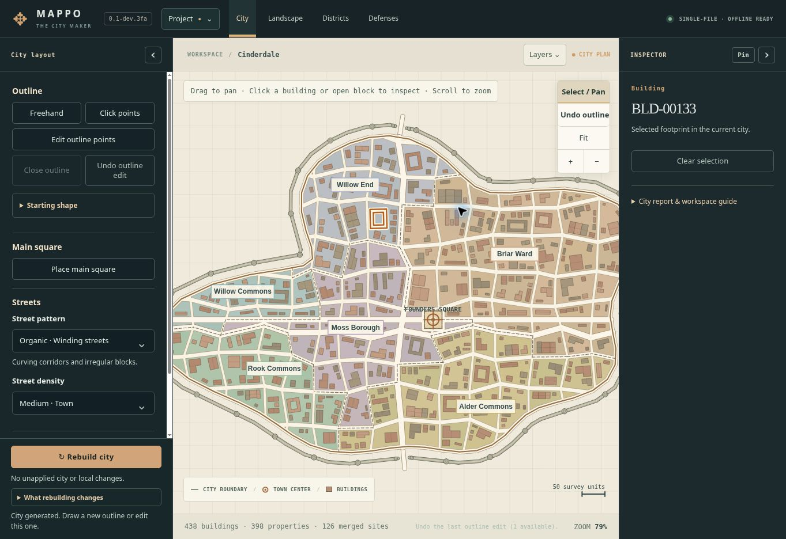
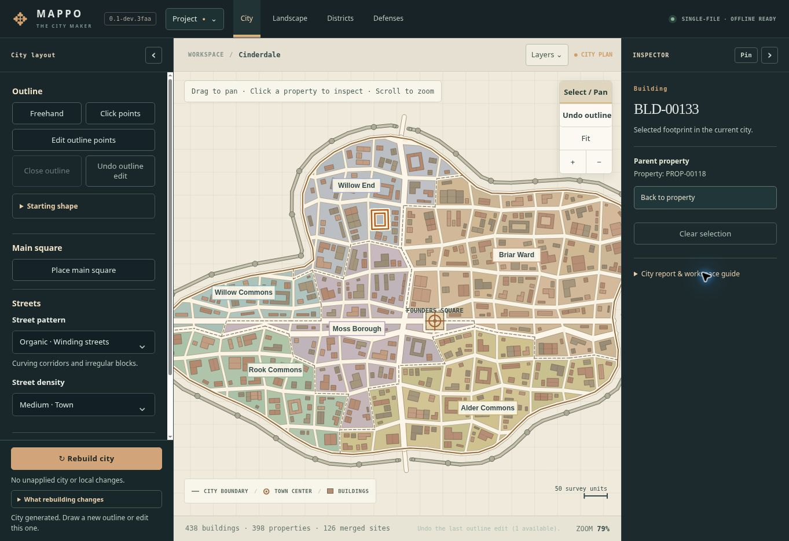
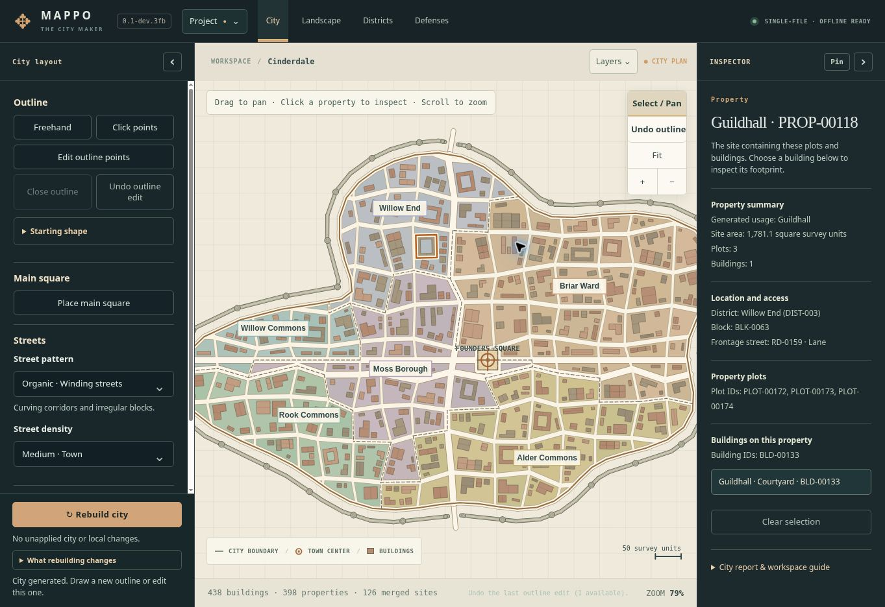
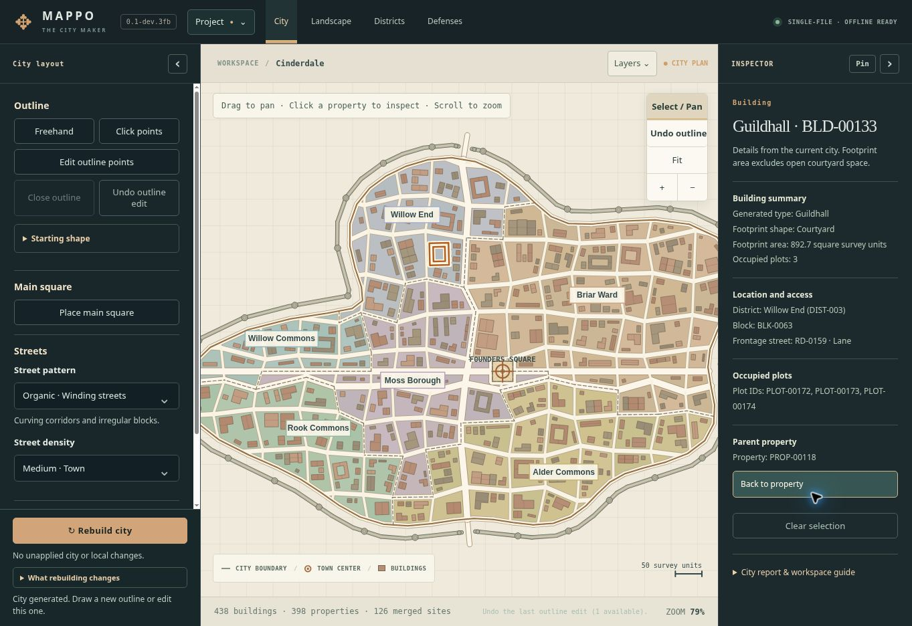
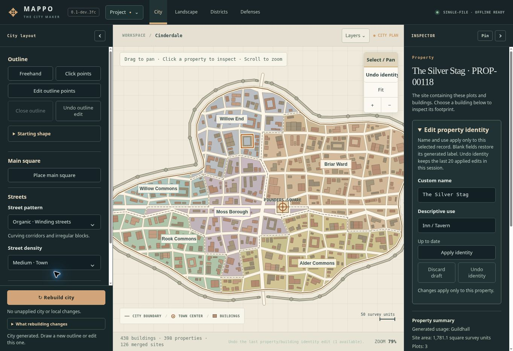

# Mappo Screenshot Gallery

> **Historical 3F screenshot gallery:** These are original milestone images, retained as development evidence. They do not represent the full published v0.2.0 Generation/Add/Roads workspace. See the [current user guide](user-guide.md).

[Project home](../../README.md) · [Documentation](../README.md) · [3F history](../history/3f/README.md)

## 3F-A: Earlier building selection

*Initial building targeting, before the property-first refinement.*

## 3F-Aa: Selecting a site and its structures

*Clicking a roof, courtyard or yard selects its owning property.*

*A linked building can be inspected individually without losing its parent property context.*

## 3F-B: Generated information

*Site-level area and linked plot/building data.*

*The individual building has independent footprint and occupancy facts.*

## 3F-C: Identity editing

*Custom names and descriptive uses are independent from generated geometry.*

These are original milestone screenshots and may differ slightly from the current interface.
