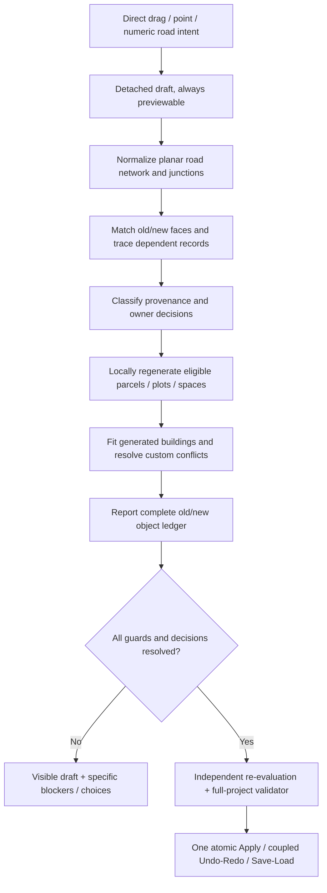

# Mappo 0.2C — Road-First Editing and Intelligent City Adaptation

**Decision:** 2026-11-19 · Owner-approved product direction.  
**Status:** Proposed detailed technical execution plan, documentation only. No feature code, schema change, merge or release authorized by this document.  
**Base:** Mappo 0.2A and 0.2B including B5 on `main`.  
**Supersedes:** The earlier 0.2C "Flexible Road Editing" cycle definitions in this path. Their safety engineering remains relevant, but preservation does not give generated properties veto power over deliberate street placements.

## 1. Product contract: the user draws the roads, Mappo arranges the city

The road network is the primary layout authority. The user directly moves, reconnects, adds, deletes and reshapes eligible ordinary streets, then Mappo proposes an intelligent **local** regeneration of affected blocks, properties, plots, open space and compatible buildings. The user can subsequently manually edit properties and boundaries after the 0.2D road usability milestone. An old generated parcel is an input to adaptation, *not a road-placement prohibition*.

Primary story: "Drag a street to where I want it; preview the revised streets, blocks, properties and buildings; accept the whole adaptation in one reversible operation; fine-tune parcels afterward."

The editor must **distinguish three different outcomes**:
1. **Draftable:** A user's valid pointing/coordinate gesture can define a road intent even if current buildings, properties or face topology do not fit. Display the road intent and its consequences instead of refusing to draw it.
2. **Reconciled candidate:** A deterministic, dependency-complete updated city can be built. Show exactly which objects moved, resized, regenerated, stayed untouched, need a decision or could not be resolved.
3. **Apply-ready:** Every dependency, protection, user authorization, schema contract and full-project validation gate has passed on an independently recomputed candidate. A draft by itself is never permission to write the city.

### User-facing acceptance stories
- Drag an ordinary street by a visibly significant distance in a developed organic city. Mappo updates incident streets, block shapes and generated parcels around the accepted position rather than forcing trial-and-error 0.001-unit moves.
- Edit streets in radial, planned and linear layouts, including the creation/closure of ordinary block faces. Resolve crossings through the explicit network-normalization tool as its cycle becomes available.
- Automatically reflow an untouched generated parcel/plot as needed, or preserve it intact if still compatible, while retaining stable semantic information where provable.
- Present a preview of generated-building shifts or replacements, with summary and confirmation. Protect a user's custom building placement by default and offer explicit, validated conflict choices.
- Apply once; Undo once restores the *entire* previously accepted neighborhood and its identity metadata; Save/Load reproduces exactly the accepted change.
- When an operation truly cannot complete (protected water/defense crossing, impossible plot access, unsupported ownership semantics), leave the street *draft visible* with precise blockers and choices; never silently mutate or drop content.

## 2. Editorial hierarchy / provenance policy

**A. User-authored intent has priority.** A deliberately placed ordinary road defines the proposed layout. Other generated content should adapt to it, not silently override it. Existing protected infrastructure (shorelines, rivers, bridges, city boundary, plaza, fortifications, terrain-pass structures) needs a dedicated separate edit and cannot be casually overwritten.

**B. Generated, not customized:** Automatically reshape/regenerate *inside the affected local neighborhood* using reproducible seeds/IDs and the new road-derived blocks. Metadata with unambiguous continuity can survive. If a property/building is replaced, report its old/new IDs and disposition; do not pretend that geometric regeneration is identity preservation.

**C. User-customized:** The user's edits, fixed building positions, named/custom records, manual geometry and unknown extension semantics are protected preferences. If road-first reflow conflicts with them, preview preservation options and ask the user to decide. Never secretly delete, move or reassign authored work.

**D. Mixed and legacy:** Existing schema-9 records may not carry reliable "generated versus customized" provenance. **Do not infer the status from shape, timestamps, naming conventions or IDs.** Treat ambiguous records conservatively until explicit provenance or user choice is available. Build a typed provenance/decision ledger before any acceptance of broad regeneration. If provenance storage cannot be accommodated without a schema migration, design schema 10 separately and seek authorization.

**E. Immutable special features:** Water, coastline, protected road links, mountain passes, gates/defenses and perimeter remain governed by their own validators. "Road-first" does not mean that unconstrained drafts can be silently accepted across those systems.

## 3. Road intent → reconciliation pipeline

**Data model boundaries:** Represent user road intent separately from accepted street/parcel records. Internal candidates include: original reference/fingerprint/revision, operation, geometric changes; new planar graph; old/new face pairing; typed object disposition (preserved, moved, resized, generated, replaced, retired, unresolved); provenance; ownership remaps; building impacts; diagnostics; decision inputs; validation and deterministic reproducibility keys. Never use one `valid` boolean for all of these stages.

**Determinism:** Stable sorting, bounded work, explicit tolerances and predictable new IDs. Distinct geometry operators must produce the same candidate from equivalent accepted data/intent/choices. Candidate status is *not* identical to final Apply status.

**Locality:** Recompute only the road-induced connected impact zone plus a tested safety margin; prove global reference closure and run global validation. Unrelated block/property/building metadata and geometry remain untouched. Never regenerate the entire city to make a local road move work.

**Identity:** Retain ID on verified one-to-one continuity. On split/merge, introduce deterministic provisional IDs and an auditable old→new provenance ledger; ownership cannot be assigned arbitrarily. Compatible generated content may be regenerated according to an explicit policy; user-custom content requires a decision. Preserve all unknown fields unless semantics are affirmatively understood or individually approved.

**Atomicity:** Preview/Reset/Cancel/search must not write accepted state, saved files, recovery or history. Apply checks latest city identity, revision, operation, resolutions, fingerprint, candidate equality and schema format; one accepted replacement, one recovery revision, coupled Undo/Redo.

## 4. Road-first development cycles

### C1 — Direct freeform road-intent editing (preview foundation)

**Deliverable:** Mouse/touch drag of an ordinary road or its endpoints, keyboard nudges and numerical adjustment, with obvious original/proposed street overlays. **The drag sets where the user wants the road**, not where current parcels permit it. Drafts can be blocked for Apply without being blocked from positioning/inspection. Clear reason categories: planar topology to normalize, generated neighborhood to reflow, protected infrastructure conflict, authored-content decision needed.

**Implementation:** Split draft intent from B4 acceptance, support multi-junction transaction geometry and bounded performance; migrate proven geometry preview, field-audit and cancellation infrastructure from PR #34 selectively. The earlier "Find a valid move" can remain optional diagnostics, not the default editing workflow. No property-dependent movement whitelist in drag handling. For C1 alone, Apply remains limited to cases the existing B4 transaction can authoritatively validate.

**Positive gate:** In a developed city, drag a street several screen pixels / materially measurable world units and see the *chosen position* persist as a detached draft even if parcels conflict. Test reversals, snapping/no-snap, mouse/pointer/touch, high zoom, pan vs drag, stale draft, rollback and complete state immutability. **C1 is an interaction/foundation checkpoint, not a promise that all drafts can already be applied.**

### C2 — Intelligent neighborhood reflow and provenance foundations

**Deliverable:** Trace affected road faces into blocks, generated properties, plot subdivisions, frontage/access and open space; locally adapt/regenerate around the *user's target street geometry*. Provide an explicit typed old→new inventory, stable one-to-one identities, split/merge handling and generated-vs-custom/unknown classification. Initial supported Apply includes realistic road translations on developed neighborhoods with fully resolved generated records.

**Implementation:** Deterministic parcel reflow, non-intersecting footprints, street setbacks, frontage, building plot access, zoning/ownership references, district relationships and spare-area accounting. Preserve untouched parcels, and preserve user-custom geometry when valid. For unsupported building conflicts, keep draft and report decision needed; don't invent a fallback.

**Positive gate:** Several materially visible **Apply→Undo→Redo→Save/Reload** road moves on developed layouts with no missing/orphan records and no changes to unrelated custom work. Include unusual parcel geometry, multiple plots/roads, empty land and formerly false-rejected "unchanged frontage" cases. Prove local changes are smaller than global regeneration.

### C3 — Planar network restructuring

**Deliverable:** Add/delete/reconnect ordinary streets, create/manage intersections, and handle ordinary face splits/merges after road intent moves through the network. Basic eligible road class changes where their semantics can be proved. Crossings are explicitly normalized into shared junctions with deterministic IDs and compatible block reflow; no silent crossing edges.

**Gate:** Each shipped tool has multiple positive, negative and recovery test cases. Split/merge provenance, preserved districts, ownership relationships, non-self-intersecting graph, protected features, serial round-trips, and inverse history must pass. Operations not supported in the validator remain preview/decision-required, not a fake Apply.

### C4 — Road shaping, bends and path controls

**Deliverable:** Direct control of road path via straight-segment/polyline handles, insert/remove/move bend points, practical snapping and precise controls. The same network normalization and reflow pipeline from C2–C3 is reused. Curved/smoothed display is only promoted to persistent geometry when topology and storage semantics are approved.

**Gate:** Multi-bend streets, complex intersections, reversal, repeated editing, nearly coincident nodes, water/boundary collision, save/reload equivalence, touch and high-resolution desktop/ultrawide gestures. No unsupported spline persistence or stealth schema change.

### C5 — Adaptive buildings and explicit custom-work resolution

**Deliverable:** Refit, move, regenerate or replace eligible **generated and untouched** buildings in the adapted neighborhood. Show old→new footprint and placement, impact counts and identity policy. Provide user decisions for custom/legacy-unknown buildings: retain as fixed obstacle, choose another placement, explicitly authorize a transformed outcome, or cancel.

**Gate:** No silent deletion, overwriting or reassignment of authored/unknown records. Buildings have complete parcel/plot/frontage/entrance/clearance consistency, correct metadata, and auditable provenance. Test multi-property developed zones, conflict UIs, cancellations, custom-preservation defaults and complete Undo/Redo.

### C6 — Unified road-first experience and release acceptance

**Deliverable:** A cohesive editor: select/drag streets, preview adaptive neighborhood, understand blockers, resolve generated/custom decisions, Apply/Undo/Redo, inspect affected records, save and continue to manual property editing. Replace trial-and-error "find permissible moves" as the primary interaction. Clearly describe operations still limited by protected infrastructure.

**Gate:** Multiple real end-user tasks with intentional road movements in **all four morphologies**, including changes larger than precision nudges and block topology edits. Full Node suite, legacy schema-9 fixtures, deterministic project reload, finite work/performance, reproducible offline versioned HTML and root parity; Chromium/Firefox desktop 1440×900, ultrawide 5120×1440, tablet 768×1024, phone 390×844; keyboard/pointer/touch checks and physical-device accessibility checklist. C6 is complete only when users can deliberately lay out streets and see intelligent city adaptation, not merely when diagnostic errors are correct.

### C7 — Unified junction adaptation

Approved follow-up to C6. Moving an ordinary junction uses the same road-first reflow, crossing normalization, building choices and atomic Apply as moving a street. The draft keeps the user's target junction position visible when a protected edge or unresolved conflict blocks Apply.

Verify substantial junction movement in all four morphologies, shared intersections, protected features, custom-building approval, Undo/Redo and schema-9 reload. Check responsiveness on a larger city. The C6 physical touch and screen-reader checks still apply before closing 0.2C. The fuller replacement report and everyday preview redesign belong in 0.2D.

## 5. Acceptance/merge workflow and relationship to existing C1 PR #34

- **PR #34 is a reusable experimental branch, not a completed C1 against this new product contract.** Its accepted-junction history, geometry, preview/report and schema safeguards may be ported after focused review. Do not merge PR #34 unchanged into `main`, despite passing its earlier technical CI.
- Adopt this new design on a separate **documentation PR** so `main` can track the decision without prematurely accepting incomplete road-edit code.
- Start the redefined C1 from the latest merged `main`, carrying forward only audited reusable portions of PR #34. Avoid presenting a tiny positive candidate survey as evidence of an intuitive road editor.
- Each C-cycle has a defined preview/reconciliation/Apply contract, positive behavior tests and review gate. C1 draft acceptance is distinct from C2 accepted neighborhood changes.
- Prefer a single coherent implementation pass/commit per scoped checkpoint (with required fixes as necessary), versioned standalone HTML and a PR. No merges/release/schema change without explicit approval. Do not delete historical compiled versions.
- Keep ordinary property-first selection, manual building/property tools, water/terrain editors and all existing 0.1/0.2 saved-project fixtures working throughout.

## 6. Subsequent 0.2 roadmap

[C7 finalization](C7_JUNCTION_FINALIZATION_PLAN.md) contains the remaining 0.2C acceptance work. [0.2D](MILESTONE_0_2D_ROAD_UX_PLAN.md) focuses on the experience of moving roads. Manual parcel creation, splitting, merging, boundary edits, and plot divisions follow. The later building, civic, and release phases remain on the roadmap with labels subject to sequencing review. Schema 9 remains the baseline. 3D remains deferred.

## 7. Decision record

**Owner approved now:** Road-first product philosophy, intelligent local adaptation, user-fine-tuned properties afterward, and restructuring C1–C6 around that outcome and adding C7 to unify junction editing.
**Separate decisions still required:** Any destructive custom-work transformation, schema migration, implementation PR merge, and release. This document does not assert complete implementation.
