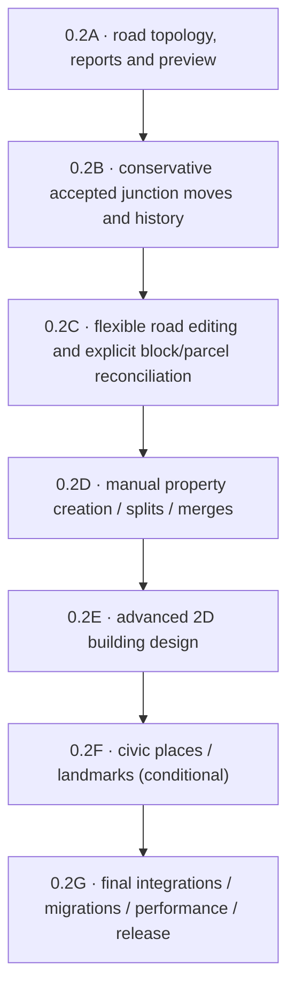

# Mappo 0.2 — 2D City Designer roadmap

> **Official direction updated 2026-11-18:** 0.2C is Flexible Road Editing, followed by dedicated manual property restructuring. This is an **approved planning direction, not approval to implement** C1–C6 or merge any PR.
>
> Primary objective: complete a dependable, highly editable **2D** fantasy city designer before pursuing 3D.

[0.2C detailed design](MILESTONE_0_2C_DESIGN.md) · [0.2B design](MILESTONE_0_2B_DESIGN.md) · [Road preservation contract](ROAD_EDIT_CONTRACT.md) · [Repository roadmap](../../ROADMAP.md)

## Release thesis

A procedural city is a starting point, not something users must accept unchanged. Users should intentionally edit roads, blocks, properties, buildings and places while retaining unrelated creative work. New geometry never licenses silent regeneration or destruction.

## Revised dependencies and phases

| Phase | Revised scope | Planned development cycles | Completion principle |
| --- | --- | --- | --- |
| **0.2A — foundations** | Graph, stable faces, impact reports, interactive read-only preview | A1–A5 | Inspections never write accepted project |
| **0.2B — conservative Apply** | Local junction candidate, compatible parcel adaptation, before/after view, atomic Apply/history, hardening | B1–B5 | Supported ordinary moves persist, safely reversible; reject unresolved cases |
| **0.2C — flexible roads** | Bounded segment movement, topology/ownership decision model, adding/removing/reconnecting/classifying ordinary roads, reshape handles, adaptation, integration | **C1–C6** — [detailed plan](MILESTONE_0_2C_DESIGN.md) | Each shipped operation has proven positive examples and full preservation gates |
| **0.2D — properties** | Manual parcel creation, split, merge, plot/ownership reconciliation, validation/history | D1 create, D2 split, D3 merge, D4 dependent objects, D5 QA | Property-first identity preserved, no orphaned buildings |
| **0.2E — buildings** | Richer 2D footprints, precision placement/editing, categories, QA | E1 shapes, E2 manual geometry, E3 categories, E4 QA | Precise buildings with accessible custom metadata |
| **0.2F — civic spaces** (conditional) | Editable markets, squares, gardens, landmarks; identity and district links | F1 records, F2 tools, F3 identity, F4 integration | Optional; may defer if 0.2 release scope requires |
| **0.2G — release** | Cross-editor polish, legacy migration, performance, browsers, release candidate | G1 workflows, G2 save/migrate, G3 perf, G4 QA, G5 RC | Offline standalone HTML, verified old saves, cross-browser regression |

These are *planning cycles*, not automatic one-to-one commits or PRs. Each specific implementation scope and merge requires separate approval. If the conditional civic phase is deferred, the final release phase remains the final release gate (its name may be relabeled later by an approved roadmap update).

## Reordering from the original plan

Originally 0.2C was manual property create/split/merge, followed by 0.2D buildings, 0.2E optional landmarks and 0.2F release. The owner **approved moving flexible road editing into 0.2C**; manual property editing moves to 0.2D, buildings to 0.2E, civic spaces to 0.2F, and release hardening to 0.2G.

C2 creates the *internal* block/property ownership reconciliation necessary for road edits. It does **not** replace the manual property-creation/split/merge tools planned for 0.2D.

## Global edit policy

1. Preserve accepted IDs, names, ownership, metadata, building positions, access, district/defense and protected water/terrain geometry unless a separately validated explicit change is approved.
2. Show before/after changes, dependencies and blockers; don't confuse a graph-valid road with a safe neighborhood transaction.
3. Apply only from fresh, independently recomputed and completely validated candidates. Failed/cancelled previews leave files, history and recovery untouched.
4. Use one coupled Apply/Undo/Redo record, no silent data loss or unrelated neighborhood regeneration.
5. Maintain **schema 9** unless a real persistence change requires a separately approved schema-10 migration.
6. Deliver modular development source and versioned, reproducible **single-file offline HTML**. Test Node and Chromium/Firefox desktop, ultrawide, tablet and phone viewports.
7. Preserve property-first selection and older distribution artifacts.
8. Protected edges and unsupported splits/merges stay blocked until independently proved.

## Status and authority

- **0.1.0:** released.
- **0.2A:** implemented/merged, including A5 impact report improvements.
- **0.2B:** B1–B4 merged. B5 stabilization [PR #32](https://github.com/xbwtyz/Mappo/pull/32) passed full CI and is **awaiting separate merge approval** as of the roadmap decision.
- **0.2C:** direction and design **approved for planning**, but implementation **has not started**. C1 starts only after an explicitly approved B5 merge and separate C1 implementation approval.
- **0.2D–G:** roadmap-level plans only; cycle scopes subject to future review.
- **3D:** deferred until the 2D city designer is capable and stable.
