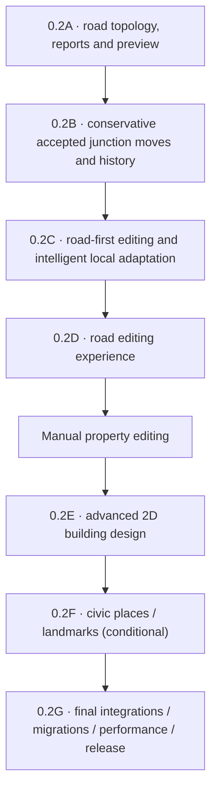

# Mappo 0.2 — 2D City Designer roadmap

> **Road-first direction approved 2026-11-19:** Users place and reshape streets; Mappo intelligently adapts generated neighborhoods; users then fine-tune properties and boundaries. This planning update does not merge or release feature code.
>
> Primary objective: deliver a dependable, fully editable **2D** city designer before 3D. Road geometry is the primary layout authority; generated parcels adapt to street decisions.

[0.2C road-first design](MILESTONE_0_2C_DESIGN.md) · [C7 finalization](C7_JUNCTION_FINALIZATION_PLAN.md) · [0.2D work plan](MILESTONE_0_2D_ROAD_UX_PLAN.md) · [C1 transition](C1_ROAD_FIRST_TRANSITION.md) · [0.2B design](MILESTONE_0_2B_DESIGN.md) · [Road preservation contract](ROAD_EDIT_CONTRACT.md) · [Repository roadmap](../../ROADMAP.md)

## Release thesis

A procedural city is a starting point, not something users must accept unchanged. Users should intentionally edit roads, blocks, properties, buildings and places while retaining unrelated creative work. New geometry never licenses silent regeneration or destruction.

## Revised dependencies and phases

| Phase | Revised scope | Planned development cycles | Completion principle |
| --- | --- | --- | --- |
| **0.2A — foundations** | Graph, stable faces, impact reports, interactive read-only preview | A1–A5 | Inspections never write accepted project |
| **0.2B — conservative Apply** | Local junction candidate, compatible parcel adaptation, before/after view, atomic Apply/history, hardening | B1–B5 | Supported ordinary moves persist, safely reversible; reject unresolved cases |
| **0.2C — road-first streets** | Direct road manipulation, local generated-neighborhood adaptation, topology normalization, paths, building conflict policy, integrated editor | **C1** road-intent drag and preview; **C2** intelligent parcel/ownership reflow; **C3** street topology operations; **C4** paths/bends; **C5** generated building fit and custom conflict decisions; **C6** end-to-end editor/QA; **C7** unified junction adaptation | Users choose streets; generated city adapts, while authored work is protected; one reversible Apply |
| **0.2D — road editing experience** | Map previews, building choices, and recovery from blocked drafts | D1 preview, D2 building choices, D3 recovery, D4 usability and release review | Users can move roads and resolve conflicts without needing the technical report |
| **After 0.2D — manual properties** | Parcel creation, split, merge, boundary changes, and plot reconciliation | Milestone label and cycles pending | Property-first identity preserved, no orphaned buildings |
| **0.2E — buildings** | Richer 2D footprints, precision placement/editing, categories, QA | E1 shapes, E2 manual geometry, E3 categories, E4 QA | Precise buildings with accessible custom metadata |
| **0.2F — civic spaces** (conditional) | Editable markets, squares, gardens, landmarks; identity and district links | F1 records, F2 tools, F3 identity, F4 integration | Optional; may defer if 0.2 release scope requires |
| **0.2G — release** | Cross-editor polish, legacy migration, performance, browsers, release candidate | G1 workflows, G2 save/migrate, G3 perf, G4 QA, G5 RC | Offline standalone HTML, verified old saves, cross-browser regression |

These are **planning cycles**. C1 establishes genuinely movable street drafts; C2 and later stages make more complex developed-neighborhood updates safely Apply-able. Neither a graph-valid draft nor a tiny accepted nudge completes the road-first feature. Implementation and merge approvals remain separate.

## Reordering from the original plan

The initial road-first roadmap moved manual property editing out of 0.2C. The follow-up puts road usability in 0.2D and schedules manual property editing after it. Later phase labels are provisional until their sequencing is reviewed.

## Road-first edit policy

1. The ordinary road **intent** is user-authored, so the UI may preview meaningful relocations despite invalidated existing parcels. Draftability and Apply-readiness are different states.
2. Generated, untouched parcels and plots may be locally regenerated around new streets. Compatible old identities/metadata remain; genuine split/merge replacements receive explicit audited lineage. No silent global regeneration.
3. Generated, unmodified buildings may adapt when C5 proves full access/placement validation. User-customized and legacy-unknown records remain protected unless explicit decisions authorize a change.
4. Water, coastlines, outline, bridges, terrain, plaza, districts and fortification infrastructure retain separate protection and validation requirements.
5. Apply revalidates topology, reference ownership, local adaptation, full project/schema compatibility and preview freshness; one coupled Undo/Redo and one recovery revision. No silent loss.
6. Maintain schema 9 until separately approved schema migration, existing property-first workflow, older versions, modular source and reproducible offline HTML. Run Node and Firefox/Chromium device/viewport QA.
7. Manual parcel changes follow the 0.2D road usability milestone.

## Status and authority

- **0.1.0:** released.
- **0.2A:** implemented/merged, including A5 impact report improvements.
- **0.2B:** B1–B5 merged, including stabilization PR #32.
- **0.2C:** C1–C6 merged. [C7 PR #42](https://github.com/xbwtyz/Mappo/pull/42) is in draft with the remaining release checks recorded in the C7 plan.
- **0.2D:** Road experience work plan documented. Implementation awaits the C7 baseline and separate approval.
- **Later phases:** Roadmap-level plans with sequencing subject to review.
- **3D:** deferred until the 2D city designer is capable and stable.
