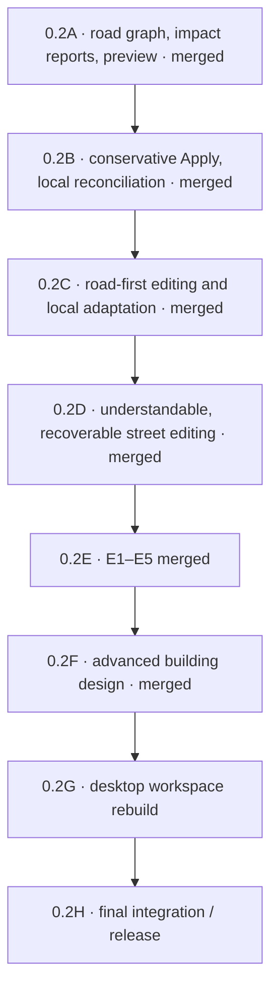

# Mappo 0.2 — 2D City Designer roadmap

> **Published:** 0.2A–G and H1–H5 are complete. [H5 PR #91](https://github.com/xbwtyz/Mappo/pull/91) was merged, [main CI](https://github.com/xbwtyz/Mappo/actions/runs/44960254289) passed, and [v0.2.0](https://github.com/xbwtyz/Mappo/releases/tag/v0.2.0) was published. Civic sites and 3D remain deferred.>
> Primary objective: a dependable, fully editable **2D** city designer before 3D. Users deliberately reshape roads; generated neighborhoods adapt where verifiably safe; then users fine-tune land and buildings.

[0.2E property plan](MILESTONE_0_2E_PROPERTY_DESIGN.md) · [E2 straight-split design](E2_PROPERTY_SPLIT_DESIGN.md) · [E3 approved merge design](E3_PROPERTY_MERGE_DESIGN.md) · [E4 approved plot-count design](E4_PLOT_COUNT_DESIGN.md) · [E4 acceptance report](E4_ACCEPTANCE_REPORT.md) · [E5 approved acceptance plan](E5_INTEGRATED_ACCEPTANCE_PLAN.md) · [E5 acceptance report](E5_ACCEPTANCE_REPORT.md) · [E3 acceptance report](E3_ACCEPTANCE_REPORT.md) · [0.2F building plan](MILESTONE_0_2F_BUILDING_DESIGN.md) · [0.2G desktop workspace plan](MILESTONE_0_2G_DESKTOP_UI.md) · [G1–G4 implementation](G1_G4_IMPLEMENTATION_PLAN.md) · [0.2G mockups](assets/Mappo_0.2G_UI_Mockups.pdf) · [0.2H release plan](MILESTONE_0_2H_RELEASE_PLAN.md) · [H3 performance results](H3_PERFORMANCE_AUDIT.md) · [H4 final QA report](H4_RELEASE_QA_REPORT.md) · [H5 release-candidate report](H5_RELEASE_CANDIDATE_REPORT.md) · [G4 acceptance report](G4_ACCEPTANCE_REPORT.md) · [0.2D closeout](MILESTONE_0_2D_ROAD_UX_PLAN.md) · [0.2C road-first design](MILESTONE_0_2C_DESIGN.md) · [Road preservation contract](ROAD_EDIT_CONTRACT.md) · [Repository roadmap](../../ROADMAP.md)

## Release thesis

A generated city is a starting point, not something users must accept unchanged. Road, property, plot and building edits must be previewable, independently validated and reversible without silently destroying unrelated authored work. **Real structural land editing is a prerequisite for advanced architecture**, because a building's footprint, plot membership, access and identity depend on its parent parcel.

## Revised dependencies and phases

| Milestone | Scope | Proposed/completed development cycles | Completion principle |
| --- | --- | --- | --- |
| **0.2A — foundations** | Road graph, stable faces, impact reports, read-only preview | A1–A5 **merged** | Inspect without mutation |
| **0.2B — conservative Apply** | Local adaptation, candidate preview, whole-edit Apply and history | B1–B5 **merged** | One verified reversible edit |
| **0.2C — road-first streets** | Street manipulation, generated-neighborhood reflow, topology, bends, building conflict policy | C1–C7 and P1–P7 **merged** | Streets drive supported local adaptation; protect authored work |
| **0.2D — road editing experience** | Readable map preview, contextual building decisions, blocked recovery and acceptance | D1–D4 **merged** in PRs #51–#53, #56 | Understand/rescue edits without technical reports |
| **0.2E — manual property restructuring** | Create/split/merge parcels, adjust plot counts and reconcile dependent references | **E1** create (merged #58); **E2** split (merged #60); **E3** merge (merged #62); **E4** plot-count editing (merged #64); **E5** integrated QA (merged #66) | No orphaned buildings or unapproved identity loss |
| **0.2F — advanced building design** | Extended 2D footprints, direct vertex/wing/hole editing, meaningful categories, QA | **F1** shapes (merged #68); **F2** direct geometry (merged #69); **F3** uses (merged #70); [**F4** integrated QA](F4_ACCEPTANCE_REPORT.md) (merged #71) | True new capabilities, no duplication of 3G/3H |
| **0.2G — desktop workspace rebuild** | Desktop and laptop UI with shared selection, Inspector, preview, and edit controls | **G1–G4 merged**; G4 acceptance [PR #87](https://github.com/xbwtyz/Mappo/pull/87) | Feature parity and a clear path from selection to decision to Apply |
| **0.2H — release hardening** | Cross-editor integration, migration audit, performance, browsers, release candidate | [**H1–H5 detailed plan**](MILESTONE_0_2H_RELEASE_PLAN.md); H1–H5 merged; stable v0.2.0 published | Stable offline standalone with tested old saves |

The new milestone identifiers replace **older active roadmap labels**; they do not rename or invalidate already merged 0.2C/0.2D commits, earlier planning branches, historical QA records or compiled distributions. Old proposals with conflicting labels remain archived context, not the current implementation authority.

## Why the order changed

1. **Original road-first revisions:** Manual property creation/split/merge was previously called 0.2C or 0.2D. Road-first editing and then its usability work took those labels instead.
2. **Post-0.2D correction:** Rather than leave manual property restructuring as an unnamed step, it is now explicitly **0.2E**. Building design followed as **0.2F**. The desktop workspace rebuild now takes **0.2G**, with civic places deferred and release hardening in **0.2H**.
3. **Reuse existing work:** 3I already edits existing corners/dividers; 3G/3H already support building transformations, placement and basic footprint presets. New phases must extend those tools, not repeat them.
4. **Dependencies:** Property/plot creation and successor ownership must be proven before adding more complex manually authored footprints that depend on them.

## Preservation and release policy

1. An ordinary road move or land/building draft may be *previewable* without being Apply-ready. Never silently rebuild protected authored/unknown records.
2. Generated untouched parcels/buildings may adapt locally only when provenance, validated geometry and dependencies justify it. Where identity lineage or placement is ambiguous, expose the blocker and require explicit resolution.
3. Preserve stable IDs and names where provable; make split/merge predecessor/successor lineage explicit. Old customized or legacy-unknown buildings cannot be silently deleted or reassigned.
4. Validate whole-project topology, block/parcel/plot ownership, building geometry, access, civic/landscape protections, independent Apply and stale draft rejection. Use one atomic transaction with Undo/Redo.
5. v0.2.0 ships format 1, project schema 9, property-first selection, modular sources and desktop Chromium/Firefox QA. Any new schema requires a separately approved design; **supporting every historical save in future releases is optional**. Existing 0.2.0 migrations/tests are unchanged.
6. [Issues #44 and #46](H3_PERFORMANCE_AUDIT.md) were closed following the owner's H3 review of reproduced performance evidence. Occasional shorter frame hitches remain a documented limitation; any future disruptive real-user freeze warrants a narrowly reproduced new issue rather than unbounded performance optimization. [Issue #79](https://github.com/xbwtyz/Mappo/issues/79) dead-end road deletion remains open and outside 0.2.0.
7. No mandatory onboarding tours, participant recruitment, forced feedback prompts or owner-run acceptance tasks.

## Status and next action

- **0.1.0:** archived first stable release, still downloadable.
- **0.2A–D:** merged on `main`, with D4 closeout in [PR #56](https://github.com/xbwtyz/Mappo/pull/56).
- **0.2E:** merged through [E5 #66](https://github.com/xbwtyz/Mappo/pull/66).
- **0.2F:** Complete through [F4 #71](https://github.com/xbwtyz/Mappo/pull/71). [F4 acceptance](F4_ACCEPTANCE_REPORT.md) covers cross-editor behavior and performance.
- **0.2G:** [G4 accepted and merged in PR #87](G4_ACCEPTANCE_REPORT.md). Generation/Add/Roads is the canonical desktop workspace.
- **0.2H:** [H1–H5 hardening](MILESTONE_0_2H_RELEASE_PLAN.md) is complete. [PR #91](https://github.com/xbwtyz/Mappo/pull/91) merged and [v0.2.0](https://github.com/xbwtyz/Mappo/releases/tag/v0.2.0) published. The [H5 report](H5_RELEASE_CANDIDATE_REPORT.md) is preserved pre-release evidence; Pages is still a separately approved deployment.
- **3D:** later, after 2D is capable and stable.

Historical design plans under `docs/history/`, old planning branches and `dist/` remain unchanged.
