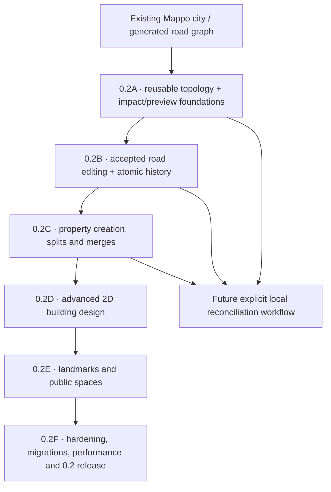

# Mappo 0.2 — City Designer milestone

> **0.2A implementation authorized 2026-11-18; later phases remain proposals.**
> Decision recorded 2026-11-18: prioritize a complete **2D city designer**, defer a 3D renderer.
> Road editing policy: **staged editing** — strict preservation first, then separately designed, explicit impact review and controlled local reconciliation.

[0.2A implementation proposal](MILESTONE_0_2A_PLAN.md) · [0.2A preservation/QA contract](ROAD_EDIT_CONTRACT.md) · [Repository roadmap](../../ROADMAP.md)

## Outcome and release thesis

Mappo 0.1 can generate a city and edit selected properties and building geometry. **Mappo 0.2 should let users deliberately redesign a generated city's roads, parcels, buildings, and meaningful places without silently regenerating or destroying unrelated work.**

The generator creates the city. The editor preserves and evolves it.

## Dependency layout

Road dependency chain: **road nodes/segments → planar faces (blocks, plaza, wet/terrain faces) → property frontage/block membership → plots → buildings → district/defense dependencies.**

## Proposed milestones and checkpoint layout

| Phase | Scope | Checkpoints | Definition of success |
| --- | --- | --- | --- |
| **0.2A — Road foundations** | Reusable topology, stable identity matching, impact detection, read-only road/junction adjustment preview | **A1:** graph API; **A2:** face/block extraction and matching; **A3:** object impact reports; **A4:** interactive preview and QA | Proposed road changes can be inspected without changing accepted city; no Apply in A4 |
| **0.2B — Road editing** | Selection, move/add/remove/classify, safe Apply, Undo/Redo | **B1:** selection; **B2:** move; **B3:** add; **B4:** remove/classify; **B5:** atomic Apply/history | Safe edits commit without global regeneration; review-required edits remain blocked until explicit reconciliation is designed |
| **0.2C — Property restructuring** | Create parcels, split, merge, reconcile plots and owned buildings | **C1:** create; **C2:** split; **C3:** merge; **C4:** dependent IDs/ownership; **C5:** validation/history | Property-first workflow continues; no silent orphaning or automatic destruction |
| **0.2D — Building design** | Expanded footprint vocabulary, manual placement control and meaningful categories | **D1:** shapes; **D2:** footprint editing; **D3:** categories; **D4:** integrated QA | Users can intentionally customize diverse building geometry |
| **0.2E — Civic places** | Squares, markets, gardens and landmark identities | **E1:** public-space records; **E2:** tools; **E3:** identity; **E4:** district integration | Meaningful, editable places; **conditional** phase that may be deferred if stability needs priority |
| **0.2F — Release** | Editing usability, migration, browser regression, performance and release candidate | **F1:** workflows; **F2:** saves/migrations; **F3:** performance; **F4:** QA; **F5:** RC | Supported legacy projects migrate; standalone HTML runs offline; cross-browser checks green |

The checkpoints are planning units, **not automatically 27 PRs**. Work can be grouped when independently testable. No feature or PR is authorized merely by its inclusion here.

## Chosen editing strategy: staged preservation

1. **Strict-first:** reject acceptance when an edit would break any existing property, plot, building, frontage, district, water/terrain, or other protected relationship.
2. **Explain consequences:** distinguish a valid network with dependent-object conflicts (**Needs review**) from malformed/disconnected geometry (**Invalid**).
3. **Separate local reconciliation:** allow future explicit, previewed transformations only after their preservation/Undo rules are approved in their own design checkpoint.
4. **Never quietly regenerate:** previously accepted identities and geometry do not disappear or renumber due to a road edit.
5. **Use a single atomic commit:** every future accepted topology edit and its approved dependent changes either complete together or do not apply at all.

## Scope boundaries and sequencing

**Not required for 0.2:** 3D renderer, population/economy simulation, NPCs, unrestricted curved splines, arbitrary concave parcels, hidden full-city regeneration after edits, or replacing every editing history with a universal timeline.

Roads can be represented as connected straight segments initially. Special edges (city boundary, plaza, banks, bridges, mountain foothills and passes) are protected in initial editing tools.

The existing project format remains **schema 9 unless a real persistence-model change requires schema 10**. For any new schema, migration from existing 0.1 saves and round-trip tests are a mandatory release gate.

## Project delivery rules

- Keep modular sources and a reproducibly compiled, **versioned single-file offline HTML** after each approved development checkpoint.
- Start from an agreed merged baseline and make each meaningful cycle on a separate feature branch.
- Node, compile/parity, Chromium and Firefox tests are required; include desktop, ultrawide, tablet and phone viewports for UI changes.
- Keep property-first selection as the primary land workflow. Existing names, custom uses, IDs and ownership must survive compatible edits.
- Preserve older standalone distributions and portable saves. Protect `main`; **never merge without separate owner approval**.
- The original planning branch remains a design reference. Implementation checkpoints start from merged `main`, with separate approval before each merge.

## Release-level acceptance contract

A 0.2 release is ready when a user can safely move/add/remove supported roads, create/split/merge properties, customize diverse 2D buildings, inspect all affected objects before applying, reverse accepted structural actions where feasible, and migrate old projects reliably. Scope may be narrowed rather than ship unstable subsystems.

## Planning state

- **Direction chosen:** 2D city designer.
- **Edit policy chosen:** strict preservation before controlled local reconciliation.
- **0.2A:** A1–A4 authorized in order; A1 merged as PR #22. A2 merged as PR #23. A3 merged as PR #24. A4 is implemented on `feature/mappo-0.2a-a4-road-preview` from merged main, pending separate review/merge approval. See [A1 record](A1_ROAD_GRAPH.md), [A2 record](A2_FACE_IDENTITY.md), [A3 record](A3_IMPACT_REPORT.md) and [A4 record](A4_ROAD_PREVIEW.md).
- **Not yet approved:** checkpoint merges, implementation of later phases, schema migration, release date.
