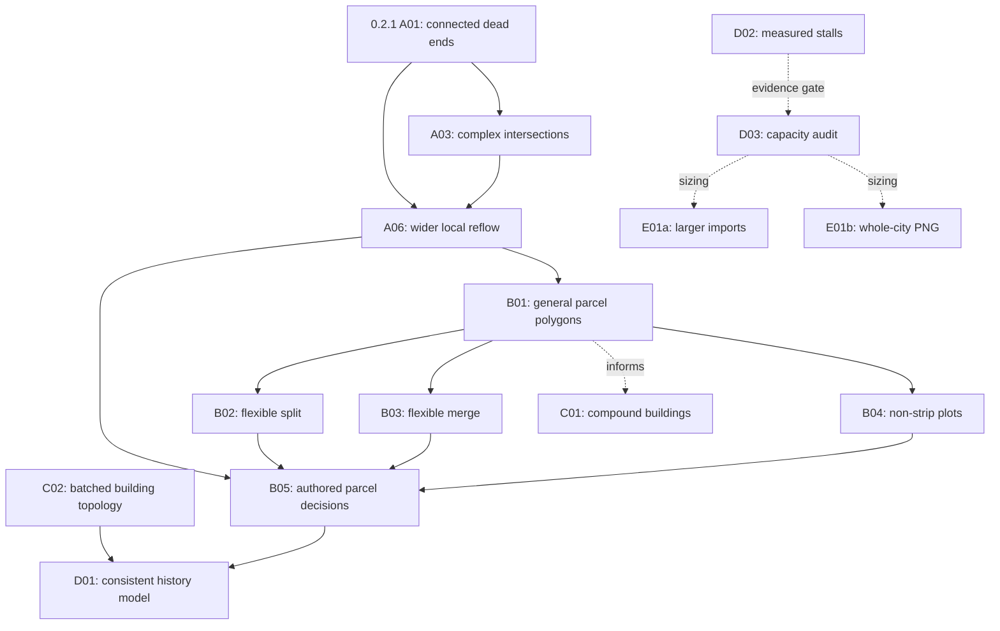

# Mappo 0.2.x — Engine Limitations Improvement Roadmap

> **Living dependency roadmap, reconciled November 22, 2026.** Development milestones 0.2.1–0.2.12 have merged into `main`. Stable release remains v0.2.0. Merge, release and Pages require separate approval.

## Problem and intended outcome

Mappo 0.2.0 is a working, offline 2D city editor. Its remaining constraints mostly arise from narrow but safe topology/parcel contracts, conservative ownership preservation, session-scoped history and bounded performance/file/export behavior. The **0.2.x goal** is to enlarge the range of valid user edits while retaining safe, deterministic, reproducible cities; it is **not** an excuse to relax validation blindly.

## Current 0.2.x development status

| Milestone | Issue | Status |
| --- | --- | --- |
| 0.2.1 A01 connected dead ends | [#79](https://github.com/xbwtyz/Mappo/issues/79) | Merged [PR #111](https://github.com/xbwtyz/Mappo/pull/111) |
| 0.2.2 A03 intersection normalization | [#95](https://github.com/xbwtyz/Mappo/issues/95) | Merged [PR #112](https://github.com/xbwtyz/Mappo/pull/112) |
| 0.2.3 A06 reflow/lineage | [#98](https://github.com/xbwtyz/Mappo/issues/98) | Merged [PR #113](https://github.com/xbwtyz/Mappo/pull/113) |
| 0.2.4 B01 irregular properties | [#99](https://github.com/xbwtyz/Mappo/issues/99) | Merged [PR #114](https://github.com/xbwtyz/Mappo/pull/114) |
| 0.2.5 B02 flexible property splitting | [#100](https://github.com/xbwtyz/Mappo/issues/100) | Merged [PR #115](https://github.com/xbwtyz/Mappo/pull/115) |
| 0.2.6 B03 partial-edge property merging | [#101](https://github.com/xbwtyz/Mappo/issues/101) | Merged [PR #116](https://github.com/xbwtyz/Mappo/pull/116); main CI passed |
| 0.2.7 B04 flexible plot partitions | [#102](https://github.com/xbwtyz/Mappo/issues/102) | Merged [PR #117](https://github.com/xbwtyz/Mappo/pull/117); [post-merge CI passed](https://github.com/xbwtyz/Mappo/actions/runs/45000385031); issue closed |
| **0.2.8 B05 authored parcel choices** | [#103](https://github.com/xbwtyz/Mappo/issues/103) | Merged [PR #118](https://github.com/xbwtyz/Mappo/pull/118); [post-merge CI passed](https://github.com/xbwtyz/Mappo/actions/runs/45075063510); issue closed |
| **0.2.9 C02 multi-operation building drafts** | [#105](https://github.com/xbwtyz/Mappo/issues/105) | Merged [PR #119](https://github.com/xbwtyz/Mappo/pull/119); [post-merge CI passed](https://github.com/xbwtyz/Mappo/actions/runs/45077771390); issue closed |
| **0.2.10 C01 compound building groups** | [#104](https://github.com/xbwtyz/Mappo/issues/104) | Merged [PR #120](https://github.com/xbwtyz/Mappo/pull/120); [main CI passed](https://github.com/xbwtyz/Mappo/actions/runs/45080212898); issue closed |
| **0.2.11 D01 unified session edit history** | [#106](https://github.com/xbwtyz/Mappo/issues/106) | Merged [PR #123](https://github.com/xbwtyz/Mappo/pull/123); [main CI passed](https://github.com/xbwtyz/Mappo/actions/runs/45092420094); issue closed |
| **0.2.12 E01b whole-city PNG export** | [#110](https://github.com/xbwtyz/Mappo/issues/110) | Merged [PR #124](https://github.com/xbwtyz/Mappo/pull/124); [main CI passed](https://github.com/xbwtyz/Mappo/actions/runs/45095188784); issue closed. [Milestone](milestones/0.2.12-whole-city-png.md) |
| **0.2.13-dev import message maintenance** | [#109](https://github.com/xbwtyz/Mappo/issues/109) | Clarify that the 20 MiB maximum is inclusive. Capacity expansion remains pending evidence. |
| **0.2.14-dev building entrance routing** | Building and compound edits | Try diagonal routes to the current street, then verified side-street frontage. Show the proposed path and identify obstructions. |
| **Irregular property frontage follow-up (in review)** | 0.2.4 B01 geometry editing | Allow side/rear edits of accepted multi-corner properties without re-rejecting an unchanged historical frontage; keep edited-frontage validation, a frontage-only restore action, and full project checks. No schema or version change. |
| Following candidates | E01a, D02/D03, C01 follow-ups | Unassigned / owner architecture review required |

## Progress and intended delivery waves

| Wave | Candidate scope | Suggested order | Version status | Relative complexity |
|---|---|---|---|---|
| **1 — First confirmed issue** | [A01 connected interior stubs after road deletion](milestones/0.2.1-dead-end-roads.md), [Issue #79](https://github.com/xbwtyz/Mappo/issues/79); corridor only, proven-generated reflow | First, prior to other changes | **Merged as 0.2.1** | **High** — graph/faces/development reflow |
| **2 — Road-topology expansion** | A03 intersection normalization, A06 wider face/ownership reflow | A03 → A06 or staged co-design | **Merged as 0.2.2 and 0.2.3** | High to very high |
| **3 — Flexible parcel foundation** | B01 general polygon properties | After road contract and with new exact polygon validators | **Merged as 0.2.4** | Very high |
| **4 — Parcel operations** | B02 splits, B03 merges, B04 plot partitions, B05 custom-parcel decisions | B01 → B02/B03/B04 → B05 | **B02–B05 merged as 0.2.5–0.2.8** | High per issue |
| **5 — Structural edits** | C02 multi-step building drafts, C01 compound structures | C02 merged 0.2.9; C01 0.2.10 approved property-owned linked compounds | C01 merged 0.2.10 | Medium / high |
| **6 — Editing history** | D01 chronological Undo/Redo | After 0.2.10 | Session history merged in 0.2.11; persistent history deferred | High |
| **7 — Whole-city export** | E01b bounded whole-city PNG | Validated supported sizes on Large maps | Merged as 0.2.12 | Moderate |
| **8 — Evidence-triggered improvements** | D02 frame hitches, D03 capacity, E01a import cap | D03 sampled Large cities and found no road-reflow or import cap hits | Capacity changes deferred pending reproducible need | Small audit → high implementation |
| **Policy decisions outside this sequence** | A02 disconnected networks, A04 protected edits, A05 true curves | Scope after product decisions; no automatic version promise | Unassigned | Very high or schema-sensitive |

Prioritization is a dependency guide, **not** a commitment to 0.2.2, 0.2.3, etc. We may split high-risk items across multiple 0.2.x releases or defer them if the cost exceeds user value. Preserve a stable, usable editor at each release gate.

## Historical 0.2.1 architecture decisions

**D-021-1=A:** interior connected ordinary stubs from otherwise-supported deletion only. **D-021-2=A:** clearance, **no new frontage**. **D-021-3=A:** only proven generated untouched content may adapt; authored/unknown data remains protected. **D-021-4=A:** one implementation PR with four internal checkpoints, after separate coding approval. [Decision log](DECISION_LOG.md) · [Issue #79 replacement draft](issues/issue-79-update-draft.md).

## Architecture dependencies

**Not hard dependencies:** A02, A04 and A05 are product-policy expansions. D02/03 and E01 can be scheduled independently once evidence and scope justify them.

## Permanent engineering constraints

1. Preserve one accepted city and independently validated, atomic edit transactions.
2. All previews, Cancel and Reset are read-only to accepted data and recovery.
3. Preserve or explicitly reconcile user-authored identities, unknown metadata, plot/building/road ownership and protected context.
4. Retain deterministic generation and accurate local change/lineage ledgers.
5. Maintain current schema 9 / envelope 1 until a separately authorized schema/format change. Future universal legacy-save support is **optional**, but shipped migrations/tests must not be silently removed.
6. Keep modular source, one dependency-free offline HTML, byte-identical root/dist build and archive retention.
7. Target Firefox and Chromium desktop/laptop/ultrawide, with keyboard, mouse/trackpad, accessible statuses and numeric editing. No forced walkthroughs.
8. Run focused tests while developing; six-runner CI (two Node shards, four browser suites) on review-ready PRs and `main`. Opt-in heavy C7 benchmark only where measured comparisons are relevant.

## Milestone release gate (repeat for each 0.2.x)

- [ ] Owner approves the issue contract and engineering scope **before coding**.
- [ ] Reproduction fixture added for the current limitation; negative safety cases retained.
- [ ] Architecture changes reuse existing source modules; no duplicate core algorithms or direct edits to compiled HTML.
- [ ] User-facing before/after documented, including any new UI choices or remaining blocked paths.
- [ ] Targeted unit/integration/browser tests pass, including no-mutation, Undo/Redo and portable save.
- [ ] Full current six-runner CI and required aggregate gate pass at exact PR head.
- [ ] Standalone offline `file://` build works; `index.html` equals versioned `dist` artifact; source version and package match.
- [ ] Owner **separately approves merge**; post-merge exact-main CI passes.
- [ ] Release notes/target version/guarded release workflow reviewed and **separately approved**; Pages remains separately manual.
- [ ] Issue closure cites evidence and describes what remains deliberately unsupported.

## Current collaboration and issue documents

[Issue register](ENGINE_LIMITATIONS_REGISTER.md) · [0.2.1 detailed plan](milestones/0.2.1-dead-end-roads.md) · [Issue review guide](../../contributing/issue-review-guide.md) · [Decision log](DECISION_LOG.md) · [All issue drafts](issues/)
## Published GitHub issue tracker

All 17 additional limitation/capability issues are recorded on GitHub. Several have since been implemented in individually approved milestones as shown above. Remaining proposals do **not** authorize implementation, merging or publishing.

| Group | Tracked issues |
|---|---|
| A — Road topology | [#79](https://github.com/xbwtyz/Mappo/issues/79) · [#94](https://github.com/xbwtyz/Mappo/issues/94) · [#95](https://github.com/xbwtyz/Mappo/issues/95) · [#96](https://github.com/xbwtyz/Mappo/issues/96) · [#97](https://github.com/xbwtyz/Mappo/issues/97) · [#98](https://github.com/xbwtyz/Mappo/issues/98) |
| B — Properties and plots | [#99](https://github.com/xbwtyz/Mappo/issues/99) · [#100](https://github.com/xbwtyz/Mappo/issues/100) · [#101](https://github.com/xbwtyz/Mappo/issues/101) · [#102](https://github.com/xbwtyz/Mappo/issues/102) · [#103](https://github.com/xbwtyz/Mappo/issues/103) |
| C — Buildings | [#104](https://github.com/xbwtyz/Mappo/issues/104) · [#105](https://github.com/xbwtyz/Mappo/issues/105) |
| D — History, performance, capacity | [#106](https://github.com/xbwtyz/Mappo/issues/106) · [#107](https://github.com/xbwtyz/Mappo/issues/107) · [#108](https://github.com/xbwtyz/Mappo/issues/108) |
| E — Project files and export | [#109](https://github.com/xbwtyz/Mappo/issues/109) · [#110](https://github.com/xbwtyz/Mappo/issues/110) |

Performance item D02 (#107) is **investigation-only**, not evidence that the closed historical #44/#46 regressions have returned. No version change, runtime work, schema work, release or Pages deployment is authorized by these tracking entries.

### D01 0.2.11 approved implementation checkpoint

D-031-1–5=A: session-only shared chronological Undo/Redo for roads, properties, plots, buildings, compounds and identities, using existing validators with a 20-entry/64 MiB estimated payload budget. [Milestone plan](milestones/0.2.11-unified-history.md) · [Issue #106](https://github.com/xbwtyz/Mappo/issues/106).
