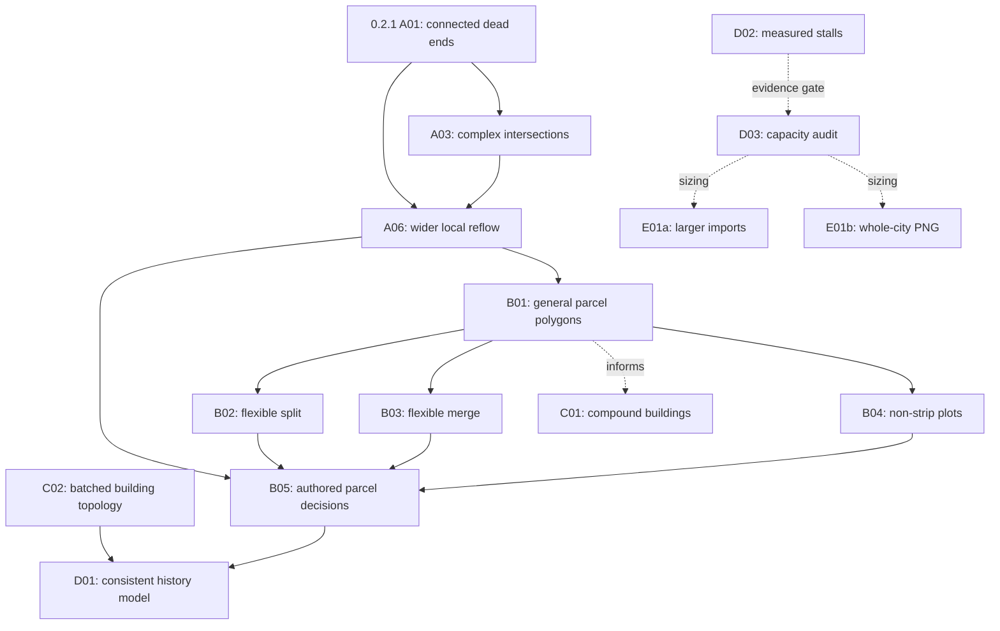

# Mappo 0.2.x — Engine Limitations Improvement Roadmap

> **Living dependency roadmap, reconciled through PR #156 on November 25, 2026 (Pacific).** The development build on `main` is **0.2.25-dev**, with Schema 11. The stable release is **v0.2.0**.

## Problem and intended outcome

Mappo 0.2.0 is a working, offline 2D city editor. Its remaining constraints mostly arise from narrow but safe topology/parcel contracts, conservative ownership preservation, session-scoped history and bounded performance/file/export behavior. The **0.2.x goal** is to enlarge the range of valid user edits while retaining safe, deterministic, reproducible cities; it is **not** an excuse to relax validation blindly.

## Current 0.2.x development status

| Milestone | Issue | Status |
| --- | --- | --- |
| 0.2.1 A01 connected dead ends | [#79](https://github.com/xbwtyz/Mappo/issues/79) | Merged [PR #111](https://github.com/xbwtyz/Mappo/pull/111) |
| 0.2.2 A03 intersection normalization | [#95](https://github.com/xbwtyz/Mappo/issues/95) | Merged [PR #112](https://github.com/xbwtyz/Mappo/pull/112) |
| 0.2.3 A06 reflow/lineage | [#98](https://github.com/xbwtyz/Mappo/issues/98) | Merged [PR #113](https://github.com/xbwtyz/Mappo/pull/113) |
| 0.2.4 B01 irregular properties | [#99](https://github.com/xbwtyz/Mappo/issues/99) | Merged [PR #114](https://github.com/xbwtyz/Mappo/pull/114) |
| 0.2.5 B02 flexible property splitting | [#100](https://github.com/xbwtyz/Mappo/issues/100) | Merged [PR #115](https://github.com/xbwtyz/Mappo/pull/115) |
| 0.2.6 B03 partial-edge property merging | [#101](https://github.com/xbwtyz/Mappo/issues/101) | Merged [PR #116](https://github.com/xbwtyz/Mappo/pull/116); main CI passed |
| 0.2.7 B04 flexible plot partitions | [#102](https://github.com/xbwtyz/Mappo/issues/102) | Merged [PR #117](https://github.com/xbwtyz/Mappo/pull/117); [post-merge CI passed](https://github.com/xbwtyz/Mappo/actions/runs/45000385031); issue closed |
| **0.2.8 B05 authored parcel choices** | [#103](https://github.com/xbwtyz/Mappo/issues/103) | Merged [PR #118](https://github.com/xbwtyz/Mappo/pull/118); [post-merge CI passed](https://github.com/xbwtyz/Mappo/actions/runs/45075063510); issue closed |
| **0.2.9 C02 multi-operation building drafts** | [#105](https://github.com/xbwtyz/Mappo/issues/105) | Merged [PR #119](https://github.com/xbwtyz/Mappo/pull/119); [post-merge CI passed](https://github.com/xbwtyz/Mappo/actions/runs/45077771390); issue closed |
| **0.2.10 C01 compound building groups** | [#104](https://github.com/xbwtyz/Mappo/issues/104) | Merged [PR #120](https://github.com/xbwtyz/Mappo/pull/120); [main CI passed](https://github.com/xbwtyz/Mappo/actions/runs/45080212898); issue closed |
| **0.2.11 D01 unified session edit history** | [#106](https://github.com/xbwtyz/Mappo/issues/106) | Merged [PR #123](https://github.com/xbwtyz/Mappo/pull/123); [main CI passed](https://github.com/xbwtyz/Mappo/actions/runs/45092420094); issue closed |
| **0.2.12 E01b whole-city PNG export** | [#110](https://github.com/xbwtyz/Mappo/issues/110) | Merged [PR #124](https://github.com/xbwtyz/Mappo/pull/124); [main CI passed](https://github.com/xbwtyz/Mappo/actions/runs/45095188784); issue closed. [Milestone](milestones/0.2.12-whole-city-png.md) |
| **0.2.13-dev import message maintenance** | [#109](https://github.com/xbwtyz/Mappo/issues/109) | Clarify that the 20 MiB maximum is inclusive. Capacity expansion remains pending evidence. |
| **0.2.14-dev building entrance routing** | Building and compound edits | Try diagonal routes to the current street, then verified side-street frontage. Show the proposed path and identify obstructions. |
| **Irregular property frontage correction** | 0.2.4 B01 geometry editing | **Merged [PR #128](https://github.com/xbwtyz/Mappo/pull/128)**: preserve accepted historical frontage on side/rear edits; retain strict edited-frontage validation, Restore frontage and independent Apply checks. No schema or version change. |
| **Smart Frontage Snapping** | Irregular properties · frontage editor | **Merged [PR #129](https://github.com/xbwtyz/Mappo/pull/129)** after #128: assigned-road corner snapping, rigid midpoint translation, bounded valid-preview clamping and precision-input parity. [Closeout/evidence](milestones/0.2x-smart-frontage-snapping.md). [Exact-main CI passed](https://github.com/xbwtyz/Mappo/actions/runs/45111675723). No schema/version change. |
| **Schema 10 S10-A pure foundation** | Canonical region/component geometry | **Merged [PR #131](https://github.com/xbwtyz/Mappo/pull/131)**; [post-merge CI passed](https://github.com/xbwtyz/Mappo/actions/runs/45119448609). No live schema change in S10-A. |
| **Schema 10 S10-B adoption** | Schema 9 to 10 migration, runtime/editor/save compatibility | **Merged [PR #132](https://github.com/xbwtyz/Mappo/pull/132)** at `08b33925cd8e`. [Implementation contract](milestones/schema10-s10b-adoption.md). |
| **Schema 10 S10-C courtyard access** | Independent courtyard buildings, explicit portals and validated routes [#122](https://github.com/xbwtyz/Mappo/issues/122) | Merged in [PR #133](https://github.com/xbwtyz/Mappo/pull/133) for `0.2.15-dev`. [Contract and acceptance](milestones/schema10-s10c-courtyard-access.md). |
| **Schema 10 S10-D building components** | One building with separately editable footprints | Merged in [PR #134](https://github.com/xbwtyz/Mappo/pull/134) for `0.2.16-dev`. [Contract and acceptance](milestones/schema10-s10d-building-components.md). |
| **Schema 10 S10-E footprint joins** | Join two components within one building [#121](https://github.com/xbwtyz/Mappo/issues/121) | Merged in [PR #135](https://github.com/xbwtyz/Mappo/pull/135) for `0.2.17-dev`. [Contract and acceptance](milestones/schema10-s10e-join-footprints.md). |
| **Schema 10 S10-F stabilization** | Mixed-city regressions, adjustment audit, and editor fixes | Merged mixed-city coverage in [PR #136](https://github.com/xbwtyz/Mappo/pull/136), the [1,075-edit audit](../../contributing/adjustment-audit.md) in [PR #139](https://github.com/xbwtyz/Mappo/pull/139), and fixes for irregular splits, multipart split guidance, and courtyard frontage repair in [PR #141](https://github.com/xbwtyz/Mappo/pull/141). Issues [#137](https://github.com/xbwtyz/Mappo/issues/137), [#138](https://github.com/xbwtyz/Mappo/issues/138), and [#140](https://github.com/xbwtyz/Mappo/issues/140) closed as completed. |
| **0.2.17-dev release readiness** | Offline cross-editor session and export verification | The Developed city PNG regression was corrected in [PR #143](https://github.com/xbwtyz/Mappo/pull/143). No known release blocker remains; exact-main CI and owner hands-on release acceptance are separate gates. See [the readiness pass](#0217-dev-release-readiness-pass). |
| **0.2.21-dev A4 draft lifecycle** | Shared draft state and diagnostics across editors | Merged in [PR #150](https://github.com/xbwtyz/Mappo/pull/150). [Implementation and acceptance criteria](milestones/0.2.21-draft-lifecycle-a4.md). |
| **0.2.22-dev A5 history and workflow** | Dedicated Reset Preview shortcut and district/defense transactions in accepted history | Merged PR #151. [Implementation and acceptance criteria](milestones/0.2.22-history-workflow-a5.md). |
| **0.2.23-dev B1 connected road translation** | Connected multi-segment selection, rigid translation and strict local reconciliation | [Merged B1](milestones/0.2.23-connected-road-groups-b1.md); PR #152 and exact-main CI passed. |

## Progress and intended delivery waves

| Wave | Candidate scope | Suggested order | Version status | Relative complexity |
|---|---|---|---|---|
| **1 — First confirmed issue** | [A01 connected interior stubs after road deletion](milestones/0.2.1-dead-end-roads.md), [Issue #79](https://github.com/xbwtyz/Mappo/issues/79); corridor only, proven-generated reflow | First, prior to other changes | **Merged as 0.2.1** | **High** — graph/faces/development reflow |
| **2 — Road-topology expansion** | A03 intersection normalization, A06 wider face/ownership reflow | A03 → A06 or staged co-design | **Merged as 0.2.2 and 0.2.3** | High to very high |
| **3 — Flexible parcel foundation** | B01 general polygon properties | After road contract and with new exact polygon validators | **Merged as 0.2.4** | Very high |
| **4 — Parcel operations** | B02 splits, B03 merges, B04 plot partitions, B05 custom-parcel decisions | B01 → B02/B03/B04 → B05 | **B02–B05 merged as 0.2.5–0.2.8** | High per issue |
| **5 — Structural edits** | C02 multi-step building drafts, C01 compound structures | C02 merged 0.2.9; C01 0.2.10 approved property-owned linked compounds | C01 merged 0.2.10 | Medium / high |
| **6 — Editing history** | D01 chronological Undo/Redo | After 0.2.10 | Session history merged in 0.2.11; persistent history deferred | High |
| **7 — Whole-city export** | E01b bounded whole-city PNG | Validated supported sizes on Large maps | Merged as 0.2.12 | Moderate |
| **8 — Evidence-triggered improvements** | D02 frame hitches, D03 capacity, E01a import cap | D03 sampled Large cities and found no road-reflow or import cap hits | Capacity changes deferred pending reproducible need | Small audit → high implementation |
| **Policy decisions outside this sequence** | A02 disconnected networks, A04 protected edits, A05 true curves | Scope after product decisions; no automatic version promise | Unassigned | Very high or schema-sensitive |

**Latest runtime candidate gate.** [PR #143 exact-head CI #45293969133](https://github.com/xbwtyz/Mappo/actions/runs/45293969133) passed all six runners and the aggregate check on `95f684c39597f29e9991e04558c795740fe811fd`. PR #143 merged to `3540c393b42a58555541d3ed98ae9babf1582ef7`; its tree is identical to the tested PR head. [Exact-main post-merge CI #45295533500](https://github.com/xbwtyz/Mappo/actions/runs/45295533500) is the separate required main gate; check its live result before any release recommendation. [PR #142 post-merge CI](https://github.com/xbwtyz/Mappo/actions/runs/45293664168) passed.

Prioritization is a dependency guide, **not** a commitment to 0.2.2, 0.2.3, etc. We may split high-risk items across multiple 0.2.x releases or defer them if the cost exceeds user value. Preserve a stable, usable editor at each release gate.

## Historical 0.2.1 architecture decisions

**D-021-1=A:** interior connected ordinary stubs from otherwise-supported deletion only. **D-021-2=A:** clearance, **no new frontage**. **D-021-3=A:** only proven generated untouched content may adapt; authored/unknown data remains protected. **D-021-4=A:** one implementation PR with four internal checkpoints, after separate coding approval. [Decision log](DECISION_LOG.md) · [Issue #79 replacement draft](issues/issue-79-update-draft.md).

## Architecture dependencies

**Not hard dependencies:** A02, A04 and A05 are product-policy expansions. D02/03 and E01 can be scheduled independently once evidence and scope justify them.

## Permanent engineering constraints

1. Preserve one accepted city and independently validated, atomic edit transactions.
2. All previews, Cancel and Reset are read-only to accepted data and recovery.
3. Preserve or explicitly reconcile user-authored identities, unknown metadata, plot/building/road ownership and protected context.
4. Retain deterministic generation and accurate local change/lineage ledgers.
5. Maintain project schema 11, portable envelope 1, and workspace schema 1 until a separately authorized schema/format change. Future universal legacy-save support is **optional**, but shipped migrations/tests must not be silently removed.
6. Keep modular source, one dependency-free offline HTML, byte-identical root/dist build and archive retention.
7. Target Firefox and Chromium desktop/laptop/ultrawide, with keyboard, mouse/trackpad, accessible statuses and numeric editing. No forced walkthroughs.
8. Run focused tests while developing; six-runner CI (two Node shards, four browser suites) on review-ready PRs and `main`. Opt-in heavy C7 benchmark only where measured comparisons are relevant.

## 0.2.17-dev release readiness pass

An automated offline session in Firefox 142.0.1 at 1440 × 900 checked the merged runtime from PR #141. The session used the repository's [mixed-city fixture](../../../tests/helpers/schema10-mixed-city.js) and the desktop editor in a standalone `file://` copy with test-only observation hooks.

- Moved frontage junction `N-0154` by +0.5 on Y and explicitly selected the courtyard access repair. Changed the divider on `PROP-00011` to 80%, preserving the multipart building with updated plot membership. The building editor blocked a move into the courtyard wall, then applied a valid move.
- Three Undo and three Redo actions restored every accepted city snapshot in order. The portable download reopened to the same accepted city after reloading the app (959,885 bytes).
- **Original release blocker (resolved by PR #143).** The default **Developed city** export assumes every building has one iterable legacy `footprint`. A valid Schema 10 multipart building has canonical exterior rings and no single legacy footprint, so the export dimensions show an error and PNG download fails. The failure also reproduced on the unmodified standalone immediately after opening the original fixture. **Full survey** framing exported a valid 2,048 × 1,454 PNG for the edited city. Neither replay required HTTP traffic. To reproduce, open the mixed-city fixture and expand **Project → Whole-city PNG** with **Developed city** selected. [Export bounds code](../../../src/data/whole-city-png.js)

### Regression correction and readiness evidence

[PR #143](https://github.com/xbwtyz/Mappo/pull/143) uses the existing canonical exterior-ring helper for developed-city bounds without changing the project schema, UI workflow, or accepted city. [Exact-head CI](https://github.com/xbwtyz/Mappo/actions/runs/45293969133) passed 604/604 Node tests and all six runners plus the aggregate gate; [fast checks](https://github.com/xbwtyz/Mappo/actions/runs/45293919139) passed 59/59 targeted/smoke tests. The official build generated byte-identical root and versioned HTML (2,103,041 bytes).

The unchanged standalone, loaded offline with the real mixed-city portable document, downloaded the following valid PNGs in **both Firefox and Chromium**:

| Framing | 2,048 longest side | 4,096 longest side |
| --- | --- | --- |
| Developed city | 2,048 × 1,465 | 4,096 × 2,930 |
| Full survey | 2,048 × 1,454 | 4,096 × 2,909 |

All eight scenarios passed with unchanged accepted project/workspace/history and no HTTP requests or page errors. The focused export/bounds source audit found no additional confirmed framing blocker; this is not exhaustive runtime coverage.

### Remaining release decisions

- Verify the exact-main CI gate for PR #143 and this documentation change after its separately approved merge.
- Owner hands-on acceptance of desktop workflows: generation, road/parcel/building edits, courtyard access, multipart components and joins, rejected-edit explanations, chronological history, portable save/reopen, recovery and PNG export. Automated CI does not substitute for owner UX signoff.
- Review release version and release notes, then obtain separate explicit release authorization. Pages deployment remains independently authorized.
- [#121](https://github.com/xbwtyz/Mappo/issues/121) and [#122](https://github.com/xbwtyz/Mappo/issues/122) have been reconciled as partially delivered with residual future scope (arbitrary cross-building Boolean operations and deeper courtyard topology respectively). Both remain open; neither is a known release blocker.
- A02, A04, and A05 remain separate product decisions. Scale and capacity work remains evidence-gated. No new engine expansion or schema change is proposed for this readiness pass.

## Milestone release gate (repeat for each 0.2.x)

- [ ] Owner approves the issue contract and engineering scope **before coding**.
- [ ] Reproduction fixture added for the current limitation; negative safety cases retained.
- [ ] Architecture changes reuse existing source modules; no duplicate core algorithms or direct edits to compiled HTML.
- [ ] User-facing before/after documented, including any new UI choices or remaining blocked paths.
- [ ] Targeted unit/integration/browser tests pass, including no-mutation, Undo/Redo and portable save.
- [ ] Full current six-runner CI and required aggregate gate pass at exact PR head.
- [ ] Standalone offline `file://` build works; `index.html` equals versioned `dist` artifact; source version and package match.
- [ ] Owner **separately approves merge**; post-merge exact-main CI passes.
- [ ] Release notes/target version/guarded release workflow reviewed and **separately approved**; Pages remains separately manual.
- [ ] Issue closure cites evidence and describes what remains deliberately unsupported.

## Current collaboration and issue documents

[Issue register](ENGINE_LIMITATIONS_REGISTER.md) · [0.2.1 detailed plan](milestones/0.2.1-dead-end-roads.md) · [Issue review guide](../../contributing/issue-review-guide.md) · [Decision log](DECISION_LOG.md) · [All issue drafts](issues/)
## Published GitHub issue tracker

All 17 additional limitation/capability issues are recorded on GitHub. Several have since been implemented in individually approved milestones as shown above. Remaining proposals do **not** authorize implementation, merging or publishing.

| Group | Tracked issues |
|---|---|
| A — Road topology | [#79](https://github.com/xbwtyz/Mappo/issues/79) · [#94](https://github.com/xbwtyz/Mappo/issues/94) · [#95](https://github.com/xbwtyz/Mappo/issues/95) · [#96](https://github.com/xbwtyz/Mappo/issues/96) · [#97](https://github.com/xbwtyz/Mappo/issues/97) · [#98](https://github.com/xbwtyz/Mappo/issues/98) |
| B — Properties and plots | [#99](https://github.com/xbwtyz/Mappo/issues/99) · [#100](https://github.com/xbwtyz/Mappo/issues/100) · [#101](https://github.com/xbwtyz/Mappo/issues/101) · [#102](https://github.com/xbwtyz/Mappo/issues/102) · [#103](https://github.com/xbwtyz/Mappo/issues/103) |
| C — Buildings | [#104](https://github.com/xbwtyz/Mappo/issues/104) · [#105](https://github.com/xbwtyz/Mappo/issues/105) |
| D — History, performance, capacity | [#106](https://github.com/xbwtyz/Mappo/issues/106) · [#107](https://github.com/xbwtyz/Mappo/issues/107) · [#108](https://github.com/xbwtyz/Mappo/issues/108) |
| E — Project files and export | [#109](https://github.com/xbwtyz/Mappo/issues/109) · [#110](https://github.com/xbwtyz/Mappo/issues/110) |

Performance item D02 (#107) is **investigation-only**, not evidence that the closed historical #44/#46 regressions have returned. No version change, runtime work, schema work, release or Pages deployment is authorized by these tracking entries.

### D01 0.2.11 approved implementation checkpoint

D-031-1–5=A: session-only shared chronological Undo/Redo for roads, properties, plots, buildings, compounds and identities, using existing validators with a 20-entry/64 MiB estimated payload budget. [Milestone plan](milestones/0.2.11-unified-history.md) · [Issue #106](https://github.com/xbwtyz/Mappo/issues/106).

**Approved next prerequisite:** [B1R — 0.2.24-dev Local Adaptive Reconciliation](milestones/0.2.24-adaptive-reconciliation-b1r.md). P1–P4 functional checks passed. PR #153 merged; exact-main CI passed. The owner approved proceeding to P5 with measured slice overruns, and the 8 ms target continues to apply. B2 is deferred.

**Approved B1R-E:** [Spatial Recovery Engine 0.2.26-dev](milestones/0.2.25-spatial-recovery-b1r-e.md), E1 foundation in progress; B2 remains deferred. No release authorized.

### Future parallel processing — owner-approved readiness, implementation deferred

During B1R-E, preserve deterministic detached computation boundaries and a single authoritative Schema 11 writer; keep already-approved SRE offline worker work. After SRE qualification, profile bottlenecks and separately plan a bounded reusable worker pool, beginning with independent expensive tasks where justified. This is not an additional prerequisite milestone, a broad parallel rewrite or an authorization to alter the current feature order. [Design constraints and deferred evaluation](milestones/0.2.25-spatial-recovery-b1r-e.md#owner-approved-parallel-execution-readiness).
